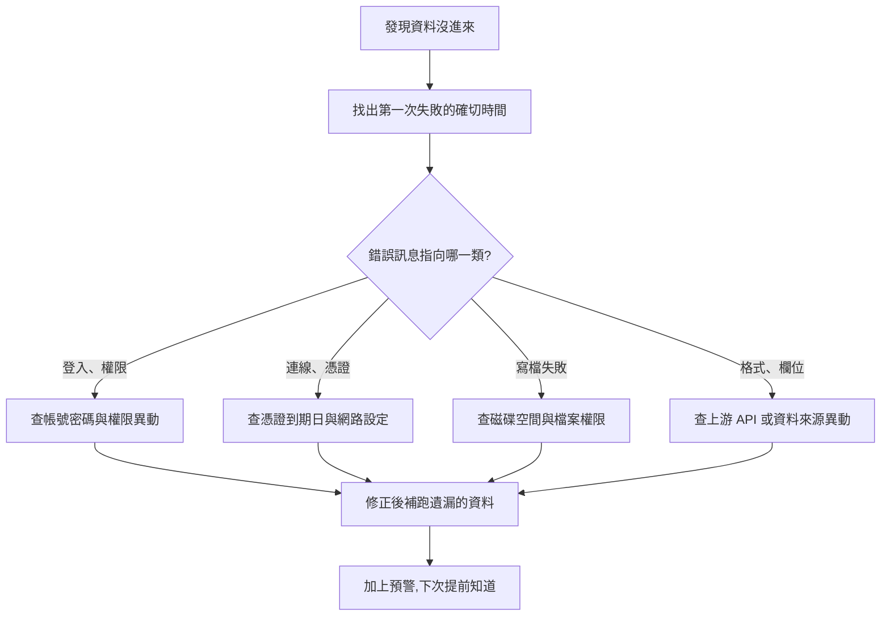

週一早上，負責對帳的同事發現：上週五之後的訂單資料都沒有進來。

每天凌晨兩點跑的同步排程，三年來沒出過事。程式碼最近沒人改過，主機也沒重開。大家的第一反應通常是「程式壞了」，然後開始翻原始碼。

這篇用一個示範情境（以下的系統名稱、帳號、時間都是虛構的）說明另一種順序：**先找出第一次失敗的時間，再問那個時間點前後，環境發生了什麼變化。**

## 程式沒改，不代表環境沒變

排程程式本身通常很穩定，會讓它「突然」壞掉的，多半是程式碼以外的東西：

- 資料庫帳號的密碼到期（有些單位會設定 90 天之類的密碼到期政策）
- SSL／TLS 憑證到期
- 磁碟空間用完，log 或暫存檔寫不進去
- 上游 API 改版，欄位名稱或回傳格式變了
- 作業系統或執行環境更新，某個套件版本跟著變了
- 資料量長大，查詢時間超過原本設定的逾時

這些變動有個共同點：**發生的時間點很明確，但不會出現在程式碼的修改紀錄裡。** 所以排查的重點會從「哪一行錯了」變成「哪一天變了」。



## 第一步：找出「第一次失敗」，不是「發現的時間」

同事是週一發現的，但排程可能早就壞了好幾天。把時間點搞錯，後面比對變動就會找錯方向。

先看一眼失敗那天的 log：

```figure caption="示範情境的排程 log：重試兩次後，第三次出現登入失敗" width="720"
<div style="font-family:var(--mono);font-size:14px;line-height:1.9;background:#1B2B3A;color:#C9D6DB;border-radius:8px;padding:18px 22px;text-align:left">
<div style="color:#8FA3AD;margin-bottom:8px">nightly-sync-2026-11-07.log</div>
<div>2026-11-07 02:00:01 [INFO] 排程 nightly-sync 開始</div>
<div>2026-11-07 02:00:02 [INFO] 連線資料庫 orders-db</div>
<div>2026-11-07 02:00:07 <span style="color:#E8C27A">[WARN]</span> 連線逾時，重試 1/3</div>
<div>2026-11-07 02:00:12 <span style="color:#E8C27A">[WARN]</span> 連線逾時，重試 2/3</div>
<div style="background:rgba(201,134,31,.22);border-left:3px solid #C9861F;margin:0 -12px;padding:0 9px;color:#fff">2026-11-07 02:00:17 [ERROR] 登入失敗：帳號 sync_user 密碼已過期 (錯誤碼 18487)</div>
<div>2026-11-07 02:00:17 [INFO] 排程結束，同步 0 筆</div>
</div>
```

一天的 log 只能看到當天。要知道從哪一天開始壞、每天的狀況如何，比較快的做法是寫一支小程式把整個資料夾掃過一遍：

```python
"""找出排程「第一次失敗」的時間，並列出每天成功／失敗的次數。

用法：python3 first_failure.py logs/
假設每行格式：2026-11-07 02:00:17 [ERROR] 訊息
"""
import re
import sys
from collections import Counter, defaultdict
from pathlib import Path

LINE = re.compile(r"^(\d{4}-\d{2}-\d{2}) (\d{2}:\d{2}:\d{2}) \[(\w+)\] (.*)$")


def scan(log_dir: Path):
    first_error = None
    daily = defaultdict(Counter)       # 日期 -> {"成功": n, "失敗": n}
    signatures = Counter()             # 錯誤訊息 -> 次數

    for path in sorted(log_dir.glob("*.log")):
        for raw in path.read_text(encoding="utf-8").splitlines():
            m = LINE.match(raw)
            if not m:
                continue
            day, time, level, msg = m.groups()
            if level == "ERROR":
                daily[day]["失敗"] += 1
                # 把數字換成 #，同一類錯誤才能合併計算
                signatures[re.sub(r"\d+", "#", msg)] += 1
                if first_error is None or (day, time) < first_error[:2]:
                    first_error = (day, time, msg, path.name)
            elif "排程結束" in msg and "同步 0 筆" not in msg:
                daily[day]["成功"] += 1
    return first_error, daily, signatures


if __name__ == "__main__":
    first, daily, sigs = scan(Path(sys.argv[1]))
    print("每日結果：")
    for day in sorted(daily):
        c = daily[day]
        print(f"  {day}  成功 {c['成功']}  失敗 {c['失敗']}")
    if first:
        print(f"\n第一次失敗：{first[0]} {first[1]}（{first[3]}）")
        print(f"  訊息：{first[2]}")
    print("\n錯誤類型：")
    for sig, n in sigs.most_common():
        print(f"  {n:>3} 次  {sig}")
```

拿示範用的 9 天 log 實際執行，結果是：

```text
每日結果：
  2026-11-01  成功 1  失敗 0
  2026-11-02  成功 1  失敗 0
  ...（11/03 到 11/05 相同）
  2026-11-06  成功 1  失敗 0
  2026-11-07  成功 0  失敗 1
  2026-11-08  成功 0  失敗 1
  2026-11-09  成功 0  失敗 1

第一次失敗：2026-11-07 02:00:17（nightly-sync-2026-11-07.log）
  訊息：登入失敗：帳號 sync_user 密碼已過期 (錯誤碼 18487)

錯誤類型：
    3 次  登入失敗：帳號 sync_user 密碼已過期 (錯誤碼 #)
```

兩件事馬上清楚了：11/06 還正常，11/07 開始壞；而且三天的錯誤都是同一種。只有一種錯誤，通常代表只有一個原因。

## 第二步：把變動排成一條時間線

接著把「第一次失敗」放到時間線上，再把那段時間所有已知的變動標上去：

```figure caption="示範情境的時間線：密碼到期的時間點，正好落在最後一次成功和第一次失敗之間" width="720"
<div style="font-family:var(--sans);text-align:left;padding:8px 4px">
  <div style="position:relative;height:150px">
    <div style="position:absolute;left:20px;right:20px;top:70px;border-top:2px solid #2F7F78"></div>
    <div style="position:absolute;left:4%;top:20px;width:150px;font-size:13px;color:#5A6B75">11/06 02:00<br><b style="color:#1B2B3A">最後一次成功</b></div>
    <div style="position:absolute;left:8%;top:63px;width:14px;height:14px;border-radius:50%;background:#2F7F78"></div>
    <div style="position:absolute;left:33%;top:96px;width:170px;font-size:13px;color:#5A6B75">11/06 23:59<br><b style="color:#C9861F">sync_user 密碼到期</b></div>
    <div style="position:absolute;left:37%;top:63px;width:14px;height:14px;transform:rotate(45deg);background:#C9861F"></div>
    <div style="position:absolute;left:55%;top:20px;width:170px;font-size:13px;color:#5A6B75">11/07 02:00<br><b style="color:#B03A2E">第一次失敗</b></div>
    <div style="position:absolute;left:59%;top:63px;width:14px;height:14px;border-radius:50%;background:#B03A2E"></div>
    <div style="position:absolute;left:80%;top:96px;width:150px;font-size:13px;color:#5A6B75">11/09 09:00<br><b style="color:#1B2B3A">使用者發現</b></div>
    <div style="position:absolute;left:84%;top:63px;width:14px;height:14px;border-radius:50%;background:#8FA3AD"></div>
  </div>
</div>
```

時間線上只要有一個變動剛好卡在「最後一次成功」和「第一次失敗」之間，它就是頭號嫌疑犯。這個情境裡，密碼在 11/06 深夜到期，下一次排程就失敗了，錯誤訊息也直接寫著「密碼已過期」，證據是一致的。

變動清單要去哪裡找？常見的來源有：

| 變動類型 | 去哪裡查 |
| --- | --- |
| 帳號密碼、權限 | 資料庫的帳號設定、AD 或帳號管理系統的密碼政策 |
| 憑證 | 憑證本身的到期日、負責續約的人或排程 |
| 磁碟空間 | 主機監控、磁碟使用量的歷史紀錄 |
| 上游 API | 對方的版本公告、改版通知信 |
| 系統更新 | 作業系統與套件的更新紀錄 |

## 第三步：修正之後，補資料、加預警

找到原因後，修正本身通常很快：重設密碼、更新排程使用的連線設定。但還有兩件事常被漏掉：

1. **補跑遺漏的資料。** 11/07 到修好之前的資料都沒同步，要確認排程能不能指定日期補跑，或要手動處理。
2. **讓下次提前知道。** 這次是密碼到期，下次可能是憑證到期。與其等使用者發現，不如讓系統先告訴你。

如果資料庫是 SQL Server，可以用下面這段查出 SQL 登入帳號還剩幾天到期，放進每天的檢查排程裡：

```sql
-- 列出啟用密碼到期政策的 SQL 登入帳號，以及剩餘天數
SELECT name,
       LOGINPROPERTY(name, 'DaysUntilExpiration') AS days_left
FROM sys.sql_logins
WHERE is_expiration_checked = 1
ORDER BY days_left;
```

> 這段 SQL 沒有在本文的環境實際執行過，使用前請先在測試環境確認結果。上面的 Python 程式則有用示範 log 實際跑過，輸出就是前面那一段。

## 學到什麼

- 程式沒改，不代表環境沒變。排程突然失敗時，先懷疑密碼、憑證、磁碟、上游這些「會到期、會長大、會被別人改」的東西。
- 先找第一次失敗的確切時間，而不是有人發現的時間。時間點對了，比對變動才有意義。
- 修好只是一半。補資料、加預警，才不會在同一個地方再摔一次。

如果你的排程也突然不跑了、原本寫的人又聯絡不上，問達工作室可以先幫你做一次診斷，找出是哪個環節變了。
