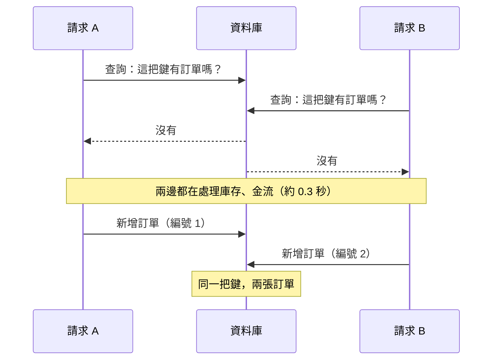
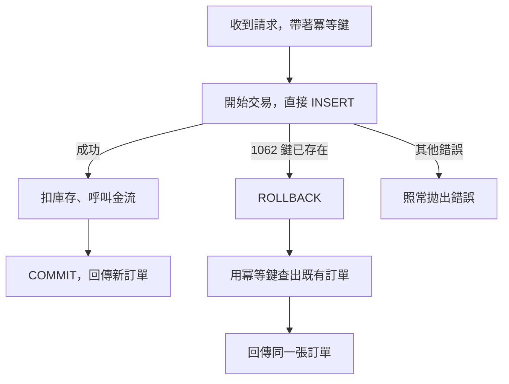

客服轉來一則抱怨：客戶說他只按了一次「確認付款」，信箱卻收到兩封訂單成立通知，庫存也被扣了兩份。

工程師的第一反應是：「不可能，結帳按鈕按下去就會變灰色，按不了第二次。」再往後端看，建立訂單前也有先查「這筆是不是已經存在」。兩道防線都在，重複訂單還是出現了。

這篇用一個示範情境（以下的系統名稱、帳號、時間、金額都是虛構的）說明：**前端擋連點只能降低機率；真正能保證「只成立一次」的，是資料庫的 UNIQUE 索引。**

## 第一步：先確認是真的重複，不是客戶下了兩次

先別急著改程式。第一件事是把重複的範圍查清楚：只有這一位客戶，還是早就有其他人中過？

判斷方式很單純：同一位客戶、同一個金額、跟上一張單只差幾秒，幾乎不可能是人自己決定再買一次。下面這段 SQL 用 `LAG()` 找出每張訂單的「上一張同客戶、同金額訂單」，再挑出間隔 5 秒內的：

```sql
-- 找出「同一位客戶、同一個金額、和上一張單相隔 5 秒內」的訂單
-- MySQL 8／MariaDB 語法；SQL Server 的時間函式寫法不同
SELECT id, customer_id, amount, created_at, prev_id,
       TIMESTAMPDIFF(MICROSECOND, prev_at, created_at) / 1000000 AS gap_sec
FROM (
    SELECT o.*,
           LAG(id)         OVER w AS prev_id,
           LAG(created_at) OVER w AS prev_at
    FROM orders o
    WINDOW w AS (PARTITION BY customer_id, amount ORDER BY created_at)
) t
WHERE prev_at IS NOT NULL
  AND created_at < prev_at + INTERVAL 5 SECOND
ORDER BY created_at;
```

在示範資料（8 張訂單）上實際執行的結果：

```text
+------+-------------+---------+-------------------------+---------+---------+
| id   | customer_id | amount  | created_at              | prev_id | gap_sec |
+------+-------------+---------+-------------------------+---------+---------+
|    2 |        1001 | 1280.00 | 2026-11-12 10:15:03.410 |       1 |  0.2900 |
|    7 |        1004 |  980.00 | 2026-11-13 09:12:57.050 |       6 |  1.2500 |
+------+-------------+---------+-------------------------+---------+---------+
```

兩組重複，間隔分別是 0.29 秒和 1.25 秒。0.29 秒不是人會「再下一次單」的速度，而是同一個動作送出了兩次請求。另外一組也提醒我們：被抱怨的那一位不是唯一的受害者，修完程式之後，這些舊的重複訂單也要逐筆處理（取消、退款），不要直接從資料庫刪掉。

## 第二步：為什麼按鈕變灰了還擋不住

「按下去就變灰」是前端的 JavaScript 做的，它擋得住大部分情況，但擋不住這些：

- 網路慢、畫面沒反應，使用者按重新整理或上一頁，再送一次
- 手機上手指連點，第二下在按鈕變灰之前就送出去了
- 前端程式設定了「逾時自動重試」，第一次其實已經成功，只是回應太慢
- 頁面的 JavaScript 還沒載入完，使用者就按了按鈕

這些情況的共通點是：**後端會收到兩個內容完全一樣的請求，而且可能幾乎同時到。** 所以防線必須放在後端。

## 第三步：後端「先查再寫」為什麼也沒用

這個示範系統的後端其實有檢查：結帳頁會產生一把只屬於這次結帳的鍵（冪等鍵，idempotency key），建立訂單前先查「這把鍵有沒有訂單了」，沒有才新增。

問題出在「查」和「寫」之間有空檔。扣庫存、呼叫金流都要時間，兩個請求同時進來時，順序會變成這樣：



這不是程式寫錯了哪一行，而是「檢查」和「寫入」是兩個分開的動作，中間誰都可以插隊。只要在程式裡判斷「有沒有」，就會有這個空檔；伺服器越忙、處理時間越長，空檔越大。

## 第四步：把「只能一筆」交給資料庫

解法的方向是反過來：**不要先查，直接寫；讓資料庫的 UNIQUE 索引決定誰先到。** 同一把鍵只能存在一筆，第二個請求寫入時會被資料庫拒絕（MySQL／MariaDB 的錯誤碼是 1062），我們再把這個「拒絕」解讀成「這筆請求之前已經處理過了」，回傳第一次建立的訂單。

```sql
ALTER TABLE orders ADD UNIQUE KEY uq_orders_idem (idempotency_key);
```



用 PHP（PDO）寫起來是這樣：

```php
// 新寫法：直接新增，讓資料庫的 UNIQUE 索引決定誰先到
function createOrderIdempotent(PDO $pdo, int $customerId, string $amount, string $key): array
{
    $pdo->beginTransaction();
    try {
        $pdo->prepare('INSERT INTO orders (customer_id, amount, idempotency_key) VALUES (?, ?, ?)')
            ->execute([$customerId, $amount, $key]);
        $id = (int) $pdo->lastInsertId();

        usleep(300_000); // 同樣的處理時間，放在交易裡

        $pdo->commit();
        return ['created', $id];
    } catch (PDOException $e) {
        $pdo->rollBack();
        if (($e->errorInfo[1] ?? null) !== 1062) { // 1062 = Duplicate entry
            throw $e;
        }
        // 鍵已存在：不是錯誤，而是「同一筆請求又來了一次」，回傳第一次建立的訂單
        $stmt = $pdo->prepare('SELECT id FROM orders WHERE idempotency_key = ?');
        $stmt->execute([$key]);
        return ['existing', (int) $stmt->fetchColumn()];
    }
}
```

為了確認兩種寫法真的有差，我用 MariaDB 10.11 和 PHP 8.3 做了一個小實驗：同一把鍵、同時開兩個 PHP 程序送出建立訂單（模擬連點兩下），中間都有 0.3 秒的處理時間。舊寫法跑「先查再寫」，新寫法跑上面這段。實際執行的輸出：

```figure caption="實際執行結果：先查再寫成立了兩張訂單；改成 UNIQUE 索引後只有一張，第二個請求拿到的是同一張訂單" width="720"
<div style="font-family:var(--mono);font-size:14px;line-height:1.9;background:#1B2B3A;color:#C9D6DB;border-radius:8px;padding:18px 22px;text-align:left">
<div style="color:#8FA3AD;white-space:pre">$ php race.php naive   # 沒有 UNIQUE 索引，先查再寫</div>
<div>請求 A：新增訂單，訂單編號 2（0.30 秒）</div>
<div>請求 B：新增訂單，訂單編號 1（0.30 秒）</div>
<div style="background:rgba(176,58,46,.28);border-left:3px solid #B03A2E;margin:0 -12px;padding:0 9px;color:#fff">資料庫裡這把鍵的訂單數：2</div>
<div style="height:14px"></div>
<div style="color:#8FA3AD;white-space:pre">$ php race.php idem    # 加上 UNIQUE 索引，直接寫、撞鍵就回傳既有訂單</div>
<div>請求 A：新增訂單，訂單編號 1（0.30 秒）</div>
<div>請求 B：<span style="color:#E8C27A">回傳既有訂單</span>，訂單編號 1（0.30 秒）</div>
<div style="background:rgba(47,127,120,.35);border-left:3px solid #2F7F78;margin:0 -12px;padding:0 9px;color:#fff">資料庫裡這把鍵的訂單數：1</div>
</div>
```

兩個請求誰先搶到，每次執行可能不同，但新寫法的結果固定只有一張訂單。注意新寫法裡，後到的請求也花了 0.3 秒：它在寫入時遇到同一把鍵、對方還沒 commit，資料庫會讓它等，等對方 commit 之後才回報 1062。這段等待正是我們要的效果。

## 容易踩到的兩個坑

**坑一：撞鍵之後，要先 ROLLBACK 再查。** MySQL／MariaDB 的 InnoDB 預設隔離等級是 REPEATABLE READ，交易裡第一次讀取資料時會建立一份快照。如果交易裡在 INSERT 之前已經讀過資料（例如先查商品價格），撞到 1062 之後直接在同一個交易裡查，可能查不到另一個請求剛 commit 的那張訂單。我在同一個 MariaDB 環境另外驗證過：不 rollback 就查，拿到的是 `false`；先 rollback 再查，才拿到正確的訂單編號。

**坑二：舊資料的鍵是空的，加索引前要先確認資料庫怎麼看待 NULL。** 舊訂單沒有冪等鍵，欄位會是 NULL。MySQL／MariaDB 的 UNIQUE 索引允許多筆 NULL，所以可以直接加（這點有在 MariaDB 上驗證）。SQL Server 不一樣：一般的 UNIQUE 索引只允許一筆 NULL，要改用篩選索引：

```sql
-- SQL Server：只對有值的鍵做唯一限制（本文環境沒有 SQL Server，這段未實際執行）
CREATE UNIQUE INDEX uq_orders_idem
    ON orders (idempotency_key)
    WHERE idempotency_key IS NOT NULL;
```

最後，冪等鍵要在「打開結帳頁」時產生一次，放進表單的隱藏欄位，送出幾次都帶同一把；不要在按下按鈕時才產生，否則每次重送都是新的鍵，等於沒擋。

> 本文的 PHP 程式、找重複訂單的 SQL、ROLLBACK 與 NULL 的行為，都在 MariaDB 10.11.14 與 PHP 8.3.6 實際執行過，輸出與文中相同。SQL Server 的篩選索引沒有實際執行，使用前請先在測試環境確認。

## 學到什麼

- 前端擋連點是體驗優化，不是資料正確性的保證。重新整理、重試、手機連點都會讓後端收到兩次請求。
- 「先查再寫」在同時進來的請求面前一定有空檔。要保證唯一，就把規則寫進資料庫的 UNIQUE 索引。
- 撞到唯一鍵不是錯誤，而是「這筆已經處理過」的訊號；回傳第一次的結果，使用者就不會看到奇怪的錯誤畫面。
- 修好程式之後，記得回頭查出已經發生的重複資料，逐筆處理。

如果你的系統也出現重複訂單、重複扣款這類「偶爾才發生、查不到原因」的資料錯亂，問達工作室可以幫你從資料和程式兩邊一起找出缺口。
