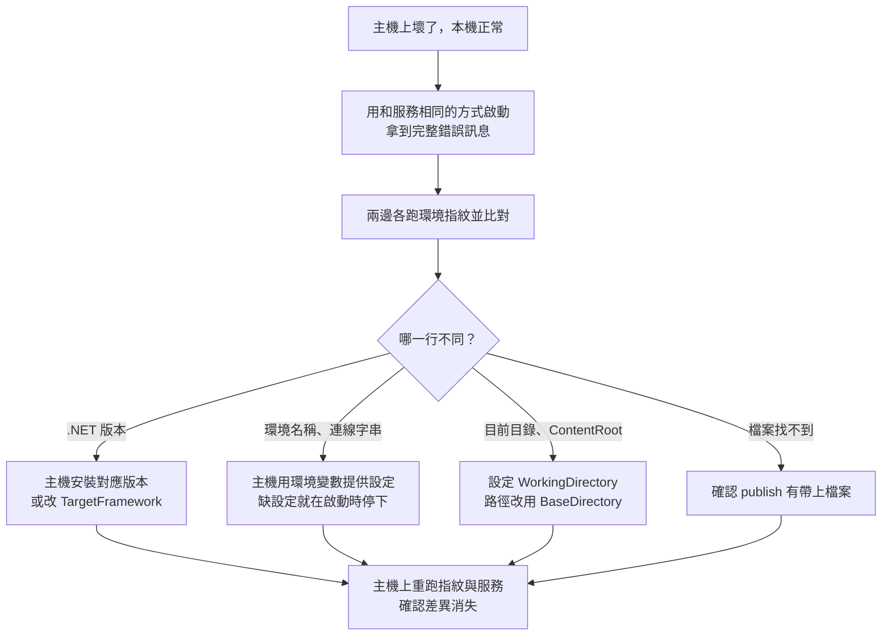

一個報名表單網站，用 AI 幫忙寫，前後大概一個週末。在自己的筆電上按下執行，表單送得出去、確認信的內容也正確。部署到公司那台 Linux 主機、設成開機自動啟動之後，服務一啟動就掛掉，錯誤訊息說找不到 `/Templates/confirm.html`。

這時候最常見的反應是把錯誤訊息貼回給 AI，請它「修好」。AI 會很認真地改程式，但它看到的只有程式碼，看不到你的主機。**程式在兩台機器上的行為不同，原因通常不在程式碼，而在兩台機器之間的差異。** 所以第一步不是改程式，而是把差異找出來。

以下用一個 ASP.NET Core 的示範情境（系統名稱、路徑、帳號都是虛構的）說明三個最常見的原因，以及怎麼一次把它們找出來。

## 先把兩台機器的「環境指紋」印出來

與其一個一個猜，不如讓程式自己說出它在什麼環境裡跑。下面這段放在 `Program.cs` 最前面，帶 `--fingerprint` 參數啟動時，只印出環境資訊就結束，不會真的啟動網站：

```csharp
using System.Runtime.InteropServices;

var builder = WebApplication.CreateBuilder(args);

// ── 環境指紋：本機和主機各跑一次，把兩份輸出並排比對 ──
if (args.Contains("--fingerprint"))
{
    var env = builder.Environment;
    var cfg = builder.Configuration;
    Console.WriteLine($".NET 版本     : {RuntimeInformation.FrameworkDescription}");
    Console.WriteLine($"作業系統      : {RuntimeInformation.OSDescription}");
    Console.WriteLine($"環境名稱      : {env.EnvironmentName}");
    Console.WriteLine($"目前目錄      : {Directory.GetCurrentDirectory()}");
    Console.WriteLine($"程式所在目錄  : {AppContext.BaseDirectory}");
    Console.WriteLine($"ContentRoot   : {env.ContentRootPath}");
    Console.WriteLine($"連線字串 Main : {(cfg.GetConnectionString("Main") is null ? "沒有" : "有")}");
    Console.WriteLine($"Templates 目錄: {(Directory.Exists("Templates") ? "找得到" : "找不到")}（以目前目錄為準）");
    return;
}
```

注意連線字串只印「有」或「沒有」，不要把內容印出來，避免密碼出現在畫面或 log 裡。

本機用 `dotnet run -- --fingerprint` 跑一次；主機用跟服務相同的方式跑一次。這個示範裡，服務是由 systemd 啟動，而且設定檔沒有指定工作目錄，所以在主機上要從根目錄 `/` 啟動，才能重現服務實際的狀況。兩份輸出並排：

```figure caption="實際執行結果：同一支程式在本機和主機上的環境指紋，標色的是不一樣的地方" width="760"
<div style="font-family:var(--sans);font-size:14px;text-align:left">
<table style="border-collapse:collapse;width:100%">
<thead><tr>
<th style="padding:9px 12px;text-align:left;width:22%;background:#1B2B3A;color:#fff">項目</th>
<th style="padding:9px 12px;text-align:left;background:#1B2B3A;color:#fff">本機（dotnet run）</th>
<th style="padding:9px 12px;text-align:left;background:#1B2B3A;color:#fff">主機（從 / 啟動）</th></tr></thead>
<tbody style="font-family:var(--mono);font-size:13px">
<tr style="border-bottom:1px solid #DCE3E6"><td style="padding:8px 12px;font-family:var(--sans)">.NET 版本</td><td style="padding:8px 12px">.NET 8.0.34</td><td style="padding:8px 12px">.NET 8.0.34</td></tr>
<tr style="border-bottom:1px solid #DCE3E6"><td style="padding:8px 12px;font-family:var(--sans)">作業系統</td><td style="padding:8px 12px">Ubuntu 24.04.5 LTS</td><td style="padding:8px 12px">Ubuntu 24.04.5 LTS</td></tr>
<tr style="border-bottom:1px solid #DCE3E6;background:#FBEDE9"><td style="padding:8px 12px;font-family:var(--sans)"><b>環境名稱</b></td><td style="padding:8px 12px">Development</td><td style="padding:8px 12px;color:#B03A2E"><b>Production</b></td></tr>
<tr style="border-bottom:1px solid #DCE3E6;background:#FBEDE9"><td style="padding:8px 12px;font-family:var(--sans)"><b>目前目錄</b></td><td style="padding:8px 12px">/home/dev/SignupApp</td><td style="padding:8px 12px;color:#B03A2E"><b>/</b></td></tr>
<tr style="border-bottom:1px solid #DCE3E6"><td style="padding:8px 12px;font-family:var(--sans)">程式所在目錄</td><td style="padding:8px 12px">/home/dev/SignupApp/bin/Release/net8.0/</td><td style="padding:8px 12px">/srv/signup/</td></tr>
<tr style="border-bottom:1px solid #DCE3E6;background:#FBEDE9"><td style="padding:8px 12px;font-family:var(--sans)"><b>ContentRoot</b></td><td style="padding:8px 12px">/home/dev/SignupApp</td><td style="padding:8px 12px;color:#B03A2E"><b>/</b></td></tr>
<tr style="border-bottom:1px solid #DCE3E6;background:#FBEDE9"><td style="padding:8px 12px;font-family:var(--sans)"><b>連線字串 Main</b></td><td style="padding:8px 12px">有</td><td style="padding:8px 12px;color:#B03A2E"><b>沒有</b></td></tr>
<tr style="background:#FBEDE9"><td style="padding:8px 12px;font-family:var(--sans)"><b>Templates 目錄</b></td><td style="padding:8px 12px">找得到</td><td style="padding:8px 12px;color:#B03A2E"><b>找不到</b></td></tr>
</tbody></table>
</div>
```

示範是在同一台 Linux 上模擬兩種啟動方式，所以版本和作業系統兩欄相同。實際情況裡，本機常常是 Windows 或 macOS，這兩欄通常也會不一樣。

「程式所在目錄」本來就會不同，除此之外還有五行不一樣，每一行都是一條線索。接下來逐一看。

## 原因一：本機是 Development，主機是 Production

`dotnet run` 和 Visual Studio 啟動時，會讀專案裡的 `Properties/launchSettings.json`，裡面預設寫著 `ASPNETCORE_ENVIRONMENT=Development`。於是本機會載入 `appsettings.Development.json`。

這個示範專案的連線字串只放在 `appsettings.Development.json`，程式裡還多了一個「找不到就用預設值」的備案：

```csharp
// ── AI 產生的原始寫法 ──
var connStr = builder.Configuration.GetConnectionString("Main")
              ?? "Server=localhost;Database=signup;User Id=sa;Password=123456";
var template = File.ReadAllText("Templates/confirm.html");
```

到了主機上，systemd 不會讀 `launchSettings.json`，沒有設定環境名稱時，ASP.NET Core 一律當成 Production。`appsettings.Development.json` 雖然被一起發佈到主機上，但不會被載入。連線字串讀不到，程式也不會報錯，而是**悄悄改用預設值**：

```text
$ cd /srv/signup && dotnet SignupApp.dll    # 補上 Templates 之後再跑
資料庫：Server=localhost / Database=signup
模板：<p>{name} 您好，已收到您的報名。</p>
```

啟動成功了，但連的是主機本機上一個不存在（或更糟：存在但不是正式資料）的資料庫。錯誤會在第一個使用者送出表單時才出現，而且看起來像「資料庫連不上」，離真正的原因很遠。

修法是**讓缺設定的程式在啟動時就停下來**，並把環境名稱寫進錯誤訊息：

```csharp
// ── 修正後的寫法 ──
// 1. 缺設定就在啟動時停下來，不要默默改用預設值
var connStr = builder.Configuration.GetConnectionString("Main")
    ?? throw new InvalidOperationException(
        $"缺少連線字串 ConnectionStrings:Main（目前環境：{builder.Environment.EnvironmentName}）");
```

主機上的連線字串則用環境變數提供。ASP.NET Core 會把環境變數名稱裡的雙底線 `__` 對應成設定的冒號，所以 `ConnectionStrings__Main` 就是 `ConnectionStrings:Main`。

## 原因二：相對路徑是相對於「從哪裡啟動」

`File.ReadAllText("Templates/confirm.html")` 這種相對路徑，是以「目前目錄」為起點，不是以程式檔案所在的位置為起點。本機在專案資料夾裡 `dotnet run`，目前目錄剛好就是專案資料夾，所以找得到。

主機上就不一樣了。依 systemd 文件的說明，系統服務如果沒有設定 `WorkingDirectory`，目前目錄是根目錄 `/`（本文環境無法執行 systemd，所以用「從 `/` 啟動」來重現），程式就去找 `/Templates/confirm.html`：

```text
$ cd / && dotnet /srv/signup/SignupApp.dll
Unhandled exception. System.IO.DirectoryNotFoundException: Could not find a part of the path '/Templates/confirm.html'.
（以下堆疊省略）
```

指紋裡還藏著一個更隱蔽的問題：`ContentRoot` 也是 `/`。ASP.NET Core 預設用目前目錄當 ContentRoot，而 `appsettings.json` 是從 ContentRoot 讀的。也就是說，從 `/` 啟動時，連 `/srv/signup/appsettings.json` 都沒有被讀到。這種情況不會有任何錯誤訊息，只會覺得「設定好像沒生效」。（Windows 服務也有類似的情況，目前目錄通常是 `C:\Windows\System32`；本文環境沒有 Windows，這點沒有實際驗證。）

就算把 systemd 的工作目錄設對，問題也還沒結束：

```text
$ cd /srv/signup && dotnet SignupApp.dll
Unhandled exception. System.IO.DirectoryNotFoundException: Could not find a part of the path '/srv/signup/Templates/confirm.html'.
```

這次路徑是對的，但檔案根本不在主機上。`dotnet publish` 預設不會帶上 `Templates` 資料夾裡的 `.html` 檔，本機跑得起來，是因為 `dotnet run` 直接用專案資料夾裡的檔案。

所以修法有三處，缺一不可：

```csharp
// 2. 路徑以程式所在目錄為準，不受「從哪裡啟動」影響
var templatePath = Path.Combine(AppContext.BaseDirectory, "Templates", "confirm.html");
var template = File.ReadAllText(templatePath);
```

```xml
<!-- SignupApp.csproj：發佈時把 Templates 一起帶上 -->
<ItemGroup>
  <None Update="Templates\**" CopyToOutputDirectory="PreserveNewest" />
</ItemGroup>
```

```ini
# /etc/systemd/system/signup.service（節錄；本文環境無法執行 systemd，這段未實際驗證）
[Service]
WorkingDirectory=/srv/signup
ExecStart=/usr/bin/dotnet /srv/signup/SignupApp.dll
EnvironmentFile=/etc/signup/signup.env
```

`signup.env` 裡放 `ConnectionStrings__Main=...`，檔案權限設成只有服務帳號讀得到，不要把密碼直接寫在 service 檔或版控裡。

## 原因三：建置用的 .NET 版本，主機上沒有

專案的目標版本（`TargetFramework`）通常跟著建立專案那台電腦上的 SDK 走。如果本機裝的是 .NET 9、專案也設成 `net9.0`，而主機只裝了 .NET 8，程式連第一行都跑不到。

本文環境只有 .NET 8，所以我把發佈結果裡 `SignupApp.runtimeconfig.json` 的版本從 `8.0.0` 改成 `9.0.0`，模擬「用 .NET 9 建置、主機只有 .NET 8」。實際執行的輸出（節錄）：

```text
$ dotnet SignupApp.dll
You must install or update .NET to run this application.

App: /tmp/v9/SignupApp.dll
Architecture: x64
Framework: 'Microsoft.NETCore.App', version '9.0.0' (x64)
.NET location: /usr/lib/dotnet/

The following frameworks were found:
  8.0.34 at [/usr/lib/dotnet/shared/Microsoft.NETCore.App]
```

這個錯誤訊息其實寫得很清楚：要的是 9.0.0，找到的是 8.0.34。修法看情況二選一：在主機上安裝對應的執行環境，或把專案的 `TargetFramework` 改成主機有的版本再重新建置。部署前先在主機上跑一次 `dotnet --list-runtimes`，就能避開。

同樣的道理也適用其他技術：Laravel 專案要確認 `composer.lock` 有進版控、主機的 PHP 版本符合要求；Node 專案則是 `package-lock.json` 與 Node 版本。版本差異不一定會讓程式啟動失敗，有時只是某個函式的行為不同，更難找。

## 修正後再跑一次

三個地方改完之後，同樣在主機上測兩種情況：沒給連線字串、以及設好工作目錄與環境變數：

```figure caption="實際執行結果：修正後，缺設定會在啟動時直接說清楚；設定齊全時連到正確的資料庫" width="760"
<div style="font-family:var(--mono);font-size:14px;line-height:1.9;background:#1B2B3A;color:#C9D6DB;border-radius:8px;padding:18px 22px;text-align:left">
<div style="color:#8FA3AD;white-space:pre">$ cd / &amp;&amp; dotnet /srv/signup2/SignupFixed.dll      # 沒有設定連線字串</div>
<div style="background:rgba(201,134,31,.25);border-left:3px solid #C9861F;margin:0 -12px;padding:0 9px;color:#fff">Unhandled exception. System.InvalidOperationException: 缺少連線字串 ConnectionStrings:Main（目前環境：Production）</div>
<div style="height:14px"></div>
<div style="color:#8FA3AD;white-space:pre">$ cd /srv/signup2 &amp;&amp; ConnectionStrings__Main='Server=db01;...' dotnet SignupFixed.dll</div>
<div style="background:rgba(47,127,120,.35);border-left:3px solid #2F7F78;margin:0 -12px;padding:0 9px;color:#fff">資料庫：Server=db01 / Database=signup</div>
<div>模板：&lt;p&gt;{name} 您好，已收到您的報名。&lt;/p&gt;</div>
</div>
```

第一種情況雖然還是失敗，但錯誤訊息直接說出缺什麼、在哪個環境，不需要再猜。第二種情況用 shell 指令模擬 systemd 的 `WorkingDirectory` 與環境變數。

整理成排查順序：



> 本文的 C# 程式、指紋輸出、三種錯誤訊息與修正後的結果，都在 Ubuntu 24.04、.NET SDK 8.0.134（執行環境 8.0.34）實際執行過，輸出與文中相同。.NET 9 的版本錯誤是修改 runtimeconfig 模擬的；systemd 設定檔與 Windows 服務的部分沒有實際執行。

## 學到什麼

- 「本機能跑、上線就壞」幾乎都是環境差異，不是程式邏輯錯誤。先比對差異，再決定改哪裡，比把錯誤訊息丟回給 AI 反覆修改快得多。
- 讀不到設定時改用預設值，會把錯誤延後到最難查的時候才出現。缺設定就在啟動時停下來。
- 相對路徑相對的是「從哪裡啟動」，而且 `dotnet run` 會掩蓋 publish 少帶檔案的問題。部署前，至少用發佈後的檔案、照服務的啟動方式跑一次。
- AI 看不到你的主機。把環境指紋的輸出一起交給它（或交給接手的工程師），討論才有共同的基礎。

如果你用 AI 做出來的系統卡在「本機好好的、上線就壞」，問達工作室可以幫你把兩邊的差異找出來，修到能穩定在主機上跑。
