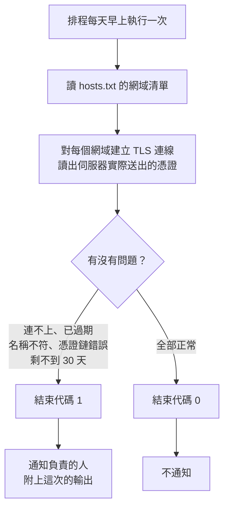

某天早上，同事說後台登入頁打不開，瀏覽器跳出「你的連線不是私人連線」，錯誤代碼是 `NET::ERR_CERT_DATE_INVALID`。前台網站正常，API 也正常，只有後台壞了。

這個錯誤代碼的意思很直接：伺服器送出的 TLS 憑證不在有效期間內，多半就是過期了。換一張新憑證，網站就會恢復。比較麻煩的是下一個問題：**明明設了自動續期，為什麼還會過期？其他網域會不會也快了？**

以下用一個示範情境說明（網域、路徑、時間都是虛構的，網域用的是保留給測試的 `.test`）：一個小型網站有前台 `www`、API `api`、後台 `admin` 三個網域，憑證都是 90 天的免費憑證。

## 先把「還剩幾天」全部列出來

與其一個一個網域打開瀏覽器點鎖頭看，不如寫一支小程式，對每個網域實際建立一次 TLS 連線，把伺服器送出的憑證讀出來，算出還剩幾天。

要檢查的網域放在一個文字檔：

```text
# hosts.txt：要檢查的網域，一行一個（預設埠號 443，其他埠號寫成 主機:埠號）
www.demo-shop.test
api.demo-shop.test
admin.demo-shop.test
```

程式本體（.NET 8 主控台程式，只用內建類別，不需要另外裝套件）：

```csharp
using System.Net.Security;
using System.Net.Sockets;
using System.Security.Cryptography.X509Certificates;

// 用法：dotnet run -- hosts.txt [提醒門檻天數，預設 30]
// hosts.txt 一行一個「主機名稱」或「主機名稱:埠號」，# 開頭是註解
// 結束代碼：全部正常是 0，任何一台需要處理是 1（讓排程判斷要不要通知）

var warnDays = args.Length > 1 ? int.Parse(args[1]) : 30;
var tw = TimeSpan.FromHours(8);          // 臺灣沒有日光節約時間，固定 UTC+8
var now = DateTimeOffset.UtcNow;
var allOk = true;

Console.WriteLine($"檢查時間：{now.ToOffset(tw):yyyy-MM-dd HH:mm}（UTC+8）  提醒門檻：{warnDays} 天");
Console.WriteLine();

foreach (var raw in File.ReadAllLines(args[0]))
{
    var line = raw.Trim();
    if (line == "" || line.StartsWith('#')) continue;

    var parts = line.Split(':');
    var host = parts[0];
    var port = parts.Length > 1 ? int.Parse(parts[1]) : 443;

    var (notAfter, status, ok) = await CheckAsync(host, port, now, warnDays);
    allOk &= ok;

    var expires = notAfter is null ? "-" : notAfter.Value.ToOffset(tw).ToString("yyyy-MM-dd HH:mm");
    Console.WriteLine($"{(ok ? "  " : "! ")}{$"{host}:{port}",-28} {expires,-17} {status}");
}

return allOk ? 0 : 1;

static async Task<(DateTimeOffset? NotAfter, string Status, bool Ok)> CheckAsync(
    string host, int port, DateTimeOffset now, int warnDays)
{
    using var cts = new CancellationTokenSource(TimeSpan.FromSeconds(10));
    X509Certificate2? cert = null;
    var errors = SslPolicyErrors.None;

    try
    {
        using var tcp = new TcpClient();
        await tcp.ConnectAsync(host, port, cts.Token);
        using var ssl = new SslStream(tcp.GetStream(), leaveInnerStreamOpen: false);
        await ssl.AuthenticateAsClientAsync(new SslClientAuthenticationOptions
        {
            // SNI：同一個 IP 掛多個網域時，伺服器靠這個決定要回哪一張憑證
            TargetHost = host,
            // 不管驗證結果都先收下，才讀得到「已經過期」的憑證；這支程式只讀憑證，不送任何資料
            RemoteCertificateValidationCallback = (_, c, _, e) =>
            {
                if (c is not null) cert = new X509Certificate2(c);
                errors = e;
                return true;
            }
        }, cts.Token);
    }
    catch (Exception ex)
    {
        return (null, $"連線失敗：{ex.Message}", false);
    }

    if (cert is null) return (null, "沒有取得憑證", false);

    var notAfter = new DateTimeOffset(cert.NotAfter.ToUniversalTime());
    var days = (notAfter - now).TotalDays;

    if (days <= 0)
        return (notAfter, $"已過期 {(int)Math.Ceiling(-days)} 天", false);
    if (errors.HasFlag(SslPolicyErrors.RemoteCertificateNameMismatch))
        return (notAfter, "憑證上的網域名稱和主機不符", false);
    if (errors.HasFlag(SslPolicyErrors.RemoteCertificateChainErrors))
        return (notAfter, "憑證鏈驗證失敗（常見原因：少了中繼憑證）", false);
    if (days < warnDays)
        return (notAfter, $"剩 {(int)Math.Floor(days)} 天，該續期了", false);

    return (notAfter, $"正常，剩 {(int)Math.Floor(days)} 天", true);
}
```

有兩個細節值得說明：

- **驗證回呼一律回傳 `true`。** 正常的程式不該這樣寫，因為這等於接受任何憑證。這裡這樣做，是因為憑證過期時驗證一定失敗，如果直接拒絕連線，就讀不到到期日了。這支程式只讀憑證、不傳任何資料，驗證結果另外記在 `errors` 裡判斷，所以這樣寫是安全的。不要把這段搬到會傳送資料的程式裡。
- **`TargetHost` 一定要帶網域名稱。** 很多主機用同一個 IP 掛好幾個網域，伺服器是看 TLS 握手時的網域名稱（SNI）決定要回哪一張憑證。只用 IP 連線，讀到的可能是別的網域的憑證。

在示範環境跑一次：

```figure caption="實際執行結果：三個網域裡，後台已經過期，API 也只剩 9 天" width="760"
<div style="font-family:var(--mono);font-size:14px;line-height:1.9;background:#1B2B3A;color:#C9D6DB;border-radius:8px;padding:18px 22px;text-align:left">
<div style="color:#8FA3AD;white-space:pre">$ dotnet run -- hosts.txt</div>
<div style="white-space:pre">檢查時間：2026-11-20 09:03（UTC+8）  提醒門檻：30 天</div>
<div style="height:10px"></div>
<div style="white-space:pre">  www.demo-shop.test:443       2027-01-23 16:00  正常，剩 64 天</div>
<div style="white-space:pre;background:rgba(201,134,31,.25);border-left:3px solid #C9861F;margin:0 -12px;padding:0 9px;color:#fff">! api.demo-shop.test:443       2026-11-29 16:00  剩 9 天，該續期了</div>
<div style="white-space:pre;background:rgba(176,58,46,.35);border-left:3px solid #E06A5C;margin:0 -12px;padding:0 9px;color:#fff">! admin.demo-shop.test:443     2026-11-18 16:00  已過期 2 天</div>
<div style="height:10px"></div>
<div style="color:#8FA3AD;white-space:pre">$ echo $?</div>
<div>1</div>
</div>
```

後台過期在預期之內，那是我們已經知道的問題。真正要緊的是第二行：**API 只剩 9 天，可是自動續期明明有在跑。**

## 原因一：有網域根本不在自動續期裡

示範情境裡，後台網域是後來才加的，當時手動申請了一張憑證，沒有加進自動續期的設定。90 天後，它就照時間過期了。

這種漏網之魚很常見：測試站、舊網域轉址、後來加上的子網域。自動續期只會續它知道的那幾張。解法很單純：每加一個網域，就同時加進續期設定和上面的 `hosts.txt`。

## 原因二：檔案續期了，伺服器還在用舊的

API 的情況比較隱蔽。到主機上看憑證檔，到期日是明年一月，看起來沒問題；但從外面連進來，拿到的卻是 11 月底到期的那一張：

```text
$ openssl x509 -in /srv/certs/api/fullchain.pem -noout -enddate
notAfter=Jan 28 08:00:00 2027 GMT

$ openssl s_client -connect api.demo-shop.test:443 -servername api.demo-shop.test < /dev/null 2>/dev/null | openssl x509 -noout -enddate
notAfter=Nov 29 08:00:00 2026 GMT
```

```figure caption="實際執行結果：同一個網域，硬碟上的檔案已經續期，但伺服器送出去的還是舊憑證" width="520"
<div style="font-family:var(--sans);font-size:17px;text-align:left">
<div style="border:2px solid #2F7F78;border-radius:10px;padding:14px 18px;background:#FBFDFC">
<div style="color:#5A6B75">硬碟上的檔案（續期工具寫入）</div>
<div style="font-family:var(--mono);font-size:15px;margin:2px 0 8px">/srv/certs/api/fullchain.pem</div>
<div style="font-family:var(--mono);font-size:24px;font-weight:700;color:#2F7F78">2027-01-28 08:00 <span style="font-size:15px;font-weight:400;color:#5A6B75">UTC 到期</span></div>
</div>
<div style="text-align:center;color:#B03A2E;font-weight:700;margin:8px 0">不一致：伺服器沒有重新載入，還在送舊的那一張</div>
<div style="border:2px solid #B03A2E;border-radius:10px;padding:14px 18px;background:#FBEDE9">
<div style="color:#5A6B75">伺服器實際送出（使用者拿到的）</div>
<div style="font-family:var(--mono);font-size:15px;margin:2px 0 8px">api.demo-shop.test:443</div>
<div style="font-family:var(--mono);font-size:24px;font-weight:700;color:#B03A2E">2026-11-29 08:00 <span style="font-size:15px;font-weight:400;color:#5A6B75">UTC 到期</span></div>
</div>
</div>
```

原因是網頁伺服器（例如 nginx、Apache）在啟動或重新載入設定時，才會把憑證讀進記憶體。續期工具換掉檔案之後，如果沒有接著讓伺服器重新載入，伺服器就會一直送舊的那一張，直到它過期。以 certbot 為例，如果不是用 nginx 或 Apache 外掛申請（例如用 webroot 方式），就要自己設定 `--deploy-hook`，在續期成功後執行 `systemctl reload nginx` 之類的指令。（本文環境沒有實際執行 certbot，這段是依工具文件的說明，請以你使用的版本為準。）

這也是為什麼檢查程式要**連線到伺服器讀憑證，而不是讀硬碟上的檔案**：使用者拿到的是伺服器送出的那一張，檔案再新都沒用。

修正之後（示範環境裡是讓 API 服務改用新檔案重新啟動、後台換上新憑證），再跑一次：

```text
$ dotnet run -- hosts.txt
檢查時間：2026-11-20 09:04（UTC+8）  提醒門檻：30 天

  www.demo-shop.test:443       2027-01-23 16:00  正常，剩 64 天
  api.demo-shop.test:443       2027-01-28 16:00  正常，剩 69 天
  admin.demo-shop.test:443     2027-02-18 08:00  正常，剩 89 天

$ echo $?
0
```

## 讓它每天自己跑

程式的結束代碼已經分好了：全部正常是 `0`，有任何一個網域需要處理是 `1`。排程只要看結束代碼決定要不要通知：



Linux 可以用 cron，例如每天早上 8 點 10 分跑一次，結束代碼不是 0 才寄信（下面這行沒有在本文環境實際排程，`mail` 要換成你主機上能用的通知方式）：

```text
10 8 * * * cd /opt/certcheck && dotnet CertCheck.dll hosts.txt > last.txt || mail -s "憑證檢查需要處理" you@example.com < last.txt
```

Windows 則可以用工作排程器執行，再依結束代碼觸發通知（本文環境沒有 Windows，這部分沒有實際驗證）。

有兩件事要注意：

- **在「外面」檢查。** 最好從另一台機器跑，用的 DNS 要跟一般使用者一樣。在網站主機自己身上檢查，可能因為 hosts 設定或內部網路，連到的不是使用者連到的那一台。
- **30 天的門檻要配合憑證效期。** 90 天的憑證通常在剩 30 天左右自動續期，所以剩不到 30 天還沒換，就代表續期出了問題。如果你的憑證效期比較短，門檻要跟著調。

## 為什麼現在更需要這支程式

過去 Let's Encrypt 會在憑證快到期時寄信提醒，但這項服務已經在 2025 年 6 月停止，不能再靠它當最後一道防線。

另一方面，CA/Browser Forum 已經通過決議，公開信任的 TLS 憑證最長效期會分階段縮短：2026 年 3 月 15 日起最長 200 天，2027 年 3 月 15 日起 100 天，2029 年 3 月 15 日起 47 天。效期越短，續期越頻繁，續期流程中任何一個環節沒接好，出事的機會也越多。

> 本文的 C# 程式、三次檢查輸出（含結束代碼）與 `openssl` 指令的輸出，都在 Ubuntu 24.04、.NET SDK 8.0.134 實際執行過，輸出與文中相同。示範用的憑證由本機自建的測試 CA 簽發，三個網域都指向本機上的 TLS 服務。cron 排程、certbot 與 Windows 工作排程器的部分沒有實際執行。

## 學到什麼

- 憑證過期不是突然發生的，到期日從申請那天就寫在憑證上了。缺的不是資訊，而是有人每天去看。
- 「自動續期有在跑」不等於「使用者拿到新憑證」。要檢查伺服器實際送出的憑證，而不是硬碟上的檔案。
- 檢查程式要把「連不上」「名稱不符」「憑證鏈錯誤」也當成問題回報，這些跟過期一樣會讓使用者看到警告頁。
- 每加一個網域，就同時加進續期設定和檢查清單。

如果你的網站曾經因為憑證過期掛掉，或不確定續期流程有沒有接好，問達工作室可以幫你把檢查和提醒設起來，讓下一次在 30 天前就知道。
