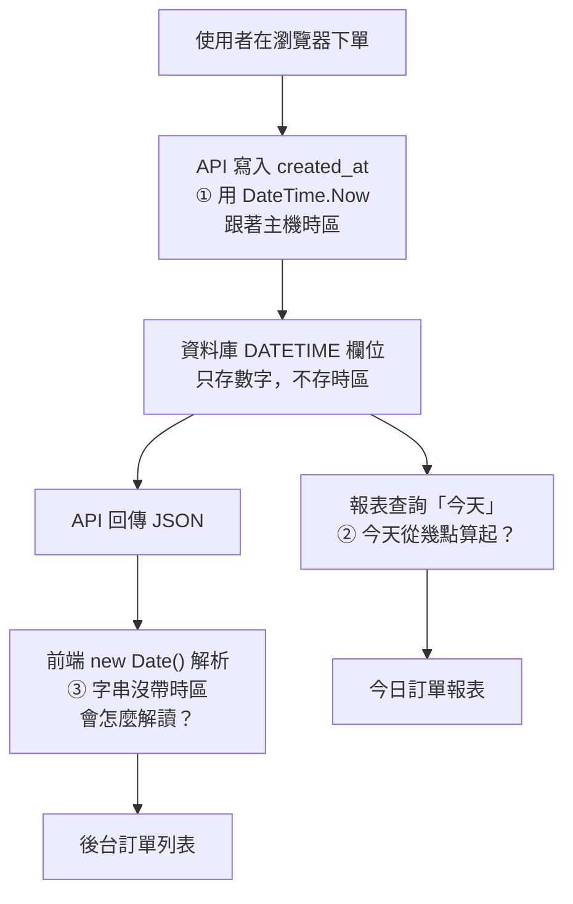

一套小型訂單系統，原本跑在辦公室的一台 Windows 主機上，這週搬到雲端的 Linux 容器。程式一行都沒改，部署完也測過能下單、能查詢。

搬完隔天早上，業務反映兩件事：

- 「今日訂單」報表少了幾筆，少的剛好都是**早上 8 點以前**下的單。
- 後台訂單列表裡，新訂單的時間都**少了 8 小時**；依時間排序時，有些新訂單還排到舊訂單前面。

以下用示範情境說明（系統、資料、時間都是虛構的）。看到「剛好 8 小時」，第一個要懷疑的就是時區：臺灣是 UTC+8，而很多雲端主機與容器映像檔預設是 UTC。

## 先畫出：一個時間會經過哪些地方

一個時間從使用者按下「送出」到出現在報表上，會經過好幾層，每一層都可能用自己的時區解讀它：



舊主機的時區是臺灣，每一層剛好都「猜對」，所以從來沒出事。搬到 UTC 的主機以後，三個點同時出問題。

## 坑一：`DateTime.Now` 跟著主機走

寫入訂單時用的是 `DateTime.Now`。它回傳的是**主機時區**的現在時間，主機換了時區，存進資料庫的數字就跟著變。資料庫的 `DATETIME`（SQL Server 的 `datetime`、`datetime2` 也一樣）只存「年月日時分秒」，不記得這個數字是哪個時區的時間。

下面這支 .NET 8 主控台程式模擬整個過程。為了讓結果可以重現，「現在」固定成兩個時間點：臺灣時間 11/16 07:30 下單、09:00 看報表。

```csharp
using System.Text.Json;

// 示範：同一段程式放在不同時區的主機上跑，結果不一樣。
// 為了讓輸出可以重現，「現在」固定成兩個時間點，再換算成 DateTime.Now 在那一刻會回傳的值。
var orderUtc  = new DateTime(2026, 11, 15, 23, 30, 0, DateTimeKind.Utc); // 臺灣時間 11/16 07:30 下單
var reportUtc = new DateTime(2026, 11, 16,  1,  0, 0, DateTimeKind.Utc); // 臺灣時間 11/16 09:00 看報表

DateTime NowAt(DateTime utc) => TimeZoneInfo.ConvertTimeFromUtc(utc, TimeZoneInfo.Local);
// 資料庫的 datetime 欄位不存時區，讀回來的 DateTime 通常是 Kind = Unspecified（依資料庫驅動程式而定）
DateTime FromDb(DateTime value) => DateTime.SpecifyKind(value, DateTimeKind.Unspecified);

Console.WriteLine($"主機時區：{TimeZoneInfo.Local.Id}");

// ── 原本的寫法：寫入用 DateTime.Now，報表的「今天」用 DateTime.Today ──
var savedOld = FromDb(NowAt(orderUtc));
var todayOld = NowAt(reportUtc).Date;
var inOld = savedOld >= todayOld && savedOld < todayOld.AddDays(1);

Console.WriteLine("[原本] 存進資料庫的時間：" + savedOld.ToString("yyyy-MM-dd HH:mm"));
Console.WriteLine("[原本] 報表的今天：" + todayOld.ToString("yyyy-MM-dd") + "，這筆在今天的報表裡：" + (inOld ? "是" : "否"));
Console.WriteLine("[原本] API 回傳：" + JsonSerializer.Serialize(savedOld));

// ── 改法：一律存 UTC；「今天」用臺灣時區算出範圍，再換成 UTC 去查 ──
var tw = TimeZoneInfo.FindSystemTimeZoneById("Asia/Taipei");
var savedNew = FromDb(orderUtc);                                   // 寫入時用 DateTime.UtcNow
var twToday  = TimeZoneInfo.ConvertTimeFromUtc(reportUtc, tw).Date;  // 臺灣的「今天」
var fromUtc  = TimeZoneInfo.ConvertTimeToUtc(twToday, tw);
var toUtc    = TimeZoneInfo.ConvertTimeToUtc(twToday.AddDays(1), tw);
var inNew    = savedNew >= fromUtc && savedNew < toUtc;

// 讀回來時明確標成 UTC，輸出時帶上時區
var apiValue = new DateTimeOffset(DateTime.SpecifyKind(savedNew, DateTimeKind.Utc)).ToOffset(tw.GetUtcOffset(savedNew));

Console.WriteLine("[改後] 存進資料庫的時間（UTC）：" + savedNew.ToString("yyyy-MM-dd HH:mm"));
Console.WriteLine($"[改後] 查詢範圍（UTC）：{fromUtc:yyyy-MM-dd HH:mm} ~ {toUtc:yyyy-MM-dd HH:mm}，這筆在今天的報表裡：" + (inNew ? "是" : "否"));
Console.WriteLine("[改後] API 回傳：" + JsonSerializer.Serialize(apiValue));
```

同一支程式，用 `TZ` 環境變數模擬兩台主機各跑一次：

```figure caption="實際執行結果：同一支程式，主機時區從臺灣換成 UTC，原本的寫法三個結果都變了，改後的寫法不受影響" width="780"
<div style="font-family:var(--mono);font-size:13.5px;line-height:1.85;text-align:left">
<div style="background:#1B2B3A;color:#C9D6DB;border-radius:8px;padding:14px 20px;margin-bottom:14px">
<div style="color:#8FA3AD;white-space:pre">$ TZ=Asia/Taipei dotnet TzDemo.dll        # 舊主機</div>
<div style="white-space:pre">主機時區：Asia/Taipei</div>
<div style="white-space:pre">[原本] 存進資料庫的時間：2026-11-16 07:30</div>
<div style="white-space:pre">[原本] 報表的今天：2026-11-16，這筆在今天的報表裡：是</div>
<div style="white-space:pre">[原本] API 回傳："2026-11-16T07:30:00"</div>
<div style="white-space:pre;color:#9FD3C7">[改後] 存進資料庫的時間（UTC）：2026-11-15 23:30</div>
<div style="white-space:pre;color:#9FD3C7">[改後] 查詢範圍（UTC）：2026-11-15 16:00 ~ 2026-11-16 16:00，這筆在今天的報表裡：是</div>
<div style="white-space:pre;color:#9FD3C7">[改後] API 回傳："2026-11-16T07:30:00+08:00"</div>
</div>
<div style="background:#1B2B3A;color:#C9D6DB;border-radius:8px;padding:14px 20px">
<div style="color:#8FA3AD;white-space:pre">$ TZ=Etc/UTC dotnet TzDemo.dll            # 新主機</div>
<div style="white-space:pre">主機時區：Etc/UTC</div>
<div style="white-space:pre;background:rgba(176,58,46,.35);border-left:3px solid #E06A5C;margin:0 -12px;padding:0 9px;color:#fff">[原本] 存進資料庫的時間：2026-11-15 23:30</div>
<div style="white-space:pre;background:rgba(176,58,46,.35);border-left:3px solid #E06A5C;margin:0 -12px;padding:0 9px;color:#fff">[原本] 報表的今天：2026-11-16，這筆在今天的報表裡：否</div>
<div style="white-space:pre;background:rgba(176,58,46,.35);border-left:3px solid #E06A5C;margin:0 -12px;padding:0 9px;color:#fff">[原本] API 回傳："2026-11-15T23:30:00"</div>
<div style="white-space:pre;color:#9FD3C7">[改後] 存進資料庫的時間（UTC）：2026-11-15 23:30</div>
<div style="white-space:pre;color:#9FD3C7">[改後] 查詢範圍（UTC）：2026-11-15 16:00 ~ 2026-11-16 16:00，這筆在今天的報表裡：是</div>
<div style="white-space:pre;color:#9FD3C7">[改後] API 回傳："2026-11-16T07:30:00+08:00"</div>
</div>
</div>
```

新主機上，臺灣時間 07:30 下的單，存進去變成 `2026-11-15 23:30`，看起來像是前一天晚上下的。

資料庫自己的 `NOW()`、`GETDATE()` 也是同一個問題，只是跟著的是**資料庫伺服器**的時區設定（MySQL 還會受每條連線的 `time_zone` 影響）。兩邊各自取時間、時區又不同，同一張表就會出現兩種時間。

## 坑二：「今天」是從幾點開始算？

報表的查詢條件是「`created_at` 介於今天 00:00 到明天 00:00」，而「今天」用 `DateTime.Today` 取得。在 UTC 主機上，這個 00:00 是 UTC 的 00:00，也就是**臺灣時間早上 8 點**。

所以每天臺灣時間 00:00～08:00 之間的訂單，會被算到前一天。這正好對上業務說的「少的都是早上 8 點以前的單」。

前端也有一樣的陷阱。日期選擇器的值是 `2026-11-16` 這種只有日期的字串，依 ECMAScript 規範，`new Date()` 會把它**當成 UTC 午夜**，在臺灣就是早上 8 點（執行結果在下一節）。如果拿它的 `toISOString()` 當查詢起點，一樣會漏掉早上 8 點以前的資料；這個問題跟主機時區無關，舊主機上可能早就存在。

## 坑三：API 回傳的時間沒有帶時區

`DateTime` 從資料庫讀回來通常是 `Kind = Unspecified`，`System.Text.Json` 序列化時就不會加上任何時區標記，輸出成 `"2026-11-15T23:30:00"`（上面的執行結果）。

前端拿到這個字串，`new Date()` 依規範會把**有時間、沒時區**的字串當成**瀏覽器所在地的時間**。存的明明是 UTC，前端卻當成臺灣時間顯示，時間就少了 8 小時。

用 Node.js 22 模擬瀏覽器解析（`new Date()` 的字串解析規則依 ECMAScript 規範，Node.js 與瀏覽器相同）：

```javascript
// 同樣的字串，交給 new Date() 解析後，各代表哪一個時間點？
const fmt = new Intl.DateTimeFormat("zh-TW", {
  timeZone: "Asia/Taipei", dateStyle: "short", timeStyle: "short", hourCycle: "h23",
});

console.log("瀏覽器時區：" + Intl.DateTimeFormat().resolvedOptions().timeZone);
for (const s of [
  "2026-11-15T23:30:00",        // API 回傳，沒有時區
  "2026-11-16T07:30:00+08:00",  // API 回傳，帶時區
  "2026-11-16",                 // 日期選擇器的值，只有日期
]) {
  const d = new Date(s);
  console.log(s.padEnd(27) + " → UTC " + d.toISOString() + "，換成臺灣時間 " + fmt.format(d));
}
```

```text
$ TZ=Asia/Taipei node parse.js
瀏覽器時區：Asia/Taipei
2026-11-15T23:30:00         → UTC 2026-11-15T15:30:00.000Z，換成臺灣時間 2026/11/15 23:30
2026-11-16T07:30:00+08:00   → UTC 2026-11-15T23:30:00.000Z，換成臺灣時間 2026/11/16 07:30
2026-11-16                  → UTC 2026-11-16T00:00:00.000Z，換成臺灣時間 2026/11/16 08:00
```

第一行就是後台列表看到的錯誤時間；第二行帶了 `+08:00`，在哪個時區解讀都是同一個時間點；第三行就是坑二的「只有日期被當成 UTC 午夜」。

換成 `TZ=America/Los_Angeles` 再跑一次，第一行會變成臺灣時間 11/16 15:30。**沒帶時區的時間字串，意思取決於誰來讀它。**

## 怎麼改：每一層都講清楚自己用哪個時區

改法的原則只有一個：**不要讓任何一層去「繼承」環境的時區**。上面程式的「改後」做了三件事：

1. **寫入一律用 UTC。** `DateTime.UtcNow`（或 `DateTimeOffset.UtcNow`），不用 `DateTime.Now`；資料庫端也不要混用 `NOW()` 與程式給的時間。
2. **「今天」用業務所在地的時區算。** 先算出臺灣的今天，再換成 UTC 範圍去查：`2026-11-15 16:00 ~ 2026-11-16 16:00`。日期選擇器的值也要用同樣方式換算，不要直接丟給 `new Date()`。
3. **API 輸出一定帶時區。** 用 `DateTimeOffset`，或在讀出時把 `Kind` 標成 `Utc`，讓 JSON 帶上 `+08:00` 或 `Z`。

如果系統只在臺灣使用，另一種務實的做法是**全部統一成臺灣時間**：程式主機、資料庫、容器都明確設定成 `Asia/Taipei`，API 輸出一樣帶 `+08:00`。這也行得通，重點是每一層都是「明確設定」，而不是剛好預設對了。

## 已經混在一起的舊資料怎麼修

最麻煩的是搬家後已經寫進去的資料：同一個欄位裡，搬家前存的是臺灣時間，搬家後存的是 UTC。示範情境裡，搬家發生在 11/15 臺灣時間 22:00，訂單 1001～1003 是搬家前的資料，1004 起是搬家後的資料。

直覺的修法是「`created_at` 早於搬家時間的就是舊資料」，但這行不通：

```figure caption="依 MySQL 8.0 實際查詢結果整理（省略秒數）：依 created_at 排序，搬家後的 1004、1005 夾在舊資料中間，用時間切會被誤判成舊資料" width="640"
<div style="font-family:var(--sans);font-size:15px;text-align:left">
<table style="border-collapse:collapse;width:100%;font-family:var(--mono);font-size:14px;margin:0;background:#fff">
<tr><th style="padding:8px 12px;text-align:left;background:#1B2B3A;color:#fff;border:0">id</th><th style="padding:8px 12px;text-align:left;background:#1B2B3A;color:#fff;border:0">created_at（存的值）</th><th style="padding:8px 12px;text-align:left;background:#1B2B3A;color:#fff;border:0">換成臺灣時間</th><th style="padding:8px 12px;text-align:left;background:#1B2B3A;color:#fff;border:0;font-family:var(--sans)">存的是</th></tr>
<tr style="border-bottom:1px solid #DDE3E6"><td style="padding:7px 12px">1001</td><td style="padding:7px 12px">2026-11-15 10:05</td><td style="padding:7px 12px">2026-11-15 10:05</td><td style="padding:7px 12px;font-family:var(--sans);color:#5A6B75">臺灣時間</td></tr>
<tr style="border-bottom:1px solid #DDE3E6;background:#FBEDE9"><td style="padding:7px 12px;color:#B03A2E;font-weight:700">1004</td><td style="padding:7px 12px">2026-11-15 14:20</td><td style="padding:7px 12px">2026-11-15 22:20</td><td style="padding:7px 12px;font-family:var(--sans);color:#B03A2E">UTC</td></tr>
<tr style="border-bottom:1px solid #DDE3E6;background:#FBEDE9"><td style="padding:7px 12px;color:#B03A2E;font-weight:700">1005</td><td style="padding:7px 12px">2026-11-15 16:03</td><td style="padding:7px 12px">2026-11-16 00:03</td><td style="padding:7px 12px;font-family:var(--sans);color:#B03A2E">UTC</td></tr>
<tr style="border-bottom:1px solid #DDE3E6"><td style="padding:7px 12px">1002</td><td style="padding:7px 12px">2026-11-15 18:12</td><td style="padding:7px 12px">2026-11-15 18:12</td><td style="padding:7px 12px;font-family:var(--sans);color:#5A6B75">臺灣時間</td></tr>
<tr style="border-bottom:1px solid #DDE3E6"><td style="padding:7px 12px">1003</td><td style="padding:7px 12px">2026-11-15 21:40</td><td style="padding:7px 12px">2026-11-15 21:40</td><td style="padding:7px 12px;font-family:var(--sans);color:#5A6B75">臺灣時間</td></tr>
<tr><td style="padding:7px 12px">1006</td><td style="padding:7px 12px">2026-11-16 01:30</td><td style="padding:7px 12px">2026-11-16 09:30</td><td style="padding:7px 12px;font-family:var(--sans);color:#5A6B75">UTC</td></tr>
</table>
<div style="margin-top:10px;color:#B03A2E">搬家時間是臺灣 22:00，但 1004、1005 存的值（14:20、16:03）都比 22:00 早</div>
</div>
```

搬家後存的 UTC 值比實際時間小 8 小時，會和搬家前的資料在 8 小時的區間裡重疊，只看數值分不出哪一筆是哪一種。列表排序錯亂也是這個原因。

可靠的切法是用**不會受時區影響的東西**，例如自動遞增的流水號，或部署紀錄對得上的批次編號。示範資料用流水號切：

```sql
-- 用流水號切：只把搬家前的舊資料換成 UTC
UPDATE orders SET created_at = created_at - INTERVAL 8 HOUR WHERE id <= 1003;
SELECT id, created_at FROM orders ORDER BY created_at;
```

```text
+------+---------------------+
| id   | created_at          |
+------+---------------------+
| 1001 | 2026-11-15 02:05:00 |
| 1002 | 2026-11-15 10:12:00 |
| 1003 | 2026-11-15 13:40:00 |
| 1004 | 2026-11-15 14:20:00 |
| 1005 | 2026-11-15 16:03:00 |
| 1006 | 2026-11-16 01:30:00 |
+------+---------------------+
```

全部換成 UTC 之後，流水號和時間的順序就一致了。實際動手前有幾件事要先確認：

- **先備份**，並在複本上跑過一次。
- 流水號能當分界，前提是它跟寫入順序一致；如果有補單、匯入或手動指定 id 的資料，要另外挑出來看。
- 同一張表裡的其他時間欄位（付款時間、更新時間）、其他資料表的時間欄位，都要一起盤點，不是只有 `created_at`。
- 修資料和改程式要同時上線，否則修完之後又會繼續寫進錯的時間。

## 部署前，先問每一層「現在幾點」

最省事的預防方法，是部署前在**新環境**裡，讓每一層各自回報一次現在時間和時區：

```text
# Linux 主機：目前時間與時差、系統時區設定、TZ 環境變數（TZ 會蓋過系統設定）
$ date '+%F %T %z'; cat /etc/timezone; echo "TZ=$TZ"
2026-11-21 09:08:23 +0800
Etc/UTC
TZ=Asia/Taipei

# MySQL：系統時區、全域與連線的 time_zone，以及 NOW() 和 UTC_TIMESTAMP() 是否相同
$ mysql -uroot -E -e "SELECT @@system_time_zone, @@global.time_zone, @@session.time_zone, NOW(), UTC_TIMESTAMP();"
*************************** 1. row ***************************
 @@system_time_zone: UTC
 @@global.time_zone: SYSTEM
@@session.time_zone: SYSTEM
              NOW(): 2026-11-21 01:08:23
    UTC_TIMESTAMP(): 2026-11-21 01:08:23

# 瀏覽器端（這裡用 Node.js 執行；在瀏覽器的開發者工具主控台也能跑）：臺灣應該是 Asia/Taipei 與 -480
$ node -e 'console.log(Intl.DateTimeFormat().resolvedOptions().timeZone, new Date().getTimezoneOffset())'
Asia/Taipei -480
```

上面是本文沙盒的實際輸出，剛好示範了一個常見狀況：**系統時區是 UTC，但登入的 shell 設了 `TZ=Asia/Taipei`，所以 `date` 顯示臺灣時間；資料庫服務沒有這個環境變數，用的是 UTC。** 同一刻，一個說 09:08、一個說 01:08。只在自己的終端機跑 `date`，會誤以為整台機器都是臺灣時間。

.NET 程式可以在啟動時把 `TimeZoneInfo.Local.Id` 寫進 log；SQL Server 可以查 `SELECT SYSDATETIMEOFFSET(), GETDATE(), GETUTCDATE();` 看時差（這行沒有實際執行）。

> 本文的 C# 程式在 Ubuntu 24.04、.NET SDK 8.0.134 實際執行過，用 `TZ` 環境變數模擬兩台主機；JavaScript 在 Node.js 22 執行；SQL 在 MySQL 8.0.46 執行；文中輸出都與實際輸出相同。SQL Server 查詢沒有實際執行；`FindSystemTimeZoneById("Asia/Taipei")` 只在 Linux 驗證過，Windows 上的時區 ID 是 `Taipei Standard Time`，請自行確認。

## 學到什麼

- 看到「剛好差 8 小時」或「剛好從早上 8 點開始不對」，先查時區，不用急著翻商業邏輯。
- `DateTime.Now`、`NOW()`、`new Date("2026-11-16")` 都會偷偷用某一層的時區。舊主機沒出事，只是剛好設成臺灣時間。
- 存 UTC、輸出帶時區、「今天」用業務所在地的時區算；或是全部明確設成同一個時區。兩種都可以，不能靠預設值。
- 已經混在一起的資料不能用時間值切，要用流水號這類不受時區影響的欄位，並且先備份。

如果你的系統搬家後出現時間對不上、報表少資料的狀況，問達工作室可以幫你逐層查出是哪裡換了時區，連同已經寫錯的資料一起修好。
