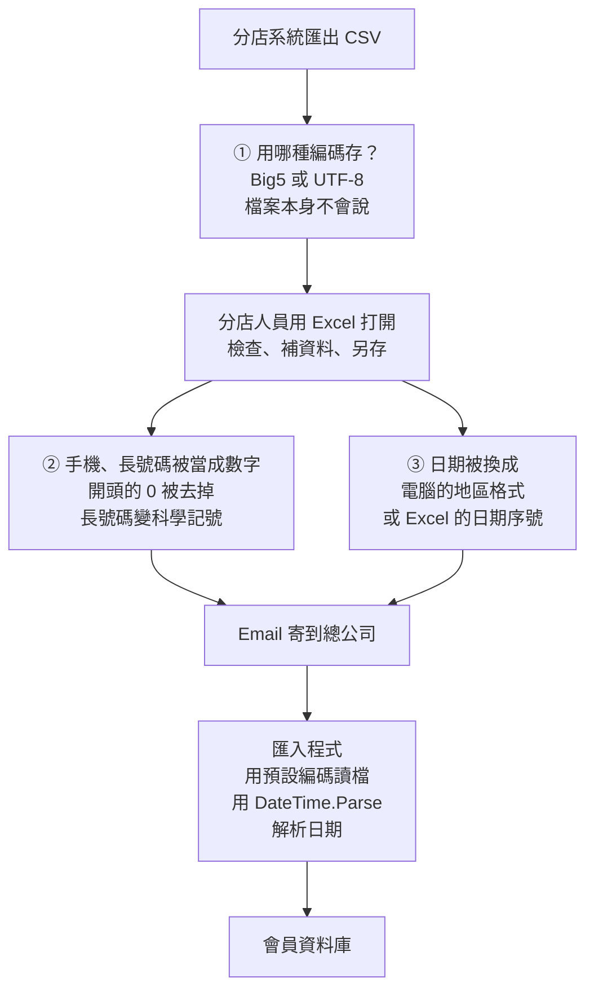
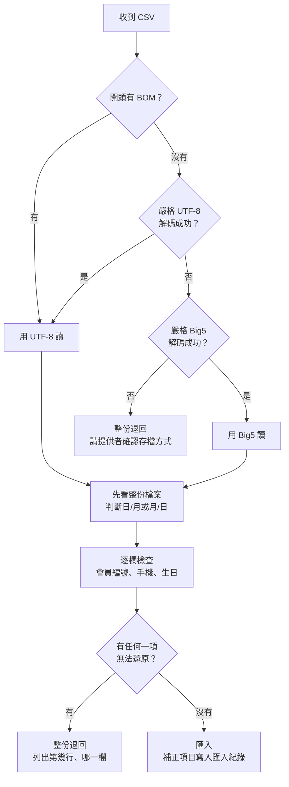

一家有三間分店的小公司，每個月月初，各分店會把當月新會員整理成 CSV 寄到總公司，行政再用一支小程式匯入會員系統。這支程式跑了一陣子都沒事，最近打算改成「收到信就自動匯入」，省掉人工。

改之前先拿上個月的檔案試跑，結果三種狀況一次出現：

- A 分店的檔案匯進去，姓名欄全是 `���j��` 這種亂碼。
- B 分店有位會員的生日，系統顯示 3 月 4 日，本人說是 4 月 3 日；另一位的生日欄是一個五位數 `32198`。
- B 分店有幾筆手機號碼只剩 9 碼，前面的 0 不見了；有一筆會員編號變成 `2.02611E+11`。

以下的公司、分店、會員姓名、號碼與日期都是虛構的示範情境。

這三個狀況看起來各不相干，其實是同一件事：**CSV 只是一串文字，裡面沒有記錄「這是什麼編碼」「這欄是日期還是文字」**，每個經手的程式都在用自己的方式猜。人工匯入時，行政看到怪怪的資料會停下來問；改成自動匯入以後，沒有人在看，猜錯的資料就直接進資料庫了。

## 先畫出：一份 CSV 從分店到資料庫，經過誰的手



匯入程式本身沒有 bug，它只是**相信檔案長得跟預期一樣**。下面一個一個拆。

## 坑一：亂碼，而且欄位跟著錯位

中文 CSV 最常見的兩種編碼是 Big5（Windows 上的代碼頁 950，簡稱 cp950）和 UTF-8。同樣是「陳大文」，兩種編碼存下來的位元組完全不同；用錯的編碼去讀，就是亂碼。

下面這支 .NET 8 主控台程式把同一行文字分別存成兩種編碼，再故意用錯的編碼讀回來：

```csharp
using System.Text;

// .NET（Core）預設只認得 UTF-8 等少數編碼，要先註冊才能用 Big5（cp950）
Encoding.RegisterProvider(CodePagesEncodingProvider.Instance);
var big5 = Encoding.GetEncoding(950);

var text = "陳大文,0912345678";
var utf8Bytes = Encoding.UTF8.GetBytes(text);
var big5Bytes = big5.GetBytes(text);

Console.WriteLine($"原文：{text}");
Console.WriteLine($"存成 UTF-8：{Convert.ToHexString(utf8Bytes)}（{utf8Bytes.Length} bytes）");
Console.WriteLine($"存成 Big5 ：{Convert.ToHexString(big5Bytes)}（{big5Bytes.Length} bytes）");
Console.WriteLine($"UTF-8 檔案用 Big5 讀：{big5.GetString(utf8Bytes)}");
Console.WriteLine($"Big5 檔案用 UTF-8 讀：{Encoding.UTF8.GetString(big5Bytes)}");
```

```text
$ dotnet run
原文：陳大文,0912345678
存成 UTF-8：E999B3E5A4A7E696872C30393132333435363738（20 bytes）
存成 Big5 ：B3AFA46AA4E52C30393132333435363738（17 bytes）
UTF-8 檔案用 Big5 讀：?喳之??0912345678
Big5 檔案用 UTF-8 讀：���j��,0912345678
```

最後一行是 Big5 檔案被當成 UTF-8 讀，中文變成 `�`（無法解碼的字元），這就是 A 分店的狀況：檔案是 Big5，匯入程式用 UTF-8 讀。至少逗號還在，欄位沒有亂。

倒數第二行是反過來的情況，比較可怕：UTF-8 檔案被當成 Big5 讀，`文` 的最後一個位元組 `87` 跟後面的逗號 `2C` 被當成一個雙位元組字（解不出來，顯示成 `?`），**逗號不見了**。姓名和手機黏在同一欄，後面每一欄都往前錯一格。如果匯入程式預設用 Big5 讀檔，而某間分店換了新系統、改寄 UTF-8 檔，就會遇到這種情況。

所以亂碼不只是「字看不懂」，它可能讓程式把手機號碼存進生日欄。

那檔案到底是哪一種編碼？有幾個判斷依據：

- **開頭有 BOM**（`EF BB BF` 三個位元組）：幾乎可以確定是 UTF-8。Excel 用「CSV UTF-8（逗號分隔）」存檔時會加上 BOM。
- **沒有 BOM**：先用「嚴格模式」的 UTF-8 解碼，遇到不合法的位元組就丟出例外而不是換成 `�`。中文的 Big5 文字幾乎不可能剛好是合法的 UTF-8，所以嚴格解碼成功，就當作 UTF-8。
- **嚴格 UTF-8 失敗**：再用嚴格模式的 Big5 試；也失敗就不要猜了，退回給提供檔案的人。

順序很重要：反過來先試 Big5，很多 UTF-8 檔案也能「成功」解成 Big5，只是解出來是亂碼，程式不會報錯。

另外，**沒有 BOM 的 UTF-8 CSV 用 Excel 直接點兩下打開**，在繁體中文 Windows 上常會被當成 Big5，畫面上就是亂碼；如果分店人員接著按下存檔，亂碼就真的寫進檔案了。

## 坑二：3 月 4 日還是 4 月 3 日？

B 分店的生日欄長這樣：`03/04/1988`、`25/12/1990`。很多匯入程式會直接用 `DateTime.Parse`，問題是它看的是「目前的文化設定」（`CultureInfo.CurrentCulture`），而這個設定跟著主機、使用者帳號走：

```csharp
using System.Globalization;

// 同一個字串，交給 DateTime.Parse，結果取決於「目前的文化設定」
foreach (var s in new[] { "03/04/1988", "25/12/1990" })
foreach (var name in new[] { "en-US", "en-GB", "zh-TW" })
{
    try
    {
        var d = DateTime.Parse(s, new CultureInfo(name));
        Console.WriteLine($"{s}  {name,-5} → {d:yyyy-MM-dd}");
    }
    catch (FormatException)
    {
        Console.WriteLine($"{s}  {name,-5} → FormatException（解析失敗）");
    }
}

// Excel 儲存格裡的日期其實是數字（1900 日期系統的序號），存成 CSV 時可能直接變成這個數字
Console.WriteLine($"32198 → {DateTime.FromOADate(32198):yyyy-MM-dd}");
```

```text
$ dotnet run
03/04/1988  en-US → 1988-03-04
03/04/1988  en-GB → 1988-04-03
03/04/1988  zh-TW → 1988-03-04
25/12/1990  en-US → FormatException（解析失敗）
25/12/1990  en-GB → 1990-12-25
25/12/1990  zh-TW → FormatException（解析失敗）
32198 → 1988-02-25
```

同一個 `03/04/1988`，美式設定解成 3 月 4 日，英式設定解成 4 月 3 日；`25/12/1990` 在美式和臺灣的設定下直接解析失敗。程式在辦公室電腦上跑得好好的，搬到另一台主機或換個帳號執行，結果就變了，而且**不會有任何錯誤訊息**，只是日月對調。

更麻煩的是，`03/04/1988` 這一筆**單看自己是無法判斷的**。要看同一份檔案裡的其他資料：只要有一筆是 `25/12/1990`，第一段大於 12，就能確定這份檔案是「日/月/年」。所以判斷要以「整份檔案」為單位，不能一筆一筆猜。

另外兩種常見的日期：

- **Excel 日期序號**：Excel 儲存格裡的日期其實是一個數字，從 1900 年起算的天數。儲存格格式被改成「通用格式」或「數值」後再存成 CSV，就會變成 `32198` 這樣的五位數。.NET 可以用 `DateTime.FromOADate` 換算（它和 Excel 在 1900 年 3 月以後的日期換算結果相同）。
- **民國年**：舊的系統常匯出 `077/03/04`，年份加 1911 就是西元年。兩位數年份（例如 `88/03/04`）可能是民國 88 年，也可能是西元 1988 年，這種要先跟提供者確認格式，不要讓程式猜。

## 坑三：手機少了 0，會員編號變成科學記號

`0912345678` 在 Excel 眼中是一個數字，數字前面的 0 沒有意義，所以被去掉，變成 `912345678`。12 位數的會員編號 `202611000201` 在「通用格式」下會顯示成 `2.02611E+11`，存成 CSV 時寫進去的就是畫面上這個字串。

這兩種情況的差別在於**還能不能救**：

- 手機少了開頭的 0：臺灣手機號碼是 `09` 開頭 10 碼，看到 `9` 開頭 9 碼，補回 0 就是原本的號碼，可以自動補正。
- 科學記號：`2.02611E+11` 只剩 6 位有效數字，原本 12 位數的後半段已經不在檔案裡了，**任何程式都還原不回來**，只能請提供者從原始系統重新匯出。

> 本文沙盒沒有 Excel，這一節與坑一提到的 Excel 行為（BOM、直接開啟時的編碼判斷、去掉前導 0、科學記號、日期序號）沒有實際重現，是一般常見的情況，會因 Excel 版本與設定而不同，請以自己的版本為準。

## 匯入前檢查：修得回來的補正，修不回來的整份退回

改成自動匯入之前，先在匯入程式前面加一關「匯入前檢查」。原則有兩條：

1. **補正要留紀錄。** 手機補 0、民國轉西元、依整份檔案判斷日月，這些可以自動處理，但每一項都寫進匯入紀錄，事後查得到是程式改的。
2. **只要有一項修不回來，整份不匯入。** 匯一半最難收拾：哪些進去了、哪些沒進去、重匯會不會重複，都要再花時間查。整份退回，請提供者修正後重寄，反而最省事。



下面是示範用的 C# 主控台程式（.NET 8），欄位固定為「會員編號、姓名、手機、生日」：

```csharp
using System.Text;
using System.Text.RegularExpressions;

// 匯入前檢查：先判斷編碼，再逐欄檢查；只要有一筆「退回」，整份檔案就不匯入
Encoding.RegisterProvider(CodePagesEncodingProvider.Instance);
foreach (var path in args) Check(path);

static void Check(string path)
{
    Console.WriteLine($"== {Path.GetFileName(path)}");
    var (text, encodingNote) = Decode(File.ReadAllBytes(path));
    Console.WriteLine($"  編碼：{encodingNote}");

    // 示範用的簡單切法；真實檔案若欄位內可能有逗號或引號，要改用能處理引號的 CSV 解析器
    var lines = text.Split('\n').Select(l => l.TrimEnd('\r')).Where(l => l.Length > 0).ToList();
    var header = lines[0].Split(',');
    int iId = Array.IndexOf(header, "會員編號"), iPhone = Array.IndexOf(header, "手機"), iBirth = Array.IndexOf(header, "生日");
    var rows = lines.Skip(1).Select((l, i) => (Line: i + 2, Cols: l.Split(','))).ToList();

    // 「日/月」還是「月/日」不能一筆一筆猜，要看整份檔案
    var (order, orderNote) = DetectOrder(rows.Select(r => r.Cols[iBirth]));
    Console.WriteLine($"  「數字/數字/西元年」日期：{orderNote}");

    int fixedCount = 0, rejected = 0;
    foreach (var (line, c) in rows)
    {
        foreach (var (level, msg) in CheckId(c[iId]).Concat(CheckPhone(c[iPhone])).Concat(CheckDate(c[iBirth], order)))
        {
            Console.WriteLine($"  第 {line} 行 [{level}] {msg}");
            if (level == "退回") rejected++; else fixedCount++;
        }
    }
    Console.WriteLine($"  結果：{rows.Count} 筆資料，補正 {fixedCount} 項、退回 {rejected} 項 → "
        + (rejected > 0 ? "整份不匯入，退回給提供者" : "可以匯入（補正項目寫入匯入紀錄）"));
}

static (string Text, string Note) Decode(byte[] b)
{
    if (b.Length >= 3 && b[0] == 0xEF && b[1] == 0xBB && b[2] == 0xBF)
        return (Encoding.UTF8.GetString(b, 3, b.Length - 3), "UTF-8（有 BOM）");
    try { return (new UTF8Encoding(false, throwOnInvalidBytes: true).GetString(b), "UTF-8（沒有 BOM）"); }
    catch (DecoderFallbackException) { }
    try
    {
        var big5 = Encoding.GetEncoding(950, EncoderFallback.ExceptionFallback, DecoderFallback.ExceptionFallback);
        return (big5.GetString(b), "不是合法的 UTF-8，改用 Big5（cp950）讀取成功");
    }
    catch (DecoderFallbackException) { throw new InvalidDataException("不是 UTF-8 也不是 Big5，請提供者確認存檔方式"); }
}

static (string? Order, string Note) DetectOrder(IEnumerable<string> values)
{
    bool any = false, dayFirst = false, monthFirst = false;
    foreach (var v in values)
    {
        var m = Regex.Match(v, @"^(\d{1,2})/(\d{1,2})/(\d{4})$");
        if (!m.Success) continue;
        any = true;
        if (int.Parse(m.Groups[1].Value) > 12) dayFirst = true;
        if (int.Parse(m.Groups[2].Value) > 12) monthFirst = true;
    }
    return (any, dayFirst, monthFirst) switch
    {
        (false, _, _) => (null, "沒有這種格式"),
        (_, true, false) => ("日/月/年", "日/月/年（有日期的第一段大於 12）"),
        (_, false, true) => ("月/日/年", "月/日/年（有日期的第二段大於 12）"),
        _ => (null, "無法判斷是日/月還是月/日"),  // 兩種都出現，或全部都 ≤ 12
    };
}

static IEnumerable<(string, string)> CheckId(string v)
{
    if (Regex.IsMatch(v, @"^\d{12}$")) yield break;
    if (v.Contains("E+", StringComparison.OrdinalIgnoreCase))
        yield return ("退回", $"會員編號「{v}」是科學記號，原始號碼已經遺失，補不回來");
    else
        yield return ("退回", $"會員編號「{v}」不是 12 碼數字");
}

static IEnumerable<(string, string)> CheckPhone(string v)
{
    if (Regex.IsMatch(v, @"^09\d{8}$")) yield break;
    if (Regex.IsMatch(v, @"^9\d{8}$"))
        yield return ("補正", $"手機「{v}」少了開頭的 0 → 0{v}");
    else
        yield return ("退回", $"手機「{v}」格式不對");
}

static IEnumerable<(string, string)> CheckDate(string v, string? order)
{
    if (Regex.IsMatch(v, @"^\d{4}[-/]\d{1,2}[-/]\d{1,2}$")) yield break;  // 年在前，沒有歧義

    Match m;
    if ((m = Regex.Match(v, @"^(\d{2,3})/(\d{1,2})/(\d{1,2})$")).Success)      // 民國年
    {
        var d = ToDate(int.Parse(m.Groups[1].Value) + 1911, m.Groups[2].Value, m.Groups[3].Value);
        yield return d is null ? ("退回", $"生日「{v}」不是有效日期") : ("補正", $"生日「{v}」是民國年 → {d}");
    }
    else if (Regex.IsMatch(v, @"^\d{5}$"))                                      // Excel 日期序號
        yield return ("補正", $"生日「{v}」像是 Excel 日期序號 → {DateTime.FromOADate(int.Parse(v)):yyyy-MM-dd}，請提供者確認");
    else if ((m = Regex.Match(v, @"^(\d{1,2})/(\d{1,2})/(\d{4})$")).Success)
    {
        if (order is null) { yield return ("退回", $"生日「{v}」無法判斷是幾月幾日"); yield break; }
        var (day, month) = order.StartsWith("日") ? (m.Groups[1].Value, m.Groups[2].Value) : (m.Groups[2].Value, m.Groups[1].Value);
        var d = ToDate(int.Parse(m.Groups[3].Value), month, day);
        if (d is null) yield return ("退回", $"生日「{v}」不是有效日期");
        else if (int.Parse(m.Groups[1].Value) <= 12 && int.Parse(m.Groups[2].Value) <= 12)
            yield return ("補正", $"生日「{v}」單看這筆無法判斷，依整份檔案視為{order} → {d}");
    }
    else
        yield return ("退回", $"生日「{v}」格式認不得");
}

static string? ToDate(int y, string m, string d)
{
    try { return new DateTime(y, int.Parse(m), int.Parse(d)).ToString("yyyy-MM-dd"); }
    catch (ArgumentOutOfRangeException) { return null; }
}
```

測試資料是兩份虛構的檔案。A 分店的檔案用 Big5 存檔、生日是民國年，內容如下（這裡顯示的是用 Big5 解碼後的文字）：

```text
會員編號,姓名,手機,生日
202611000101,陳大文,0912345678,077/03/04
202611000102,林美華,0922333444,079/12/25
```

B 分店的檔案是有 BOM 的 UTF-8，模擬被 Excel 開過再存檔的結果：

```text
會員編號,姓名,手機,生日
2.02611E+11,張小芬,912000111,03/04/1988
202611000202,黃志明,0933555666,25/12/1990
202611000203,吳家豪,955777888,32198
202611000204,李雅婷,0966123456,14/07/1992
```

兩份一起檢查：

```figure caption="實際執行結果：A 分店是 Big5 編碼，補正民國年後可以匯入；B 分店有一筆會員編號已變成科學記號，整份退回" width="820"
<div style="font-family:var(--mono);font-size:13.5px;line-height:1.85;text-align:left;background:#1B2B3A;color:#C9D6DB;border-radius:8px;padding:14px 20px">
<div style="color:#8FA3AD;white-space:pre">$ dotnet run -- branch-a.csv branch-b.csv</div>
<div style="white-space:pre;color:#fff;font-weight:700;margin-top:6px">== branch-a.csv</div>
<div style="white-space:pre;">  編碼：不是合法的 UTF-8，改用 Big5（cp950）讀取成功</div>
<div style="white-space:pre;">  「數字/數字/西元年」日期：沒有這種格式</div>
<div style="white-space:pre;color:#F2C879">  第 2 行 [補正] 生日「077/03/04」是民國年 → 1988-03-04</div>
<div style="white-space:pre;color:#F2C879">  第 3 行 [補正] 生日「079/12/25」是民國年 → 1990-12-25</div>
<div style="white-space:pre;color:#9FD3C7">  結果：2 筆資料，補正 2 項、退回 0 項 → 可以匯入（補正項目寫入匯入紀錄）</div>
<div style="white-space:pre;color:#fff;font-weight:700;margin-top:6px">== branch-b.csv</div>
<div style="white-space:pre;">  編碼：UTF-8（有 BOM）</div>
<div style="white-space:pre;">  「數字/數字/西元年」日期：日/月/年（有日期的第一段大於 12）</div>
<div style="white-space:pre;background:rgba(176,58,46,.35);border-left:3px solid #E06A5C;margin:0 -12px;padding:0 9px;color:#fff">  第 2 行 [退回] 會員編號「2.02611E+11」是科學記號，原始號碼已經遺失，補不回來</div>
<div style="white-space:pre;color:#F2C879">  第 2 行 [補正] 手機「912000111」少了開頭的 0 → 0912000111</div>
<div style="white-space:pre;color:#F2C879">  第 2 行 [補正] 生日「03/04/1988」單看這筆無法判斷，依整份檔案視為日/月/年 → 1988-04-03</div>
<div style="white-space:pre;color:#F2C879">  第 4 行 [補正] 手機「955777888」少了開頭的 0 → 0955777888</div>
<div style="white-space:pre;color:#F2C879">  第 4 行 [補正] 生日「32198」像是 Excel 日期序號 → 1988-02-25，請提供者確認</div>
<div style="white-space:pre;background:rgba(176,58,46,.35);border-left:3px solid #E06A5C;margin:0 -12px;padding:0 9px;color:#fff">  結果：4 筆資料，補正 4 項、退回 1 項 → 整份不匯入，退回給提供者</div>
</div>
```

A 分店的亂碼問題，在這裡只是「改用 Big5 讀取」一行說明；B 分店雖然大部分都補正得回來，但第 2 行的會員編號救不回來，所以整份退回。退回時附上這份清單，提供者馬上知道要改哪一行，不用來回問。

這支程式是示範用的簡化版本，實際使用前還要補上幾件事：

- 用能處理引號的 CSV 解析器取代 `Split(',')`，否則欄位內有逗號（例如地址）就會切錯。
- 欄位名稱、號碼規則要依實際資料調整；市話、統一編號、郵遞區號都有各自的前導 0 問題。
- 匯入紀錄要存下原始檔案，補正前後的值都要留著。

能從源頭解決更好：請分店直接從系統匯出、不要經過 Excel 另存；或約定用「CSV UTF-8」格式存檔、日期一律寫成 `yyyy-MM-dd`。即使約定好了，檢查這一關還是要留著，因為總會有人忘記。

> 本文的 C# 程式在 Ubuntu 24.04、.NET SDK 8.0.134 實際執行過，文中的輸出都與實際輸出相同；測試用的 CSV 檔由 Python 產生（A 分店以 cp950 編碼寫入，B 分店以 UTF-8 加 BOM 寫入）。`DateTime.Parse` 的結果依 .NET 在 Linux 上使用的 ICU 文化資料，Windows 上的結果請自行確認。Excel 的相關行為沒有實際重現（見坑三的說明）。

## 學到什麼

- CSV 裡沒有編碼和欄位型別的資訊，每個經手的程式都在猜。改成自動匯入以前，要先把「猜」換成「檢查」。
- 編碼的判斷順序是：BOM → 嚴格 UTF-8 → 嚴格 Big5 → 退回。亂碼可能吃掉逗號，讓整欄錯位。
- 不要用 `DateTime.Parse` 解析外部檔案的日期；格式要明確指定，「日/月」或「月/日」要看整份檔案決定。
- 手機少了 0 救得回來，科學記號救不回來。分清楚哪些可以補正、哪些只能退回，有一項退回就整份不匯入。

如果你每個月也在處理別人寄來的檔案，想改成自動匯入又怕資料出錯，問達工作室可以幫你把這一關檢查做進流程裡，並把已經匯錯的資料一起找出來。
