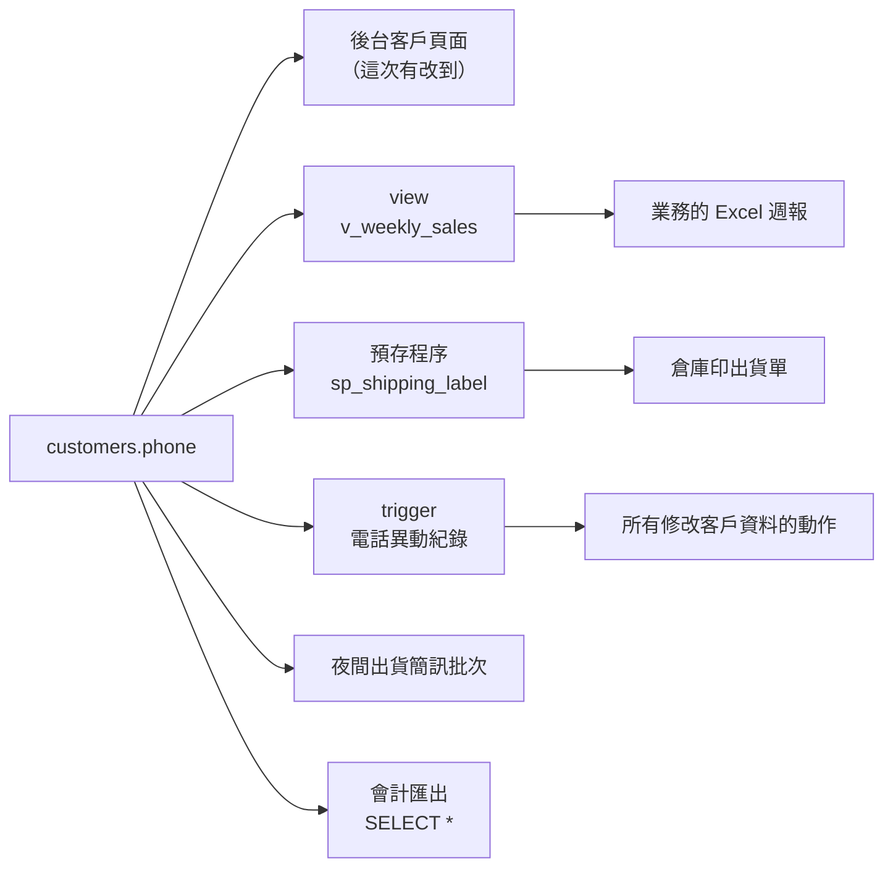
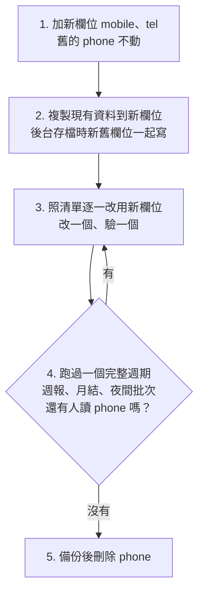

一家做零件批發的小公司，客戶資料表裡只有一個 `phone` 欄位，手機和市話混著填。出貨簡訊常常發到市話，老闆跟工程師說：「把電話拆成手機、市話兩欄吧，應該很快？」

工程師週五下午把 `phone` 改名成 `mobile`，再新增一個 `tel` 欄位，後台的客戶編輯頁也一起改好。新增一筆客戶測試，正常，上線。

接下來的三天：

- 週六凌晨，夜間的出貨簡訊批次失敗。週末沒人看，沒人發現。
- 週一早上，業務打開 Excel 週報按「重新整理」，跳出錯誤。
- 倉庫要印出貨單，按下去是錯誤頁。
- 客服幫客戶改地址，按儲存失敗；連改客戶名稱都存不進去。

老闆問：「不是只改了一個欄位嗎？」

以下的公司、客戶、系統名稱與時間都是虛構的示範情境；資料庫的行為是在 MariaDB 上實際重現的。

## 一個欄位，不是只屬於一個畫面

工程師改的是「後台客戶頁面用到的欄位」，但資料庫裡的欄位是大家共用的。這個 `phone` 實際上被這些地方讀取：



系統用得越久，這張圖就長得越大。寫 view 的人、寫批次的人、做 Excel 報表的人，常常不是同一個人，也沒有一份文件記下「誰在用哪個欄位」。接手的人只看得到自己手上那一塊。

## 資料庫不會擋你

先在 MariaDB 10.11 建一個示範資料庫：`customers` 資料表，加上一個 view、一個預存程序、一個「電話被修改時寫紀錄」的 trigger，都用到 `phone`。然後照工程師的做法改名：

```text
$ mariadb shop_demo -e "ALTER TABLE customers RENAME COLUMN phone TO mobile; ALTER TABLE customers ADD COLUMN tel VARCHAR(20) NULL;"
$ mariadb shop_demo -e "INSERT INTO customers (id, name, mobile) VALUES (3, '阿志冷氣', '0933111222');"
```

兩個指令都成功，沒有任何訊息，也沒有警告。接著試試其他地方（以下只保留錯誤訊息；MariaDB 用戶端出錯時會把指令再印一次，這裡省略）：

```text
$ mariadb shop_demo -e "SELECT * FROM v_weekly_sales;"
ERROR 1356 (HY000) at line 1: View 'shop_demo.v_weekly_sales' references invalid table(s) or column(s) or function(s) or definer/invoker of view lack rights to use them

$ mariadb shop_demo -e "CALL sp_shipping_label(101);"
ERROR 1054 (42S22) at line 1: Unknown column 'c.phone' in 'SELECT'

$ mariadb shop_demo -e "UPDATE customers SET name = '大明五金行' WHERE id = 1;"
ERROR 1054 (42S22) at line 1: Unknown column 'phone' in 'OLD'
```

這三個錯誤對應到開頭的三件事：

- **Excel 週報**連的是 view。改名當下 view 不會報錯，要等到有人查詢它才失敗。
- **出貨單**呼叫的預存程序也一樣，等到被呼叫才失敗。
- **後台存檔失敗**最容易誤判。trigger 寫在 `UPDATE` 上，裡面讀 `OLD.phone`；欄位不在了，**所有**修改客戶資料的動作都會失敗，不管改的是不是電話。而工程師測的是「新增客戶」，`INSERT` 不會觸發這個 trigger，所以測試正好避開了它。

夜間簡訊批次的 SQL 直接寫了 `phone`，失敗的原因相同。

SQL Server 的情況類似：用 `sp_rename` 改欄位名稱時只會顯示一段提醒，說改名可能讓指令碼和預存程序失效，不會阻止你。（這段沒有在 SQL Server 上實測。）

### 會報錯的，反而是好處理的

清單上還有一個沒報錯的：會計匯出程式用 `SELECT * FROM customers`，把第 3 欄當成電話寫進 CSV。改名後欄位順序是 `id, name, mobile, tel`，第 3 欄剛好還是電話，程式照樣能跑。

問題在下一步：行政開始把市話從 `mobile` 搬到 `tel` 以後，會計拿到的檔案裡，那些客戶的電話會變成空白。沒有錯誤訊息，沒有人被通知，可能要等到會計需要打電話給客戶時才發現。

欄位改名、刪除會讓程式報錯；欄位的**意義**改變（原本放所有電話，現在只放手機）不會報錯，只會讓資料默默變少或變錯。後者更需要事前找出來。

這次的止血方式很單純：先把欄位名稱改回 `phone`，後台程式退回上一版。新加的 `tel` 欄位留著，沒有人讀它，不影響任何東西。改回之後，view、預存程序與 `UPDATE` 都恢復正常（同一個示範資料庫上實際驗證過）。

接下來才是正事：重新改一次，這次先找出所有用到 `phone` 的地方。

## 改之前，兩邊各找一次

相依關係分散在兩個地方：**資料庫裡面**（view、預存程序、函式、trigger），和**資料庫外面**（程式碼、批次、報表檔）。兩邊要分開找。

### 第一邊：資料庫裡的物件

MySQL／MariaDB 的 `information_schema` 裡存有 view、預存程序與 trigger 的定義，可以直接搜尋：

```sql
SELECT 'VIEW' AS object_type, TABLE_NAME AS object_name
FROM information_schema.VIEWS
WHERE TABLE_SCHEMA = 'shop_demo' AND VIEW_DEFINITION LIKE '%phone%'
UNION ALL
SELECT ROUTINE_TYPE, ROUTINE_NAME
FROM information_schema.ROUTINES
WHERE ROUTINE_SCHEMA = 'shop_demo' AND ROUTINE_DEFINITION LIKE '%phone%'
UNION ALL
SELECT 'TRIGGER', TRIGGER_NAME
FROM information_schema.TRIGGERS
WHERE TRIGGER_SCHEMA = 'shop_demo' AND ACTION_STATEMENT LIKE '%phone%';
```

在改名之前的示範資料庫上執行：

```text
$ mariadb --table shop_demo < find_refs.sql
+-------------+-------------------------+
| object_type | object_name             |
+-------------+-------------------------+
| VIEW        | v_weekly_sales          |
| PROCEDURE   | sp_shipping_label       |
| TRIGGER     | trg_customers_phone_log |
+-------------+-------------------------+
```

幾個注意事項：

- `LIKE '%phone%'` 會多抓，例如 `phone_ext` 也會被列出來。盤點時寧可多抓再人工排除，不要漏掉。
- 查詢的帳號權限不夠時，定義欄位可能是空的，看起來像「沒有任何相依」。這次是用 root 帳號執行的。
- 如果有好幾個資料庫（schema），每個都要查，別的資料庫裡的 view 也可能跨庫讀這張表。

SQL Server 可以從 `sys.sql_modules` 找，view、預存程序、函式、trigger 的定義都在裡面。以下這段**沒有實際執行過**（本文環境沒有 SQL Server），使用前請先在測試環境確認：

```sql
-- SQL Server 版本：未實際執行
SELECT OBJECT_SCHEMA_NAME(m.object_id) AS schema_name,
       OBJECT_NAME(m.object_id)        AS object_name,
       o.type_desc
FROM sys.sql_modules m
JOIN sys.objects o ON o.object_id = m.object_id
WHERE m.definition LIKE '%phone%';
```

### 第二邊：資料庫外面的程式與報表

這一邊要掃的是原始碼、批次程式、報表檔。用編輯器全文搜尋 `phone` 當然可以，但結果一多就很難判斷哪些是真的相關。下面這支 .NET 8 主控台程式做了幾件全文搜尋做不到的事：

- 同一個檔案裡有沒有出現資料表名稱，用來區分「確定相關」和「需要人工確認」（例如供應商資料表也有 `phone`）。
- 除了欄位本身，也搜尋第一邊找到的 view、預存程序名稱。Excel 週報裡寫的是 `v_weekly_sales`，出貨單程式寫的是 `sp_shipping_label`，它們沒有直接提到 `customers`，但一樣會受影響。
- 標出 `SELECT * FROM customers`，因為這種寫法依賴欄位順序或全部欄位，搜尋 `phone` 找不到。
- 打開 `.xlsx`。xlsx 其實是一個 zip 檔，Excel 的外部資料連線查詢存在裡面的 `xl/connections.xml`。

```csharp
using System.IO.Compression;
using System.Text.RegularExpressions;

// 用法：dotnet run -- <資料夾> <資料表> <欄位> [相依的 view/預存程序/trigger ...]
if (args.Length < 3)
{
    Console.WriteLine("用法：dotnet run -- <資料夾> <資料表> <欄位> [相依物件 ...]");
    return;
}
var (root, table, column) = (args[0], args[1], args[2]);
var dependents = args.Skip(3).ToArray();

var textExt = new[] { ".cs", ".php", ".sql", ".js", ".ts", ".vue", ".py", ".bat", ".ps1", ".config", ".json", ".xml" };
var opt = RegexOptions.IgnoreCase;
var columnRe = new Regex($@"\b{Regex.Escape(column)}\b", opt);
// 資料表名稱的單數也算，例如 customers 對應 Laravel 的 Customer model
var tableRe = new Regex($@"\b{Regex.Escape(table.TrimEnd('s'))}s?\b", opt);
var selectStarRe = new Regex($@"SELECT\s+\*\s+FROM\s+{Regex.Escape(table)}\b", opt);

var hits = new List<(string Kind, string Where, string Line)>();
var scanned = 0;

foreach (var path in Directory.EnumerateFiles(root, "*", SearchOption.AllDirectories).Order())
{
    var rel = Path.GetRelativePath(root, path);
    var ext = Path.GetExtension(path).ToLowerInvariant();
    if (path.EndsWith(".blade.php") || textExt.Contains(ext))
    {
        scanned++;
        Check(rel, File.ReadAllLines(path));
    }
    else if (ext == ".xlsx")
    {
        // xlsx 是 zip 檔，外部資料連線的查詢語法存在裡面的 XML
        scanned++;
        using var zip = ZipFile.OpenRead(path);
        foreach (var entry in zip.Entries.Where(e => e.FullName.EndsWith(".xml")))
        {
            using var sr = new StreamReader(entry.Open());
            Check($"{rel} → {entry.FullName}", sr.ReadToEnd().Split('\n'));
        }
    }
}

void Check(string where, string[] lines)
{
    var fileMentionsTable = lines.Any(l => tableRe.IsMatch(l));
    for (var i = 0; i < lines.Length; i++)
    {
        var line = lines[i].Trim();
        var dep = dependents.FirstOrDefault(d => Regex.IsMatch(line, $@"\b{Regex.Escape(d)}\b", opt));
        string? kind =
            dep != null ? $"經由 {dep}" :
            selectStarRe.IsMatch(line) ? "SELECT *（依欄位順序或全部欄位）" :
            columnRe.IsMatch(line) && fileMentionsTable ? "直接使用" :
            columnRe.IsMatch(line) ? $"需人工確認（檔案裡沒有 {table}）" :
            null;
        if (kind != null) hits.Add((kind, $"{where}:{i + 1}", line));
    }
}

Console.WriteLine($"找 {table}.{column} 的使用位置，掃描 {scanned} 個檔案");
int Rank(string kind) => kind.StartsWith("直接") ? 0 : kind.StartsWith("經由") ? 1 : kind.StartsWith("SELECT") ? 2 : 3;
foreach (var group in hits.GroupBy(h => h.Kind).OrderBy(g => Rank(g.Key)))
{
    Console.WriteLine($"\n[{group.Key}] {group.Count()} 處");
    foreach (var h in group)
        Console.WriteLine($"  {h.Where}\n      {(h.Line.Length > 90 ? h.Line[..90] + "…" : h.Line)}");
}
```

拿一個示範用的專案資料夾來掃：裡面有 Laravel 後台的幾個檔案、兩支 C# 批次程式、一個 Excel 週報。參數帶入資料表、欄位，以及第一邊找到的 view 和預存程序名稱：

```figure caption="實際執行結果：直接用到 phone 的 3 處、經由 view 與預存程序的 2 處、SELECT * 的 1 處，另有 1 處要人工確認" width="820"
<div style="font-family:var(--mono);font-size:13px;line-height:1.75;text-align:left;background:#1B2B3A;color:#C9D6DB;border-radius:8px;padding:14px 20px">
<div style="color:#8FA3AD;white-space:pre">$ dotnet run -- ../system customers phone v_weekly_sales sp_shipping_label</div>
<div style="white-space:pre;color:#fff;font-weight:700;margin-top:6px">找 customers.phone 的使用位置，掃描 7 個檔案</div>
<div style="white-space:pre;color:#F2C879;margin-top:8px">[直接使用] 3 處</div>
<div style="white-space:pre">  batch/NightlySms/Program.cs:6</div>
<div style="white-space:pre;color:#8FA3AD">      "SELECT id, name, phone FROM customers WHERE phone LIKE '09%'", conn);</div>
<div style="white-space:pre">  web/app/Models/Customer.php:10</div>
<div style="white-space:pre;color:#8FA3AD">      protected $fillable = ['name', 'phone'];</div>
<div style="white-space:pre">  web/resources/views/customers/edit.blade.php:4</div>
<div style="white-space:pre;color:#8FA3AD">      &lt;input name="phone" value="{{ $customer-&gt;phone }}"&gt;</div>
<div style="white-space:pre;color:#F2C879;margin-top:8px">[經由 v_weekly_sales] 1 處</div>
<div style="white-space:pre">  reports/weekly_sales.xlsx → xl/connections.xml:4</div>
<div style="white-space:pre;color:#8FA3AD">      &lt;dbPr connection="DSN=shop;" command="SELECT name, phone, total FROM v_weekly_sales ORDER …</div>
<div style="white-space:pre;color:#F2C879;margin-top:8px">[經由 sp_shipping_label] 1 處</div>
<div style="white-space:pre">  web/app/Http/Controllers/ShippingController.php:11</div>
<div style="white-space:pre;color:#8FA3AD">      $rows = DB::select('CALL sp_shipping_label(?)', [$orderId]);</div>
<div style="white-space:pre;background:rgba(176,58,46,.35);border-left:3px solid #E06A5C;margin:8px -12px 0;padding:0 9px;color:#fff">[SELECT *（依欄位順序或全部欄位）] 1 處</div>
<div style="white-space:pre">  batch/AccountantExport/Program.cs:5</div>
<div style="white-space:pre;color:#8FA3AD">      var cmd = new MySqlCommand("SELECT * FROM customers ORDER BY id", conn);</div>
<div style="white-space:pre;color:#9FD3C7;margin-top:8px">[需人工確認（檔案裡沒有 customers）] 1 處</div>
<div style="white-space:pre">  web/app/Models/Supplier.php:10</div>
<div style="white-space:pre;color:#8FA3AD">      protected $fillable = ['company', 'phone', 'contact'];</div>
</div>
```

逐項看：

- **直接使用**的 3 處：簡訊批次、Laravel 的 model、客戶編輯頁。後兩個是這次有改到的，簡訊批次沒有。
- **經由 view、預存程序**的 2 處：Excel 週報和出貨單程式。這兩個檔案裡完全沒有 `customers` 這個字，只搜尋資料表名稱會漏掉。
- **SELECT \***：會計匯出。要打開來看它怎麼使用欄位，這次的答案是「依位置取第 3 欄」，正好是會默默出錯的那一種。
- **需人工確認**：`Supplier.php` 是供應商資料表的電話，跟這次無關，排除。

trigger 沒有出現在掃描結果裡，這是正常的：沒有程式會「呼叫」trigger，它跟著 `UPDATE customers` 自動執行。所以 trigger 只能從第一邊找，而它影響的範圍是**所有**更新客戶資料的地方。

這支程式找不到的東西，要另外處理：

- 用字串拼出來的 SQL，例如欄位名稱放在設定檔或變數裡組起來。
- 用 Power Query 建立的 Excel 查詢：據我所知不是以純文字存放，這支程式應該找不到（這點本文沒有實測）。
- **不在你手上的東西**：同事電腦裡自己做的 Excel、直接連資料庫的會計軟體、另一家廠商寫的程式。這部分沒辦法靠掃描，可以從資料庫的帳號清單反推：每個有權限連進來的帳號，都代表一個使用者，一個一個問。

## 怎麼改才不會掛：先加、再搬、最後才刪

盤點出清單後，改法也要換。不要一次把 `phone` 改名，而是讓新舊欄位並存一段時間，等每個使用者都換過去，才把舊的拿掉：



第 1、2 步在示範資料庫上執行（重新建立，`phone` 尚未被改名）：

```sql
-- 第 1 步：只加新欄位，舊的 phone 不動；新欄位加在最後，不改變既有欄位的順序
ALTER TABLE customers
  ADD COLUMN mobile VARCHAR(20) NULL,
  ADD COLUMN tel    VARCHAR(20) NULL;

-- 第 2 步：把現有資料複製一份到新欄位
UPDATE customers SET mobile = phone WHERE phone LIKE '09%';
UPDATE customers SET tel    = phone WHERE phone NOT LIKE '09%';

SELECT id, name, phone, mobile, tel FROM customers;
```

```text
$ mariadb shop_demo < expand.sql
id	name	phone	mobile	tel
1	大明五金	0912345678	0912345678	NULL
2	小華水電	02-2345-6789	NULL	02-2345-6789
```

舊的使用者完全不受影響，view 和預存程序照常運作：

```text
$ mariadb shop_demo -e "SELECT * FROM v_weekly_sales; CALL sp_shipping_label(101);"
name	phone	total
大明五金	0912345678	12800
小華水電	02-2345-6789	5400
id	name	phone
101	大明五金	0912345678
```

新欄位加在最後面，是為了保護 `SELECT *` 依位置取值的會計匯出：前三欄還是 `id, name, phone`。

第 3 步照清單一項一項改：簡訊批次改讀 `mobile`、會計匯出改成明確寫出欄位名稱、view 和預存程序加上新欄位、trigger 改成記錄新欄位的異動、通知業務 Excel 週報要換欄位。每改一項，就實際跑一次那個功能。

第 4 步的「完整週期」，是指所有週期性的東西都至少跑過一次：每天的批次、每週的報表、每月的月結。只跑過一天就刪舊欄位，月底的報表還是會壞。

這個改法比較慢，但每一步都退得回去：第 3 步改到一半發現問題，舊欄位還在，退回那一項就好。

> 本文的 SQL 在 Ubuntu 24.04、MariaDB 10.11.14 實際執行過，C# 掃描程式在 .NET SDK 8.0.134 實際執行過，文中的輸出都與實際輸出相同（錯誤訊息的部分省略了用戶端重複印出的指令）。被掃描的示範專案檔案（PHP、C# 批次程式）只用來被掃描，沒有編譯或執行；示範用的 xlsx 由 Python 產生，裡面只有 `xl/connections.xml`，不是 Excel 實際存出的檔案。MySQL 8、SQL Server 與 Power Query 的部分沒有實測。

## 學到什麼

- 資料庫允許你改欄位名稱，不代表沒有人在用它。view 和預存程序要等到被使用才報錯，trigger 會讓整張表的更新一起失敗。
- 測試要測「別人的功能」：這次只測了新增客戶，正好避開唯一會立刻出事的 `UPDATE`。
- 找相依關係分兩邊：資料庫裡查 view、預存程序、trigger 的定義；資料庫外掃程式碼和報表檔，並把第一邊找到的物件名稱一起搜尋。
- 報錯的好處理，意義改變卻不報錯的才危險。`SELECT *` 和依位置取值的程式要特別看。
- 改欄位用「先加、再搬、最後才刪」，每一步都能停、都能退。

如果你手上的系統也是「不知道改了會牽動哪裡」，或是已經改出問題、不確定還有哪些地方跟著壞，問達工作室可以幫你在動手前把相依關係盤點出來，再一項一項修回來。
