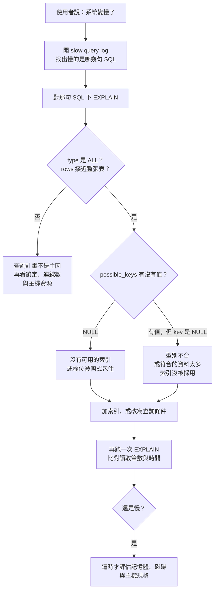

一家做五金批發的小公司，訂單系統用了快三年。最近客服常抱怨：客人打電話來問訂單，輸入手機號碼後要等好一陣子才出來；每月初會計跑上個月的營業額，那幾分鐘後台整個變慢。

主機商看了一下資源使用率，建議升級到更高的方案。老闆來問：「升級就會變快嗎？」

可能會快一點，但不一定解決問題。先確認一件事：**慢，是因為機器太弱，還是因為每次查詢都讀了太多資料？**後者升級主機只能撐一陣子，資料每個月還在長。

以下的公司、系統名稱、資料與時間都是虛構的示範情境；文中的 SQL 與執行結果是在 MariaDB 上實際跑出來的。

## 先把排查順序排好



## 第一步：找出是哪一句 SQL 慢

「系統很慢」通常不是每個畫面都慢，而是某幾句 SQL 很慢。MySQL／MariaDB 內建的 slow query log 會把執行超過指定秒數的 SQL 記下來：

```sql
SET GLOBAL slow_query_log = ON;
SET GLOBAL long_query_time = 0.5;   -- 超過 0.5 秒就記錄
SET GLOBAL slow_query_log_file = '/var/log/mysql/slow.log';
```

`SET GLOBAL` 在資料庫重新啟動後就失效，適合臨時開來抓問題；要長期保留就寫進設定檔。需要 `SUPER` 或相關權限，共用主機方案可能沒有，這時候只能從程式端的記錄去找。

在示範資料庫上跑一次月報的查詢，log 裡會出現這一段：

```text
# Query_time: 0.663598  Lock_time: 0.000089  Rows_sent: 1  Rows_examined: 2000000
SELECT COUNT(*) AS orders, SUM(total) AS amount
FROM orders
WHERE DATE_FORMAT(created_at, '%Y-%m') = '2026-10';
```

最值得看的是最後兩個數字：**回傳 1 筆，讀了 200 萬筆**。`Rows_examined` 遠大於實際需要的資料量，就是查詢計畫有問題的訊號，跟主機快慢無關。

## 第二步：用 EXPLAIN 看它打算怎麼找

示範用的訂單資料表長這樣，用 MariaDB 的 `seq_1_to_N` 序列表產生 200 萬筆、3,000 位客戶的假資料：

```sql
CREATE TABLE orders (
  id             INT UNSIGNED  NOT NULL AUTO_INCREMENT PRIMARY KEY,
  order_no       VARCHAR(20)   NOT NULL,
  customer_phone VARCHAR(20)   NOT NULL,
  created_at     DATETIME      NOT NULL,
  total          DECIMAL(10,0) NOT NULL,
  note           VARCHAR(200)  NULL,
  KEY idx_created_at (created_at)
) ENGINE=InnoDB;

INSERT INTO orders (order_no, customer_phone, created_at, total, note)
SELECT CONCAT('SO', LPAD(seq, 8, '0')),
       CONCAT('09', LPAD((seq * 7919) % 3000 + 10000000, 8, '0')),
       '2024-01-01' + INTERVAL (seq * 0.75) MINUTE,
       100 + (seq * 37) % 20000,
       REPEAT('x', 80)
FROM seq_1_to_2000000;
```

注意 `created_at` 已經有索引。客服查詢用的 SQL：

```sql
SELECT id, order_no, created_at, total
FROM orders
WHERE customer_phone = '0910001234'
ORDER BY created_at DESC;
```

在前面加上 `EXPLAIN`，資料庫不會真的執行，只回報它打算怎麼找：

```text
+------+-------------+--------+------+---------------+------+---------+------+---------+-----------------------------+
| id   | select_type | table  | type | possible_keys | key  | key_len | ref  | rows    | Extra                       |
+------+-------------+--------+------+---------------+------+---------+------+---------+-----------------------------+
|    1 | SIMPLE      | orders | ALL  | NULL          | NULL | NULL    | NULL | 1982090 | Using where; Using filesort |
+------+-------------+--------+------+---------------+------+---------+------+---------+-----------------------------+
```

欄位很多，先看這四個就夠：

| 欄位 | 看什麼 | 這次的值代表 |
| --- | --- | --- |
| `type` | 怎麼找資料。`ALL` 是整張表從頭讀到尾，`ref`、`range` 是透過索引只讀一部分 | `ALL`：全表掃描 |
| `possible_keys`／`key` | 可以用的索引／實際選用的索引 | 兩個都是 `NULL`：沒有索引可用 |
| `rows` | 預估要讀幾筆（是估計值，不是實際值） | 約 198 萬，幾乎整張表 |
| `Extra` | 額外動作。`Using filesort` 是讀完之後另外排序 | 讀完還要再排一次 |

為了找一位客人的 667 筆訂單，資料庫每次都把 200 萬筆讀過一遍，再排序。換一台快兩倍的主機，就是讀得快兩倍；資料量再翻倍，又回到原點。

## 第三步：對症下藥，三種常見情況

### 情況一：根本沒有可用的索引

`customer_phone` 沒有索引，只能全表掃描。加一個複合索引：

```sql
ALTER TABLE orders
  ADD INDEX idx_phone_created (customer_phone, created_at),
  ALGORITHM=INPLACE, LOCK=NONE;
```

欄位順序有講究：等號比對的 `customer_phone` 放前面，排序用的 `created_at` 放後面。這樣同一位客人的訂單在索引裡已經照時間排好，連排序都省了。

`ALGORITHM=INPLACE, LOCK=NONE` 是要求建索引時不鎖住資料表，建的過程中還能寫入；如果資料庫做不到，會直接報錯，而不是默默鎖表。這次在示範環境建 200 萬筆的索引花了 2.5 秒左右，正式環境的資料量和負載不同，還是建議先在測試環境用相近的資料量試一次，並挑離峰時間做。

再 `EXPLAIN` 一次：

```text
+------+-------------+--------+------+-------------------+-------------------+---------+-------+------+-------------+
| id   | select_type | table  | type | possible_keys     | key               | key_len | ref   | rows | Extra       |
+------+-------------+--------+------+-------------------+-------------------+---------+-------+------+-------------+
|    1 | SIMPLE      | orders | ref  | idx_phone_created | idx_phone_created | 82      | const | 667  | Using where |
+------+-------------+--------+------+-------------------+-------------------+---------+-------+------+-------------+
```

`type` 變成 `ref`，預估筆數從 198 萬變成 667，`Using filesort` 也消失了。

### 情況二：有索引，但欄位被函式包住

月報的查詢明明條件是 `created_at`，而 `created_at` 早就有索引，`EXPLAIN` 卻是這樣：

```text
+------+-------------+--------+------+---------------+------+---------+------+---------+-------------+
| id   | select_type | table  | type | possible_keys | key  | key_len | ref  | rows    | Extra       |
+------+-------------+--------+------+---------------+------+---------+------+---------+-------------+
|    1 | SIMPLE      | orders | ALL  | NULL          | NULL | NULL    | NULL | 1982090 | Using where |
+------+-------------+--------+------+---------------+------+---------+------+---------+-------------+
```

`possible_keys` 是 `NULL`，資料庫認為沒有索引能用。原因在條件寫法：

```sql
WHERE DATE_FORMAT(created_at, '%Y-%m') = '2026-10'
```

索引裡存的是 `created_at` 的原始值，排好序方便找範圍；但條件要比對的是「`created_at` 經過 `DATE_FORMAT` 之後的結果」，資料庫只能每一筆都算一次再比。`DATE()`、`YEAR()`、`MONTH()`、`LEFT()` 包住欄位都是同樣的情況。

改寫成範圍條件，讓欄位保持原樣：

```sql
SELECT COUNT(*) AS orders, SUM(total) AS amount
FROM orders
WHERE created_at >= '2026-10-01'
  AND created_at <  '2026-11-01';
```

結束日期用「小於下個月 1 號」，就不用煩惱月底是 30 號還是 31 號，也不會漏掉 23:59:59 之後的資料。改寫後：

```text
+------+-------------+--------+-------+----------------+----------------+---------+------+--------+-----------------------+
| id   | select_type | table  | type  | possible_keys  | key            | key_len | ref  | rows   | Extra                 |
+------+-------------+--------+-------+----------------+----------------+---------+------+--------+-----------------------+
|    1 | SIMPLE      | orders | range | idx_created_at | idx_created_at | 5       | NULL | 122858 | Using index condition |
+------+-------------+--------+-------+----------------+----------------+---------+------+--------+-----------------------+
```

`rows` 預估 12 萬，實際讀了 59,520 筆（從 slow log 的 `Rows_examined` 確認），這也說明 `rows` 只是估計。改寫前後兩句查詢的結果都是 `59520` 筆、金額 `600836480`，結果相同。

### 情況三：有索引，但型別不合

加完索引後，客服的查詢在測試時很快，上線後還是慢。追下去發現程式在組查詢前，把使用者輸入的電話轉成了數字：

```sql
SELECT id, order_no, created_at, total
FROM orders
WHERE customer_phone = 910001234
ORDER BY created_at DESC;
```

```text
+------+-------------+--------+------+-------------------+------+---------+------+---------+-----------------------------+
| id   | select_type | table  | type | possible_keys     | key  | key_len | ref  | rows    | Extra                       |
+------+-------------+--------+------+-------------------+------+---------+------+---------+-----------------------------+
|    1 | SIMPLE      | orders | ALL  | idx_phone_created | NULL | NULL    | NULL | 1982090 | Using where; Using filesort |
+------+-------------+--------+------+-------------------+------+---------+------+---------+-----------------------------+
```

這次 `possible_keys` 有值，`key` 卻是 `NULL`：索引在，但沒被採用。在 `EXPLAIN` 之後接著執行 `SHOW WARNINGS`，MariaDB 會直接說明原因（單純執行查詢不會出現這則訊息）：

```text
Note 1105: Cannot use key `idx_phone_created` part[0] for lookup: `shop_demo`.`orders`.`customer_phone` of type `varchar` = "910001234" of type `int`
```

字串欄位跟數字比較時，資料庫要把每一筆的字串轉成數字再比，索引的排序就派不上用場。更麻煩的是查詢結果完全正確：`'0910001234'` 轉成數字剛好等於 `910001234`，一樣回傳 667 筆，畫面上看不出任何異狀，只是每次都讀 200 萬筆。

修法是在程式端把參數當字串傳入，不需要動資料庫。`possible_keys` 有值而 `key` 是 `NULL`，也可能是符合條件的資料太多（例如查「狀態 = 已完成」，九成訂單都符合），資料庫判斷直接全表讀比較快；這種情況要從查詢條件或索引設計重新考慮，不是型別問題。

## 改完之後，用同一台機器比一次

```figure caption="同一台示範機器、同一份 200 萬筆資料的前後對照；時間為連續執行 5 次的中位數，讀取筆數取自 slow log 的 Rows_examined" width="760"
<div style="font-family:var(--sans);font-size:15px;color:#1B2B3A;background:#fff;text-align:left;line-height:1.5">
<div style="font-weight:700;font-size:17px;margin-bottom:12px">查詢計畫改善前後（MariaDB 10.11，200 萬筆訂單）</div>
<table style="border-collapse:collapse;width:100%;font-size:14px;margin:0">
<thead><tr style="background:#DCEAE7">
<th style="border:1px solid #9CC3BE;padding:8px 10px;vertical-align:middle;text-align:left">查詢</th>
<th style="border:1px solid #9CC3BE;padding:8px 10px;vertical-align:middle;text-align:left">做了什麼</th>
<th style="border:1px solid #9CC3BE;padding:8px 10px;vertical-align:middle;text-align:right">讀取筆數</th>
<th style="border:1px solid #9CC3BE;padding:8px 10px;vertical-align:middle;text-align:right">時間</th>
</tr></thead>
<tbody>
<tr><td rowspan="2" style="border:1px solid #9CC3BE;padding:8px 10px;vertical-align:middle">客服查詢<br><span style="color:#5A6B75;font-size:12px">回傳 667 筆</span></td>
<td style="border:1px solid #9CC3BE;padding:8px 10px;vertical-align:middle;background:#FBEDEA">改之前：全表掃描＋排序</td>
<td style="border:1px solid #9CC3BE;padding:8px 10px;vertical-align:middle;text-align:right;font-family:var(--mono)">2,000,667</td>
<td style="border:1px solid #9CC3BE;padding:8px 10px;vertical-align:middle;text-align:right;font-family:var(--mono)">0.657 秒</td></tr>
<tr><td style="border:1px solid #9CC3BE;padding:8px 10px;vertical-align:middle;background:#E8F4F1">加複合索引 (customer_phone, created_at)</td>
<td style="border:1px solid #9CC3BE;padding:8px 10px;vertical-align:middle;text-align:right;font-family:var(--mono)">667</td>
<td style="border:1px solid #9CC3BE;padding:8px 10px;vertical-align:middle;text-align:right;font-family:var(--mono);font-weight:700;color:#2F7F78">0.002 秒</td></tr>
<tr><td rowspan="2" style="border:1px solid #9CC3BE;padding:8px 10px;vertical-align:middle">月報<br><span style="color:#5A6B75;font-size:12px">回傳 1 筆</span></td>
<td style="border:1px solid #9CC3BE;padding:8px 10px;vertical-align:middle;background:#FBEDEA">改之前：DATE_FORMAT 包住欄位</td>
<td style="border:1px solid #9CC3BE;padding:8px 10px;vertical-align:middle;text-align:right;font-family:var(--mono)">2,000,000</td>
<td style="border:1px solid #9CC3BE;padding:8px 10px;vertical-align:middle;text-align:right;font-family:var(--mono)">0.688 秒</td></tr>
<tr><td style="border:1px solid #9CC3BE;padding:8px 10px;vertical-align:middle;background:#E8F4F1">改寫成範圍條件</td>
<td style="border:1px solid #9CC3BE;padding:8px 10px;vertical-align:middle;text-align:right;font-family:var(--mono)">59,520</td>
<td style="border:1px solid #9CC3BE;padding:8px 10px;vertical-align:middle;text-align:right;font-family:var(--mono);font-weight:700;color:#2F7F78">0.063 秒</td></tr>
<tr><td style="border:1px solid #9CC3BE;padding:8px 10px;vertical-align:middle">客服查詢<br><span style="color:#5A6B75;font-size:12px">電話被轉成數字</span></td>
<td style="border:1px solid #9CC3BE;padding:8px 10px;vertical-align:middle;background:#FBEDEA">索引已建立，但型別不合沒被採用</td>
<td style="border:1px solid #9CC3BE;padding:8px 10px;vertical-align:middle;text-align:right;font-family:var(--mono)">2,000,667</td>
<td style="border:1px solid #9CC3BE;padding:8px 10px;vertical-align:middle;text-align:right;font-family:var(--mono)">0.761 秒</td></tr>
</tbody></table>
<div style="color:#5A6B75;font-size:12px;margin-top:10px">讀取筆數 2,000,667 ＝ 全表 200 萬筆＋排序時再讀的 667 筆</div>
</div>
```

示範環境沒有其他使用者，單次查詢不到一秒；放到正式環境，同一時間有好幾個客服在查、旁邊還有批次在跑，每一次都讀 200 萬筆的查詢會互相搶磁碟和記憶體。這裡要看的是**讀取筆數**：它決定了資料量成長時查詢會不會跟著變慢，絕對秒數則會隨機器不同而改變。

## 加索引不是免費的

- **佔空間**：示範資料表的索引從約 29 MB 增加到 82 MB（`information_schema.TABLES` 的 `index_length`）。
- **拖慢寫入**：每次新增、修改訂單，資料庫都要多維護一份索引。不要看到慢就每個欄位都加，只加 slow log 裡確實需要的。
- **建立當下有風險**：大資料表建索引需要時間與額外的磁碟空間，前面提過要先在測試環境試、挑離峰時間。

## 什麼時候才真的該加硬體

把主要的慢查詢都處理過，`Rows_examined` 已經接近實際需要的筆數，系統還是慢，這時候升級才有明確的理由，例如經常查詢的資料大到放不進資料庫的記憶體快取，或磁碟讀寫已經滿載。先把查詢修好，再看硬體，升級規格時也比較知道要升哪一項。

## 用其他資料庫的話

- **MySQL 8**：`EXPLAIN` 多了 `partitions`、`filtered` 兩欄，前面四個欄位的判讀方式相同；MySQL 8.0.18 之後也有 `EXPLAIN ANALYZE`，會真的執行並回報實際筆數與時間。MySQL 官方文件同樣說明字串欄位與數字比較時無法使用該欄位的索引。（這段沒有在 MySQL 8 上實測。）
- **SQL Server**：在 SSMS 勾選「包括實際執行計畫」（Ctrl+M）後執行查詢，看到 `Table Scan` 或 `Clustered Index Scan` 而不是 `Index Seek`，就是同樣的全表掃描；執行前加上 `SET STATISTICS IO ON;` 可以看到每張表的 logical reads，作用接近這裡的讀取筆數。執行計畫上偶爾會出現建議建立的索引（Missing Index），可以參考，但一樣要評估寫入與空間成本，不要照單全收。（這段沒有在 SQL Server 上實測。）

> 本文的 SQL 在 Ubuntu 24.04、MariaDB 10.11.14 實際執行過，`EXPLAIN` 輸出、slow log 片段、警告訊息與查詢結果都與實際輸出相同（`SHOW WARNINGS` 的表格框線改成一行顯示）。前後對照圖的時間是同一台沙盒機器上連續執行 5 次的中位數，只用來比較前後差異，不代表任何正式環境的效能。MySQL 8 與 SQL Server 的部分沒有實測。

## 學到什麼

- 系統變慢，先找出是哪一句 SQL，再看它讀了多少筆。`Rows_examined` 遠大於回傳筆數，加硬體只能延後問題。
- `EXPLAIN` 先看四個欄位：`type`、`possible_keys`／`key`、`rows`、`Extra`。`ALL` 加上接近整張表的 `rows`，就是全表掃描。
- 有索引不代表會被用到：欄位被函式包住、型別不合，都會讓索引失效，而且查詢結果完全正確，不會有任何錯誤訊息。
- 複合索引的欄位順序要配合查詢：等號條件在前，範圍或排序欄位在後。
- 每個改動都用同一份資料、同一台機器比讀取筆數與時間，確認真的有改善，也確認結果沒有變。

如果你的系統也是越用越慢、不確定該升級主機還是先修查詢，問達工作室可以幫你從 slow log 和執行計畫找出真正拖慢系統的那幾句 SQL，再決定怎麼改。
