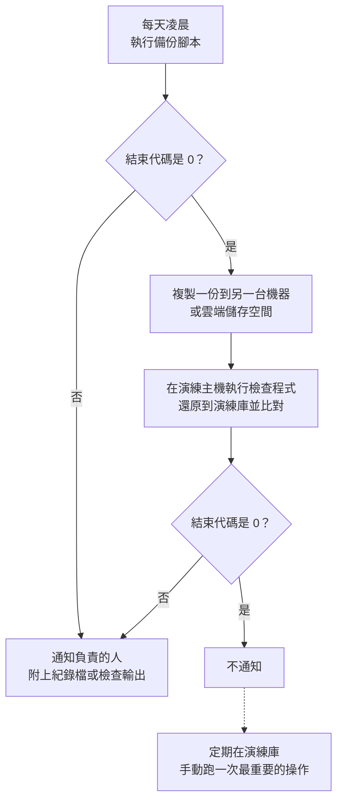

週一早上，有人在後台批次修改訂單狀態，條件下錯，一批訂單被改掉了。還好每天凌晨都有備份，備份紀錄裡每一天都寫著「備份成功」。

把昨晚的備份檔解開，準備把訂單撈回來，才發現檔案裡只有 `customers` 一張表。`orders` 不在裡面，`order_items`、`products` 也都不在。往前翻，三週來每一份備份都一樣。

這篇不談怎麼救回那批訂單（那要看有沒有開 binlog 之類的條件），談的是另一件事：**為什麼每天都「成功」的備份，其實不能用？以及怎麼每天確認它真的還原得回來。**

以下的公司、資料庫名稱、資料與時間都是虛構的示範情境；文中的指令、程式與輸出，是在 MariaDB 10.11 上實際執行的結果。

## 先看原本的備份腳本

示範情境裡的備份腳本，是很多小公司系統都看得到的寫法：

```bash
#!/bin/bash
# 原本的備份腳本（有問題的版本）
FILE=/backup/shop-$(date +%Y%m%d).sql.gz
mysqldump --defaults-extra-file=/etc/backup/db.cnf shop | gzip > "$FILE"
if [ $? -eq 0 ]; then
  echo "$(date '+%F %T') 備份成功 $FILE" >> /backup/backup.log
else
  echo "$(date '+%F %T') 備份失敗" >> /backup/backup.log
fi
```

看起來有判斷成功失敗，也有寫紀錄。實際跑一次：

```text
$ ./backup-old.sh
mysqldump: Couldn't execute 'SHOW FIELDS FROM `monthly_sales`': View 'shop.monthly_sales' references invalid table(s) or column(s) or function(s) or definer/invoker of view lack rights to use them (1356)
$ echo $?
0
$ cat /backup/backup.log
2026-11-25 09:06:17 備份成功 /backup/shop-20261125.sql.gz
```

`mysqldump` 明明報錯了，紀錄卻寫「備份成功」。這行錯誤訊息是印在畫面上（stderr）的，放進排程之後，如果沒有人收排程的錯誤輸出，它就這樣消失了。

## 坑一：管線的結束代碼，是最後一段的

`mysqldump ... | gzip > 檔案` 是一條管線（pipeline）。bash 預設把**最後一個指令**的結束代碼當成整條管線的結果。`mysqldump` 失敗了，但 `gzip` 把收到的半份資料壓好、正常結束，`$?` 就是 0。

用最小的例子就看得出來：

```text
$ false | gzip > /dev/null; echo $?
0
$ set -o pipefail
$ false | gzip > /dev/null; echo $?
1
```

`set -o pipefail` 打開之後，管線裡任何一段失敗，整條就算失敗。這是修正備份腳本的第一步。

## 坑二：一個壞掉的 view，讓備份停在一半

錯誤訊息指向 `monthly_sales` 這個 view。示範情境裡，三週前有人把 `orders.order_date` 改名成 `ordered_at`，但 `monthly_sales` 還在用舊的欄位名稱。從那天起，這個 view 一查就報錯，平常沒人用它，所以沒人發現。

`mysqldump` 照資料表名稱的字母順序處理，遇到 view 時會先讀它的欄位結構。讀到 `monthly_sales` 就失敗，沒有加 `--force` 的情況下直接停止，排在後面的表全部沒有寫進備份：

```figure caption="實際的備份內容：mysqldump 照名稱順序處理，停在壞掉的 view，後面的表都沒寫進去" width="640"
<div style="font-family:var(--sans);font-size:16px;text-align:left">
<div style="color:#5A6B75;margin-bottom:8px">shop-20261125.sql.gz 的內容（13,027 bytes；修好之後的完整備份是 111,843 bytes）</div>
<div style="display:grid;grid-template-columns:150px 1fr;gap:6px 12px;align-items:center">
<div style="font-family:var(--mono);background:#DCEAE7;border:2px solid #2F7F78;border-radius:6px;padding:6px 10px">customers</div><div style="color:#2F7F78;font-weight:700">已寫入，1,200 筆</div>
<div style="font-family:var(--mono);background:#FBEDE9;border:2px solid #B03A2E;border-radius:6px;padding:6px 10px">monthly_sales</div><div style="color:#B03A2E;font-weight:700">view 參照了不存在的欄位，讀取失敗，mysqldump 在這裡停止</div>
<div style="font-family:var(--mono);background:#F2F4F5;border:2px dashed #9AA8AF;border-radius:6px;padding:6px 10px;color:#8A979E">order_items</div><div style="color:#8A979E">沒有寫入</div>
<div style="font-family:var(--mono);background:#F2F4F5;border:2px dashed #9AA8AF;border-radius:6px;padding:6px 10px;color:#8A979E">orders</div><div style="color:#8A979E">沒有寫入</div>
<div style="font-family:var(--mono);background:#F2F4F5;border:2px dashed #9AA8AF;border-radius:6px;padding:6px 10px;color:#8A979E">products</div><div style="color:#8A979E">沒有寫入</div>
<div style="font-family:var(--mono);background:#F2F4F5;border:2px dashed #9AA8AF;border-radius:6px;padding:6px 10px;color:#8A979E">觸發程序等</div><div style="color:#8A979E">沒有寫入</div>
</div>
<div style="margin-top:10px;color:#5A6B75">檔案最後也沒有 mysqldump 正常結束時會寫的「-- Dump completed on …」</div>
</div>
```

所以真正的問題有兩層：備份腳本沒抓到錯誤，而錯誤的源頭是正式庫裡一個早就壞掉的 view。只修腳本不修 view，結果只是從「每天假成功」變成「每天真失敗」。示範情境把 view 改成用新的欄位名稱之後，`mysqldump` 才能完整跑完。

這也是改欄位之前要先列出「誰在用它」的另一個理由：受影響的不只報表和程式，還有備份。

## 坑三：預存程序和排程事件，預設不在備份裡

修好 view、用原本的腳本再備份一次，這次檔案完整了。但是接下來介紹的檢查程式還是報了一項不通過：

```text
[4] 物件比對
  ✗ 還原後缺少 PROCEDURE sp_close_month
```

`mysqldump` 預設會備份觸發程序（trigger），但**不會**備份預存程序、函式（routine）和排程事件（event）。要加上 `--routines` 和 `--events` 才會包含。如果系統的月結、對帳邏輯寫在預存程序裡，這種備份還原回去，資料都在，功能卻少了一塊。

## 修正後的備份腳本

```bash
#!/bin/bash
# 修正後的備份腳本
set -euo pipefail                       # 管線中任何一段失敗，整個腳本就算失敗

DB=shop
DIR=/backup
FILE="$DIR/$DB-$(date +%Y%m%d).sql.gz"
TMP="$FILE.tmp"
LOG="$DIR/backup.log"

if mysqldump --defaults-extra-file=/etc/backup/db.cnf \
     --single-transaction --routines --triggers --events \
     "$DB" 2>>"$LOG" | gzip > "$TMP"; then
  mv "$TMP" "$FILE"                     # 成功才換成正式檔名，失敗的半成品不會被當成備份
  echo "$(date '+%F %T') 備份成功 $FILE $(stat -c %s "$FILE") bytes" >> "$LOG"
else
  rm -f "$TMP"
  echo "$(date '+%F %T') 備份失敗，錯誤訊息見上一行" >> "$LOG"
  exit 1                                # 讓排程知道失敗，才能通知
fi
```

幾個重點：

- **`set -o pipefail`**：抓到 `mysqldump` 的失敗。
- **錯誤訊息寫進紀錄檔**：`2>>"$LOG"` 讓失敗原因和「備份失敗」那行放在一起，不會隨著排程消失。
- **先寫暫存檔，成功才改名**：失敗時不會留下一個看起來正常、其實只有一半的 `.sql.gz`。
- **`--single-transaction`**：對 InnoDB 的表，在同一個交易快照裡讀資料，備份時不鎖表，前後資料也一致。這個參數對 MyISAM 這類不支援交易的表沒有效果（依官方文件說明，本文沒有實測併發寫入的情況）。
- **結束代碼不是 0**：排程才有辦法判斷要不要通知。

在 view 還沒修好的狀態下跑新腳本，它會正確地回報失敗：

```text
$ ./backup.sh; echo $?
1
$ tail -2 /backup/backup.log
mysqldump: Couldn't execute 'SHOW FIELDS FROM `monthly_sales`': View 'shop.monthly_sales' references invalid table(s) or column(s) or function(s) or definer/invoker of view lack rights to use them (1356)
2026-11-25 09:06:18 備份失敗，錯誤訊息見上一行
```

## 光看紀錄還不夠：每天實際還原一次

腳本改好之後，備份失敗會被發現。但「`mysqldump` 結束代碼是 0」只代表它自己覺得完成了，不代表這份檔案還原得回來、還原回來的東西是完整的。示範情境裡的三個坑，有兩個（缺 view 之後的表、缺預存程序）是「真的去還原一次再比對」才看得出來的。

所以再加一支檢查程式：每天拿最新的備份檔，還原到一個獨立的演練庫，再和正式庫比對。.NET 8 主控台程式，只用內建類別，查詢透過主機上的 `mysql` 用戶端程式執行，不需要另外裝套件：

```csharp
using System.Diagnostics;
using System.IO.Compression;

// 用法：dotnet run -- <備份檔.sql.gz> <正式庫名稱> <演練庫名稱>
// 帳密放在 source.cnf（正式庫，唯讀帳號即可）與 scratch.cnf（演練用主機），不寫在命令列上
// 需要主機上有 mysql 用戶端程式；結束代碼：全部通過是 0，任何一項不通過是 1

var (file, sourceDb, scratchDb) = (args[0], args[1], args[2]);
if (scratchDb == sourceDb) { Console.WriteLine("演練庫會被整個刪掉重建，名稱不可和正式庫相同"); return 1; }
const string SourceCnf = "source.cnf", ScratchCnf = "scratch.cnf";
var failed = false;
void Pass(string msg) => Console.WriteLine($"  ✓ {msg}");
void Fail(string msg) { failed = true; Console.WriteLine($"  ✗ {msg}"); }

Console.WriteLine($"備份檔：{Path.GetFileName(file)}");

// [1] 檔案本身：存在、不是空的、是最近產生的
Console.WriteLine("[1] 檔案");
var info = new FileInfo(file);
if (!info.Exists) { Fail("找不到備份檔"); return 1; }
var age = DateTime.Now - info.LastWriteTime;
if (info.Length == 0) Fail("檔案大小是 0"); else Pass($"大小 {info.Length:N0} bytes");
if (age > TimeSpan.FromHours(26)) Fail($"{age.TotalHours:F0} 小時前產生，昨晚的備份可能沒跑");
else Pass($"{age.TotalHours:F1} 小時前產生");

// [2] 完整性：gzip 能從頭解到尾，而且最後一行是 mysqldump 的結束標記
Console.WriteLine("[2] 完整性");
string lastLine = "";
try
{
    using var reader = new StreamReader(new GZipStream(info.OpenRead(), CompressionMode.Decompress));
    while (reader.ReadLine() is { } line) if (line.Trim() != "") lastLine = line;
}
catch (Exception ex) { Fail($"解壓縮失敗：{ex.Message}"); return 1; }
if (lastLine.StartsWith("-- Dump completed")) Pass($"結尾標記：{lastLine}");
else Fail("沒有「-- Dump completed」結尾標記，mysqldump 很可能中途就停了");

// [3] 真的還原一次：建立空的演練庫，把備份檔整份灌進去
Console.WriteLine("[3] 還原");
Mysql(ScratchCnf, null, $"DROP DATABASE IF EXISTS `{scratchDb}`; CREATE DATABASE `{scratchDb}`;");
using (var gz = new GZipStream(info.OpenRead(), CompressionMode.Decompress))
{
    var (code, _, err) = Mysql(ScratchCnf, scratchDb, null, gz);
    if (code != 0) { Fail($"還原失敗：{err.Trim()}"); return 1; }
}
Pass($"已還原到 {scratchDb}");

// [4] 和正式庫比對：資料表、檢視表、預存程序、觸發程序一個都不能少
Console.WriteLine("[4] 物件比對");
const string ObjectsSql = """
    SELECT CONCAT(IF(table_type = 'VIEW', 'VIEW', 'TABLE'), ' ', table_name) FROM information_schema.tables WHERE table_schema = DATABASE()
    UNION ALL SELECT CONCAT(routine_type, ' ', routine_name) FROM information_schema.routines WHERE routine_schema = DATABASE()
    UNION ALL SELECT CONCAT('TRIGGER ', trigger_name) FROM information_schema.triggers WHERE trigger_schema = DATABASE()
    UNION ALL SELECT CONCAT('EVENT ', event_name) FROM information_schema.events WHERE event_schema = DATABASE()
    ORDER BY 1;
    """;
var srcObjects = Lines(Mysql(SourceCnf, sourceDb, ObjectsSql).Out);
var dstObjects = Lines(Mysql(ScratchCnf, scratchDb, ObjectsSql).Out).ToHashSet();
var missing = srcObjects.Where(o => !dstObjects.Contains(o)).ToList();
if (missing.Count == 0) Pass($"{srcObjects.Count} 個物件都在");
foreach (var m in missing) Fail($"還原後缺少 {m}");

// [5] 筆數比對：用 COUNT(*) 實際數，不用 information_schema 的 table_rows（InnoDB 那是估計值）
//     備份之後正式庫還會繼續寫入，所以兩邊不會完全一樣；這裡擋的是「整張表是空的」
Console.WriteLine("[5] 筆數比對（正式庫 → 還原後）");
foreach (var obj in srcObjects.Where(o => o.StartsWith("TABLE ") && dstObjects.Contains(o)))
{
    var table = obj[6..];
    var src = long.Parse(Mysql(SourceCnf, sourceDb, $"SELECT COUNT(*) FROM `{table}`;").Out.Trim());
    var dst = long.Parse(Mysql(ScratchCnf, scratchDb, $"SELECT COUNT(*) FROM `{table}`;").Out.Trim());
    var text = $"{table,-14}{src,8:N0} → {dst,8:N0}";
    if (src > 0 && dst == 0) Fail($"{text}  還原後是空的"); else Pass(text);
}

Console.WriteLine(failed ? "結果：不通過，這份備份不能拿來還原" : "結果：通過");
return failed ? 1 : 0;

static List<string> Lines(string s) => s.Split('\n', StringSplitOptions.RemoveEmptyEntries).ToList();

// 呼叫 mysql 用戶端；sql 與 input 二選一，input 用串流灌入，備份檔再大也不會整份讀進記憶體
static (int Code, string Out, string Err) Mysql(string cnf, string? db, string? sql, Stream? input = null)
{
    var psi = new ProcessStartInfo("mysql")
    {
        RedirectStandardInput = true, RedirectStandardOutput = true, RedirectStandardError = true,
    };
    psi.ArgumentList.Add($"--defaults-extra-file={cnf}");  // 必須是第一個參數
    psi.ArgumentList.Add("--batch");
    psi.ArgumentList.Add("--skip-column-names");
    if (db is not null) psi.ArgumentList.Add(db);

    using var p = Process.Start(psi)!;
    var stdout = p.StandardOutput.ReadToEndAsync();
    var stderr = p.StandardError.ReadToEndAsync();
    if (input is not null) input.CopyTo(p.StandardInput.BaseStream);
    else p.StandardInput.Write(sql);
    p.StandardInput.Close();
    p.WaitForExit();
    return (p.ExitCode, stdout.Result, stderr.Result);
}
```

拿一開始那份「備份成功」的檔案來跑：

```figure caption="實際執行結果：還原這一步「成功」了，但比對後少了 6 個物件" width="720"
<div style="font-family:var(--mono);font-size:14px;line-height:1.85;background:#1B2B3A;color:#C9D6DB;border-radius:8px;padding:18px 22px;text-align:left">
<div style="color:#8FA3AD;white-space:pre">$ dotnet run -- /backup/shop-20261125.sql.gz shop shop_check</div>
<div style="white-space:pre">備份檔：shop-20261125.sql.gz</div>
<div style="white-space:pre">[1] 檔案</div>
<div style="white-space:pre">  ✓ 大小 13,027 bytes</div>
<div style="white-space:pre">  ✓ 0.0 小時前產生</div>
<div style="white-space:pre">[2] 完整性</div>
<div style="white-space:pre;background:rgba(176,58,46,.35);border-left:3px solid #E06A5C;margin:0 -12px;padding:0 9px;color:#fff">  ✗ 沒有「-- Dump completed」結尾標記，mysqldump 很可能中途就停了</div>
<div style="white-space:pre">[3] 還原</div>
<div style="white-space:pre;background:rgba(201,134,31,.25);border-left:3px solid #C9861F;margin:0 -12px;padding:0 9px;color:#fff">  ✓ 已還原到 shop_check</div>
<div style="white-space:pre">[4] 物件比對</div>
<div style="background:rgba(176,58,46,.35);border-left:3px solid #E06A5C;margin:0 -12px;padding:0 9px;color:#fff">
<div style="white-space:pre">  ✗ 還原後缺少 PROCEDURE sp_close_month</div>
<div style="white-space:pre">  ✗ 還原後缺少 TABLE orders</div>
<div style="white-space:pre">  ✗ 還原後缺少 TABLE order_items</div>
<div style="white-space:pre">  ✗ 還原後缺少 TABLE products</div>
<div style="white-space:pre">  ✗ 還原後缺少 TRIGGER trg_stock_deduct</div>
<div style="white-space:pre">  ✗ 還原後缺少 VIEW monthly_sales</div>
</div>
<div style="white-space:pre">[5] 筆數比對（正式庫 → 還原後）</div>
<div style="white-space:pre">  ✓ customers        1,200 →    1,200</div>
<div style="white-space:pre">結果：不通過，這份備份不能拿來還原</div>
<div style="color:#8FA3AD;white-space:pre">$ echo $?</div>
<div>1</div>
</div>
```

注意第 [3] 步：**半份備份也能「還原成功」**。`mysql` 用戶端只是把檔案裡的 SQL 一句一句執行，檔案裡沒有的表，它不會知道少了。所以只做到「還原不報錯」還不夠，一定要和正式庫比對。

程式裡有幾個刻意的選擇：

- **筆數用 `COUNT(*)` 實際數。** `information_schema.tables` 的 `table_rows` 對 InnoDB 是估計值，不能拿來判斷資料有沒有少。
- **筆數只擋「整張表變空的」。** 備份之後正式庫還會繼續寫入，兩邊本來就不會一樣。要更嚴格的話，可以比對重要資料表的最新一筆時間是否接近備份時間。
- **結尾標記要配合備份參數。** `-- Dump completed` 是 `mysqldump` 預設會寫的註解；如果備份時加了 `--skip-comments` 或 `--compact`，就不會有這行，這項檢查要拿掉。
- **演練庫會被刪掉重建。** 所以程式擋掉了演練庫和正式庫同名的情況。比較好的做法是在另一台機器上還原，不要佔用正式主機的資源，也不會有刪錯庫的風險。

修好 view、改用新腳本備份之後，再跑一次（備份後正式庫又進了 3 筆訂單，所以 `orders` 兩邊差 3 筆，這是正常的）：

```text
$ dotnet run -- /backup/shop-20261125.sql.gz shop shop_check
備份檔：shop-20261125.sql.gz
[1] 檔案
  ✓ 大小 111,843 bytes
  ✓ 0.0 小時前產生
[2] 完整性
  ✓ 結尾標記：-- Dump completed on 2026-11-25  9:06:18
[3] 還原
  ✓ 已還原到 shop_check
[4] 物件比對
  ✓ 7 個物件都在
[5] 筆數比對（正式庫 → 還原後）
  ✓ customers        1,200 →    1,200
  ✓ orders           5,003 →    5,000
  ✓ order_items     12,000 →   12,000
  ✓ products           300 →      300
結果：通過
$ echo $?
0
```

## 「都在」不等於「都能用」

通過之後，在演練庫抽查了一下月結用的預存程序：

```text
$ mysql shop_check -e "CALL sp_close_month('2025-03');"
--------------
CALL sp_close_month('2025-03')
--------------

ERROR 1054 (42S22) at line 1: Unknown column 'order_date' in 'WHERE'
```

到正式庫執行，結果一樣。三週前那次欄位改名，除了 view 之外，這個預存程序也一起壞了，只是月底還沒到，沒人呼叫它。MariaDB 建立預存程序時不會檢查裡面引用的欄位存不存在，要到執行時才會報錯。

這不是備份的問題，備份忠實地把壞掉的程序也備份下來了。但它說明了這支檢查程式的範圍：**它能證明備份檔完整、物件都在、資料表不是空的；不能證明系統的每個功能都正常。**最後一哩還是要有人定期在演練庫上，把最重要的幾個操作實際跑一遍。

## 排成每天自動跑



以 Linux 的 cron 為例，大概是這樣（這兩行沒有在本文環境實際排程；crontab 裡的 `%` 要寫成 `\%`，`mail` 要換成你主機上能用的通知方式）：

```text
10 2 * * * /opt/backup/backup.sh || mail -s "備份失敗" you@example.com < /backup/backup.log
40 2 * * * cd /opt/backupcheck && dotnet BackupCheck.dll /backup/shop-$(date +\%Y\%m\%d).sql.gz shop shop_check > last.txt || mail -s "還原演練不通過" you@example.com < last.txt
```

另外兩件事一定要做，但這篇沒有展開：

- **備份要離開這台機器。** 和資料庫放在同一顆硬碟上的備份，硬碟壞掉、主機被加密勒索時會一起不見。至少複製一份到另一台機器或雲端儲存空間。
- **保留多天的備份。** 示範情境裡，問題是三週後才被發現的；如果只留最近 3 天，就算備份是好的，也找不回三週前的資料。

> 本文的兩個備份腳本、`pipefail` 的例子、C# 檢查程式（.NET SDK 8.0.134）與所有執行輸出，都在 Ubuntu 24.04、MariaDB 10.11.14 實際執行過，輸出與文中相同。示範資料庫與資料是自行建立的，正式庫與演練庫在同一台沙盒主機上。cron 排程、異地複製與 `mail` 通知沒有實際執行；MySQL 8 沒有實測，錯誤訊息的文字可能略有不同。

## 學到什麼

- 「備份成功」的紀錄，只代表腳本覺得自己成功。`mysqldump | gzip` 不加 `pipefail`，`mysqldump` 失敗也會回報成功。
- 正式庫裡一個沒人用、早就壞掉的 view，就能讓備份停在一半。備份失敗常常是別的問題的症狀。
- `mysqldump` 預設不備份預存程序、函式與排程事件，要加 `--routines` 和 `--events`。
- 半份備份也能「還原成功」。確認備份能用的唯一方法，是真的還原一次，再和正式庫比對。
- 檢查程式能證明「東西都在」，不能證明「功能都正常」，重要的操作還是要定期在演練庫上跑一次。

如果你的系統每天都有備份，但從來沒有人試著還原過，問達工作室可以幫你把備份腳本和每天的還原演練接起來，讓問題在需要還原之前就被發現。
