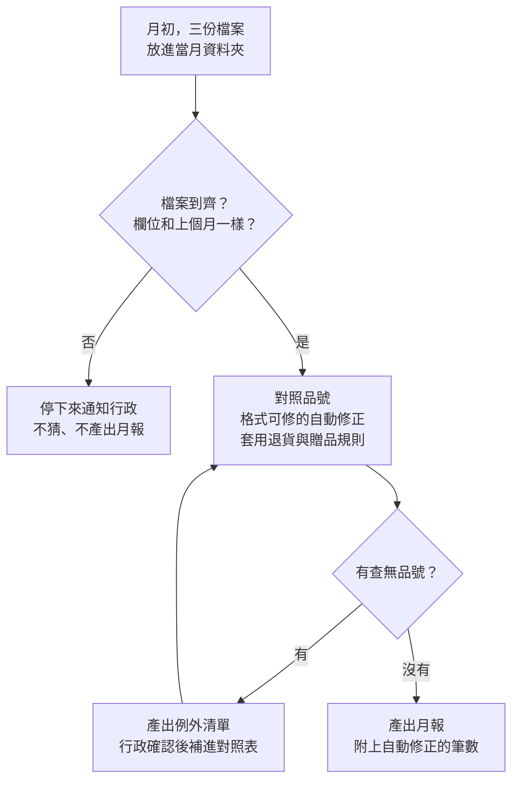

月初第三個工作天，行政又把整個下午留給月報：從門市 POS、網路商店後台各匯出一份銷售明細，再跟業務要批發單，全部貼進同一份 Excel，用品號對出商品類別，做樞紐分析，寄給老闆。每個月大約 4 小時。

老闆問：「這個寫支程式自動跑就好了吧？」

可以，但動手之前要先回答三個問題，而且最好拿過去半年的檔案實際跑一次體檢。原因很簡單：自動化省下的是「每次都一樣」的工作。如果那 4 小時大部分花在「每次都不一樣」的地方，程式寫好了也省不了多少，還可能把錯的數字算得更快。

以下的公司、檔案、品號與數字都是虛構的示範情境；文中的 C# 程式與輸出，是對自行產生的示範資料實際執行的結果。

## 問題一：這 4 小時到底花在哪？

先請做報表的人把步驟列出來，每一步大概花多久，再分成兩種：

- **機械**：每次做法都一樣，講得出規則。例如下載檔案、複製貼上、VLOOKUP。
- **判斷**：要看情況、問人、或憑經驗決定。例如這個品號是什麼商品、這筆退貨要算在哪個月。

```figure caption="示範情境的時間拆解：程式能直接接手的是藍綠色的部分，橘色的部分要先變成規則" width="720"
<div style="font-family:var(--sans);font-size:15px;text-align:left">
<div style="display:flex;gap:18px;margin-bottom:12px;color:#5A6B75">
<span><span style="display:inline-block;width:12px;height:12px;background:#2F7F78;border-radius:2px;margin-right:6px"></span>機械：規則固定，共 100 分鐘</span>
<span><span style="display:inline-block;width:12px;height:12px;background:#C9861F;border-radius:2px;margin-right:6px"></span>判斷：要看情況或問人，共 140 分鐘</span>
</div>
<div style="display:grid;grid-template-columns:270px 1fr;gap:8px 12px;align-items:center">
<div>1. 下載兩份匯出檔、跟業務要批發單</div><div style="display:flex;align-items:center;gap:8px"><div style="width:30px;height:20px;background:#2F7F78;border-radius:3px"></div>15 分</div>
<div>2. 貼進彙整用的 Excel、整理欄位</div><div style="display:flex;align-items:center;gap:8px"><div style="width:90px;height:20px;background:#2F7F78;border-radius:3px"></div>45 分</div>
<div>3. VLOOKUP 對出商品類別</div><div style="display:flex;align-items:center;gap:8px"><div style="width:40px;height:20px;background:#2F7F78;border-radius:3px"></div>20 分</div>
<div>4. 對不到的品號：一筆一筆查、問業務</div><div style="display:flex;align-items:center;gap:8px"><div style="width:120px;height:20px;background:#C9861F;border-radius:3px"></div>60 分</div>
<div>5. 退貨、贈品：要不要算、算哪個月</div><div style="display:flex;align-items:center;gap:8px"><div style="width:100px;height:20px;background:#C9861F;border-radius:3px"></div>50 分</div>
<div>6. 總額和各系統後台對不起來，找差額</div><div style="display:flex;align-items:center;gap:8px"><div style="width:60px;height:20px;background:#C9861F;border-radius:3px"></div>30 分</div>
<div>7. 樞紐分析、排版、寄出</div><div style="display:flex;align-items:center;gap:8px"><div style="width:40px;height:20px;background:#2F7F78;border-radius:3px"></div>20 分</div>
</div>
</div>
```

在這個示範情境裡，機械的部分加起來 100 分鐘，判斷的部分 140 分鐘。程式能直接接手的是前者；後者要先講清楚規則，程式才接得了。

這一步不用寫程式，卻最常被跳過。跳過的結果通常是：程式做好了，行政每個月還是花兩個多小時處理「程式算不出來的那些筆」，然後大家覺得自動化沒什麼用。

## 用一支小程式，替問題二和問題三做體檢

問題二和問題三不用憑印象回答，直接查過去的檔案。請行政把過去六個月的匯出檔照月份放好，品號對照表就是她平常 VLOOKUP 用的那張：

```text
data/
├── 品號對照表.csv
├── 2026-05/   門市POS.csv  網路商店.csv  批發單.csv
├── 2026-06/   …
└── 2026-10/   …
```

然後跑這支體檢程式。它只讀不寫，做兩件事：逐月比對每個來源的欄位有沒有變，再把每一筆的品號拿去對照表對一次，統計有多少筆是程式沒辦法自己決定的。

```csharp
using System.Globalization;

// 用法：dotnet run -- <資料夾> <品號對照表.csv>
// 資料夾底下每個月一個子資料夾（例如 2026-05），裡面放各來源匯出的 CSV
// 這支程式只讀不寫，不會改動任何檔案

var (root, mapFile) = (args[0], args[1]);

// 程式需要的欄位。同一個欄位在不同月份可能被改名，確認是同一件事之後再把新名字補進來
var required = new Dictionary<string, string[]>
{
    ["品號"] = ["品號", "商品編號"],
    ["數量"] = ["數量"],
    ["單價"] = ["單價"],
};

// 品號 → 類別。另外準備一份「正規化」後的對照：去掉空白和連字號、轉成大寫
var map = ReadCsv(mapFile).Rows.ToDictionary(r => r[0], r => r[1]);
var mapNorm = map.Keys.ToDictionary(Norm, k => k);

var months = Directory.GetDirectories(root).Order().ToList();
var sources = months.SelectMany(m => Directory.GetFiles(m, "*.csv"))
    .Select(Path.GetFileNameWithoutExtension).Distinct().Order().ToList();

// ---------- 問題二：資料來源每個月長得一樣嗎？ ----------
Console.WriteLine("== 問題二：資料來源每個月長得一樣嗎？ ==");
foreach (var src in sources)
{
    Console.WriteLine($"[{src}]");
    string[]? prev = null;
    foreach (var m in months)
    {
        var path = Path.Combine(m, src + ".csv");
        var month = Path.GetFileName(m);
        if (!File.Exists(path)) { Console.WriteLine($"  {month}  ✗ 這個月沒有檔案"); continue; }

        var header = ReadCsv(path).Header;
        var notes = new List<string>();
        if (prev is not null)
        {
            var added = header.Except(prev).ToList();
            var removed = prev.Except(header).ToList();
            if (added.Count > 0) notes.Add("新增 " + string.Join("、", added));
            if (removed.Count > 0) notes.Add("少了 " + string.Join("、", removed));
            if (added.Count == 0 && removed.Count == 0 && !header.SequenceEqual(prev)) notes.Add("欄位順序改變");
        }
        var missing = required.Where(f => !f.Value.Any(header.Contains)).Select(f => f.Key).ToList();
        if (missing.Count > 0) notes.Add("缺少必要欄位 " + string.Join("、", missing));

        var text = prev is null ? string.Join(",", header) : notes.Count == 0 ? "與上一份相同" : string.Join("；", notes);
        Console.WriteLine($"  {month}  {(notes.Count == 0 ? "✓" : "!")} {text}");
        prev = header;
    }
}

// ---------- 問題三：有多少筆要人判斷？ ----------
Console.WriteLine();
Console.WriteLine("== 問題三：有多少筆要人判斷？ ==");
Console.WriteLine("月份      筆數 │ 品號：對得上 格式可修 查無 │ 其中：退貨 贈品");
var unknown = new SortedDictionary<string, List<string>>();   // 查無的品號 → 出現在哪些月份、來源
var (sumReturn, sumGift, sumFix, sumUnknown) = (0, 0, 0, 0);
foreach (var m in months)
{
    var month = Path.GetFileName(m);
    int total = 0, exact = 0, fixable = 0, notFound = 0, returns = 0, gifts = 0;
    foreach (var path in Directory.GetFiles(m, "*.csv").Order())
    {
        var csv = ReadCsv(path);
        // 用欄位名稱找位置，不用「第幾欄」：欄位順序被改過也不會讀錯
        int Col(string field) => Array.FindIndex(csv.Header, h => required[field].Contains(h));
        var (iCode, iQty, iPrice) = (Col("品號"), Col("數量"), Col("單價"));
        if (iCode < 0 || iQty < 0 || iPrice < 0) continue;   // 缺欄位的檔案，問題二已經列出來了

        foreach (var r in csv.Rows)
        {
            total++;
            var code = r[iCode];
            if (map.ContainsKey(code)) exact++;
            else if (mapNorm.ContainsKey(Norm(code))) fixable++;
            else
            {
                notFound++;
                var where = $"{month} {Path.GetFileNameWithoutExtension(path)}";
                if (!unknown.TryGetValue(code, out var list)) unknown[code] = list = [];
                list.Add(where);
            }
            if (decimal.Parse(r[iQty], CultureInfo.InvariantCulture) < 0) returns++;
            else if (decimal.Parse(r[iPrice], CultureInfo.InvariantCulture) == 0) gifts++;
        }
    }
    Console.WriteLine($"{month}  {total,5} │       {exact,5}    {fixable,5} {notFound,4} │       {returns,4} {gifts,4}");
    (sumReturn, sumGift, sumFix, sumUnknown) = (sumReturn + returns, sumGift + gifts, sumFix + fixable, sumUnknown + notFound);
}

Console.WriteLine();
Console.WriteLine("查無的品號：");
foreach (var (code, list) in unknown)
{
    var places = list.GroupBy(w => w).Select(g => $"{g.Key} {g.Count()} 筆");
    Console.WriteLine($"  {code,-8} {string.Join("、", places)}");
}

// 程式能做的是「照規則做」；規則本身要由人決定，這裡把要決定的事列出來
Console.WriteLine();
Console.WriteLine("要先請負責人決定的規則：");
Console.WriteLine($"  1. 退貨（{sumReturn} 筆）：算在退貨當月，還是沖回原本賣出的月份？");
Console.WriteLine($"  2. 贈品（{sumGift} 筆）：數量要不要算進銷售量？");
Console.WriteLine($"  3. 格式可修（{sumFix} 筆）：可以直接自動修正嗎？要不要通知打單的人？");
Console.WriteLine($"  4. 查無品號（{sumUnknown} 筆）：對照表由誰維護？新品上架時誰負責補？");

// 去掉空白、連字號並轉大寫，讓「cb-003」「CB003」「CB-003 」都對到 CB-003
static string Norm(string s) => s.Replace(" ", "").Replace("-", "").ToUpperInvariant();

// 示範資料沒有含逗號或引號的欄位，所以直接用 Split；實際檔案請改用 CSV 套件（例如 CsvHelper）
static (string[] Header, List<string[]> Rows) ReadCsv(string path)
{
    var lines = File.ReadAllLines(path).Where(l => l.Trim() != "").ToList();
    return (lines[0].Split(','), lines.Skip(1).Select(l => l.Split(',')).ToList());
}
```

幾個刻意的設計：

- **用欄位名稱找位置，不用「第幾欄」。** 原本的 Excel 巨集或公式如果寫死「第 3 欄是品號」，欄位順序一換就會讀錯，而且不會報錯。
- **必要欄位可以有別名。** 但別名是確認過「真的是同一件事」才加進去的，不是程式自己猜。
- **品號先比完全相同，再比正規化後相同。** 兩者分開統計，才知道有多少筆是「打法不一致」、有多少筆是「真的不認識」。

## 問題二：資料來源每個月長得一樣嗎？

手動整理時，人會自動適應：欄位改名了、多一欄、順序換了，看一眼就知道。程式不會。體檢結果的前半段：

```text
$ dotnet run -- data data/品號對照表.csv
== 問題二：資料來源每個月長得一樣嗎？ ==
[批發單]
  2026-05  ✓ 日期,客戶,品號,數量,單價
  2026-06  ✗ 這個月沒有檔案
  2026-07  ! 欄位順序改變
  2026-08  ✓ 與上一份相同
  2026-09  ✓ 與上一份相同
  2026-10  ✓ 與上一份相同
[網路商店]
  2026-05  ✓ 訂單編號,下單時間,品號,數量,單價,小計
  2026-06  ✓ 與上一份相同
  2026-07  ✓ 與上一份相同
  2026-08  ✓ 與上一份相同
  2026-09  ! 新增 優惠碼
  2026-10  ✓ 與上一份相同
[門市POS]
  2026-05  ✓ 日期,品號,品名,數量,單價,金額
  2026-06  ✓ 與上一份相同
  2026-07  ✓ 與上一份相同
  2026-08  ! 新增 商品編號、折扣；少了 品號
  2026-09  ✓ 與上一份相同
  2026-10  ✓ 與上一份相同
```

六個月裡，三個來源有四件事是行政自己默默處理掉的：

- **批發單 6 月沒有檔案。** 問了才知道那個月業務忘了交，行政是看紙本補的。程式要知道「少一份」時該停下來，而不是當作批發是 0。
- **批發單 7 月起欄位順序改了。** 業務換了一份自己的 Excel 範本，品號移到客戶前面。
- **網路商店 9 月多了「優惠碼」。** 後台開了優惠碼功能，匯出檔就多一欄。
- **門市 POS 8 月改版，「品號」改名「商品編號」，還多了「折扣」。**

最後這一項最危險。上面的程式已經把「商品編號」列為「品號」的別名；如果拿掉這個別名再跑一次，問題三的筆數是這樣（節錄）：

```text
2026-07    488 │         486        2    0 │          5    6
2026-08    182 │         179        3    0 │          0    0
2026-09    195 │         188        6    1 │          4    0
```

8 月起門市的資料整份被跳過：8 月只剩 182 筆，有別名時是 501 筆。這支體檢程式會在問題二標出「缺少必要欄位 品號」，但一支沒有做這種檢查的自動化程式，很可能就安靜地產出一份少了門市業績的月報。

所以問題二的答案決定了自動化要做到多保守：**格式會變的來源，程式遇到變動就要停下來通知人，不要猜。**另外也值得跟提供檔案的人約定：改範本、改系統之前先講一聲。

（同一類的問題還有編碼、日期格式、前導零，在〈[分店寄來的 CSV 一匯入就出事](https://hn83320589.github.io/wenda-studio/blog/csv-import-encoding-date/)〉那篇談過，這裡不重複。）

## 問題三：例外有多少、由誰決定？

體檢結果的後半段：

```figure caption="實際執行結果的後半段：例外的筆數不多，但每一類都需要有人先定規則" width="760"
<div style="font-family:var(--mono);font-size:14px;line-height:1.85;background:#1B2B3A;color:#C9D6DB;border-radius:8px;padding:18px 22px;text-align:left">
<div style="white-space:pre">== 問題三：有多少筆要人判斷？ ==</div>
<div style="white-space:pre">月份      筆數 │ 品號：對得上 格式可修 查無 │ 其中：退貨 贈品</div>
<div style="white-space:pre">2026-05    489 │         485        4    0 │          2    3</div>
<div style="white-space:pre">2026-06    459 │         459        0    0 │         10    6</div>
<div style="white-space:pre">2026-07    488 │         486        2    0 │          5    6</div>
<div style="white-space:pre">2026-08    501 │         498        3    0 │          6    4</div>
<div style="white-space:pre">2026-09    509 │         502        6    1 │          7   12</div>
<div style="white-space:pre;background:rgba(176,58,46,.35);border-left:3px solid #E06A5C;margin:0 -12px;padding:0 9px;color:#fff">2026-10    488 │         466        4   18 │          6    5</div>
<div style="white-space:pre"> </div>
<div style="white-space:pre">查無的品號：</div>
<div style="background:rgba(176,58,46,.35);border-left:3px solid #E06A5C;margin:0 -12px;padding:0 9px;color:#fff">
<div style="white-space:pre">  CB-013   2026-10 網路商店 1 筆、2026-10 門市POS 8 筆</div>
<div style="white-space:pre">  CB-014   2026-10 批發單 1 筆、2026-10 門市POS 8 筆</div>
</div>
<div style="white-space:pre;background:rgba(201,134,31,.25);border-left:3px solid #C9861F;margin:0 -12px;padding:0 9px;color:#fff">  CB-0O5   2026-09 批發單 1 筆</div>
<div style="white-space:pre"> </div>
<div style="white-space:pre">要先請負責人決定的規則：</div>
<div style="white-space:pre">  1. 退貨（36 筆）：算在退貨當月，還是沖回原本賣出的月份？</div>
<div style="white-space:pre">  2. 贈品（36 筆）：數量要不要算進銷售量？</div>
<div style="white-space:pre">  3. 格式可修（19 筆）：可以直接自動修正嗎？要不要通知打單的人？</div>
<div style="white-space:pre">  4. 查無品號（19 筆）：對照表由誰維護？新品上架時誰負責補？</div>
</div>
```

每個月近 500 筆裡，這四類加起來最多三十幾筆，不到一成。但對照問題一，這三十幾筆正是那 140 分鐘的來源：每一筆都要有人想一下、查一下、問一下。

逐類來看：

- **退貨、贈品**：這是會計或老闆要決定的事，不是技術問題。規則一旦定下來（例如「退貨算在退貨當月」「贈品數量另列、不算銷售量」），就從判斷變成機械，程式照做就好。示範情境裡，問題一第 6 步「總額和後台對不起來」，有一部分就是因為退貨的算法和後台不同；規則定了，差額也比較好解釋。
- **格式可修**：`cb-003`、`CB003`、`CB-003 ` 這類，程式可以自動對回 `CB-003`。要決定的是「修了要不要讓打單的人知道」，否則每個月都會有。
- **查無品號**：`CB-013`、`CB-014` 是 10 月上架的新品，對照表沒人補，所以 10 月一口氣多了 18 筆。這是流程問題：**對照表由誰維護？**這件事沒有答案，程式每個月都會卡在同一個地方。
- **`CB-0O5`**：數字 0 打成英文字母 O。這種只能人看，程式能做的是把它列出來，不要猜。

## 體檢之後：自動化要做成什麼樣子

三個問題回答完，這個示範情境的自動化範圍就很清楚了：機械的部分交給程式；判斷的部分先定規則，定不了的留給人，但程式要把它們整理成一份清單，而不是讓人從 Excel 裡一筆一筆找。



不同的體檢結果，建議也不同：

| 體檢結果 | 建議 |
| --- | --- |
| 大部分是機械、格式穩定、例外少 | 直接自動化，例外清單交給人看 |
| 格式常變 | 先和提供檔案的人約定格式；程式遇到變動就停下來通知 |
| 例外多，而且沒有規則 | 先把規則定下來，再談自動化 |
| 判斷佔了大部分，規則也講不清楚 | 暫時只自動化下載、彙整這一段，其餘維持人工 |

這張表也說明了為什麼不該一開始就承諾「自動化之後只要幾分鐘」：省下多少時間，取決於規則定得多清楚、例外有多少，而這兩件事在體檢之前都不知道。

> 本文的 C# 體檢程式（.NET SDK 8.0.134，Ubuntu 24.04）與兩段執行輸出都實際執行過，輸出與文中相同；示範資料是另外寫程式產生的，不是真實的銷售資料。問題一的時間拆解是示範情境的假設數字，不是量測結果。文中的流程圖是設計示意，沒有實作成完整的自動化程式。

## 學到什麼

- 自動化省下的是「每次都一樣」的工作。先把時間拆成機械和判斷，才知道程式能接手多少。
- 資料來源的格式會變，而且通常沒人通知。拿過去半年的檔案跑一次，就能看到欄位改名、順序改變、漏交的月份。
- 讀檔案要用欄位名稱找位置；遇到看不懂的格式就停下來，不要猜。安靜地產出一份少了資料的報表，比直接失敗更糟。
- 例外的筆數通常不多，卻佔掉最多時間。退貨、贈品要先請負責人定規則；對照表要有人負責維護。
- 程式定不了的事，就把它整理成清單交給人，而不是假裝全部自動化了。

如果你也有每個月固定要花半天整理的報表，問達工作室可以先拿你過去幾個月的檔案做一次這樣的體檢，再一起決定哪些值得交給程式。
