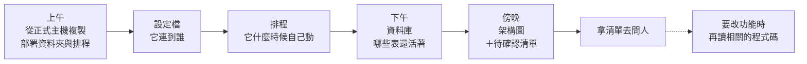
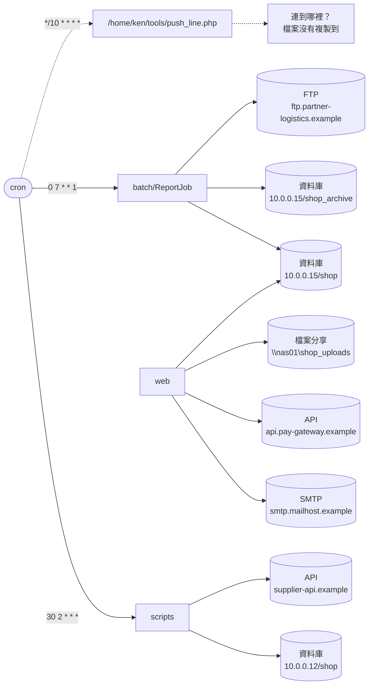

一家做訂製家具的小公司，官網接單、後台出貨，系統是幾年前請外包工程師做的。合約結束後，那位工程師就聯絡不上了。

新接手的工程師拿到三樣東西：正式主機的 SSH 帳號、資料庫帳號，和一份只有網站程式的 repo。沒有文件，程式裡幾乎沒有註解。

老闆的問題很實際：「下個月想把優惠券功能打開，順便改 LINE 出貨通知的文字。會動到哪些地方？先跟我說這套系統到底有哪些東西。」

以下的公司、主機、帳號、網址與時間都是虛構的示範情境；程式與 SQL 是在示範資料上實際執行的。

## 先別打開程式碼

直覺的做法是 clone 下來，從 `Program.cs` 或 `index.php` 一路往下讀。問題是程式碼回答的是「怎麼做」，而接手第一天要回答的是另外四件事：

- 系統由哪幾塊組成？
- 每一塊**連到誰**（資料庫、外部 API、檔案主機）？
- 什麼東西會在沒人操作的時候**自己動**？
- 資料庫裡哪些表**還活著**，彼此怎麼關聯？

這四件事都會在正式主機上留下痕跡：設定檔、排程、資料庫。讀它們比讀程式碼快得多，而且讀到的是「正式環境實際在跑的樣子」，不是 repo 裡某個版本的樣子。

這次的示範就是一個很典型的例子：repo 裡只有網站，但正式主機上還有一支每週跑的報表程式、兩支腳本，它們從來沒進過版控。



## 上午：把正式主機上的東西複製下來

原則只有一個：**正式主機只讀不改**。所有分析都在複製出來的資料夾上做。

要複製的是部署資料夾（不含 log 和使用者上傳的檔案），以及排程的設定。以 Linux 主機為例，大致是這幾個指令（示範情境沒有真的主機，**以下指令沒有實際執行**）：

```bash
# 未實際執行：在自己的電腦上，從正式主機拉一份下來
rsync -av --exclude='*.log' --exclude='uploads/' deploy@正式主機:/opt/shop/ ./legacy/
ssh deploy@正式主機 'crontab -l' > ./legacy/cron/crontab.txt
# crontab -l 只會列出目前這個帳號的排程，root 和其他帳號也要看
ssh deploy@正式主機 'sudo crontab -l -u root; ls /etc/cron.d; systemctl list-timers --all'
```

Windows 主機的排程在「工作排程器」，可以用 `schtasks /query /fo csv /v` 匯出成 CSV；用 SQL Server 的話，SQL Server Agent 的作業也是排程，存在 `msdb` 資料庫裡。（這兩項也沒有實際執行。）

複製下來的設定檔裡有資料庫密碼。這份資料夾要和正式環境一樣小心保管，不要放進 repo、不要貼到聊天群組或 AI 工具裡。

示範情境複製下來的資料夾長這樣：

```text
$ find legacy -type f | sort
legacy/batch/ReportJob/ReportJob.exe
legacy/batch/ReportJob/ReportJob.exe.config
legacy/cron/crontab.txt
legacy/scripts/.env
legacy/scripts/cleanup_orders.sh
legacy/scripts/import_stock.php
legacy/scripts/sync_stock.sh
legacy/web/appsettings.Production.json
legacy/web/appsettings.json
```

三種設定檔格式：網站是 ASP.NET Core 的 `appsettings.json`，報表程式是 .NET Framework 的 `.exe.config`，腳本用 `.env`。一套系統用了三種寫法，通常代表它是不同時期、可能不同人一塊一塊加上去的。

## 設定檔與排程：它連到誰、什麼時候自己動

檔案不多的時候，一個一個打開看也可以。但設定檔一多，很容易漏看，也很難比對「這個檔案說資料庫在 A，那個檔案說在 B」。所以寫一支小程式來做這件事。

這支 .NET 8 主控台程式會：

- 讀 `.json`、`.config`、`.env`，找出連線字串、網址、網路磁碟路徑和 SMTP 主機，**不輸出密碼**。
- 知道 `appsettings.Production.json` 會覆寫 `appsettings.json` 的同名設定，只留下實際生效的那一個，並把被覆寫的記進待確認。
- 讀 crontab，找出每個排程執行的程式，檢查它在不在部署路徑底下、有沒有被註解掉。
- 最後輸出一份 Mermaid 架構圖。

它只認得示範情境用到的格式，判斷規則也很粗略（例如用 `Server=` 判斷是不是連線字串）。拿到你的系統上用，要依實際的設定檔格式調整。

```csharp
using System.Text;
using System.Text.Json;
using System.Text.RegularExpressions;
using System.Xml.Linq;

// 用法：dotnet run -- <資料夾> <正式主機上的部署路徑>
// 例如：dotnet run -- ./legacy /opt/shop
if (args.Length < 2) { Console.WriteLine("用法：SystemMap <資料夾> <部署路徑>"); return; }
var root = Path.GetFullPath(args[0]);
var deployRoot = args[1].TrimEnd('/');

var found = new List<Link>();     // 設定檔裡找到的「連到誰」
var jobs = new List<Job>();       // 排程
var notes = new List<string>();   // 待確認

foreach (var file in Directory.EnumerateFiles(root, "*", SearchOption.AllDirectories).Order())
{
    var rel = Path.GetRelativePath(root, file).Replace('\\', '/');
    var name = Path.GetFileName(file);
    var comp = Path.GetDirectoryName(rel)!.Replace('\\', '/');   // 設定檔所在的資料夾，當成一個元件

    if (name.EndsWith(".json"))
    {
        using var doc = JsonDocument.Parse(File.ReadAllText(file));
        Walk(doc.RootElement, "", (key, value) => Classify(comp, rel, key, value));
    }
    else if (name.EndsWith(".config"))
    {
        var x = XDocument.Load(file);
        foreach (var a in x.Descendants("connectionStrings").Elements("add"))
            Classify(comp, rel, (string)a.Attribute("name")!, (string)a.Attribute("connectionString")!);
        foreach (var a in x.Descendants("appSettings").Elements("add"))
            Classify(comp, rel, (string)a.Attribute("key")!, (string)a.Attribute("value")!);
    }
    else if (name == ".env")
    {
        var env = File.ReadLines(file).Where(l => l.Contains('=') && !l.StartsWith('#'))
            .Select(l => l.Split('=', 2)).ToDictionary(p => p[0].Trim(), p => p[1].Trim());
        if (env.TryGetValue("DB_HOST", out var h))
            found.Add(new(comp, rel, "DB_HOST", "資料庫", $"{h}/{env.GetValueOrDefault("DB_NAME", "?")}"));
        foreach (var (k, v) in env.Where(e => !e.Key.StartsWith("DB_"))) Classify(comp, rel, k, v);
    }
    else if (name.StartsWith("crontab"))
    {
        foreach (var line in File.ReadLines(file))
        {
            if (Regex.IsMatch(line, "^MAILTO=\"?\"?$"))
                notes.Add($"{rel}：MAILTO 是空的，排程失敗不會寄信給任何人");
            var m = Regex.Match(line, @"^(#\s*)?((?:\S+\s+){4}\S+)\s+(.+)$");
            if (!m.Success || !Regex.IsMatch(m.Groups[2].Value, @"^[\d*/,\-]")) continue;
            var cmd = m.Groups[3].Value;
            var target = Regex.Match(cmd, @"\S+\.(exe|php|sh|py|dll)\b").Value;
            if (!target.Contains('/'))   // 例如「cd /opt/shop/x && mono X.exe」
                target = Regex.Match(cmd, @"cd\s+(\S+)").Groups[1].Value.TrimEnd('/') + "/" + target;
            var inDeploy = target.StartsWith(deployRoot + "/");
            var local = Path.Combine(root, target.Replace(deployRoot + "/", ""));
            jobs.Add(new(m.Groups[2].Value, target, inDeploy ? Path.GetDirectoryName(Path.GetRelativePath(root, local))! : "",
                m.Groups[1].Success, inDeploy, inDeploy && File.Exists(local)));
        }
    }
}

// .NET 的 appsettings.{環境}.json 會覆寫 appsettings.json 的同名設定
foreach (var o in found.Where(f => Regex.IsMatch(f.File, @"appsettings\.\w+\.json$")).ToList())
    foreach (var b in found.Where(f => f.Comp == o.Comp && f.Key == o.Key && f.File.EndsWith("/appsettings.json")).ToList())
    {
        found.Remove(b);
        notes.Add($"{b.File} 的 {b.Key} 指向 {b.Target}，但被 {Path.GetFileName(o.File)} 覆寫成 {o.Target}");
    }

// 同一個資料庫名稱，出現在不同主機
foreach (var g in found.Where(f => f.Kind == "資料庫").GroupBy(f => f.Target.Split('/')[1]))
    if (g.Select(f => f.Target).Distinct().Count() > 1)
        notes.Add($"資料庫 {g.Key} 出現在不同主機：" + string.Join("、",
            g.GroupBy(f => f.Target.Split('/')[0]).Select(h => $"{h.Key}（{string.Join("、", h.Select(f => f.Comp))}）")));

foreach (var j in jobs)
{
    var name = Path.GetFileName(j.Program);
    if (j.Disabled) notes.Add($"排程 {name} 被註解掉了：是停用，還是暫停後忘了打開？");
    else if (!j.InDeploy) notes.Add($"排程 {name} 放在 {Path.GetDirectoryName(j.Program)}，不在 {deployRoot} 底下");
    else if (!j.Exists) notes.Add($"排程 {name} 在資料夾裡找不到");
}

Console.WriteLine("== 設定檔：這些元件連到哪裡（密碼不輸出） ==");
foreach (var f in found) Console.WriteLine($"{Pad(f.Comp, 16)}{Pad(f.Kind, 9)}{Pad(f.Target, 32)}← {Path.GetFileName(f.File)} {f.Key}");
Console.WriteLine("\n== 排程 ==");
foreach (var j in jobs)
    Console.WriteLine($"{Pad(j.Schedule, 14)}{Pad(j.Disabled ? "已註解" : "啟用", 8)}{j.Program}");
Console.WriteLine("\n== 待確認 ==");
for (int i = 0; i < notes.Count; i++) Console.WriteLine($"{i + 1}. {notes[i]}");

// 輸出 Mermaid：推得出來的畫實線，有疑問的畫虛線
var sb = new StringBuilder("flowchart LR\n");
var ids = new Dictionary<string, string>();
string Id(string s) => ids.TryGetValue(s, out var v) ? v : ids[s] = $"n{ids.Count + 1}";
string L(string s) => s.Replace("\\", "\\\u200B");   // 反斜線後面補一個零寬空白，免得 \n 被 Mermaid 當成換行
foreach (var f in found)
    sb.AppendLine($"    {Id(f.Comp)}[\"{L(f.Comp)}\"] --> {Id(f.Target)}[(\"{f.Kind}<br/>{L(f.Target)}\")]");
foreach (var j in jobs.Where(j => !j.Disabled))   // 排程放最後畫，版面比較不會交錯
{
    var to = j.Exists ? j.Comp : j.Program;
    sb.AppendLine($"    cron([\"cron\"]) {(j.Exists ? "-->" : "-.->")}|\"{j.Schedule}\"| {Id(to)}[\"{L(to)}\"]");
    if (!j.InDeploy) sb.AppendLine($"    {Id(to)} -.-> {Id(to + "?")}[\"連到哪裡？<br/>檔案沒有複製到\"]");
}
File.WriteAllText(Path.Combine(root, "..", "system-map.mmd"), sb.ToString());
Console.WriteLine("\n已輸出 system-map.mmd");

// ---- 以下是輔助函式 ----
// 中文字在終端機佔兩格，用顯示寬度補空白才對得齊
string Pad(string s, int width) => s + new string(' ', Math.Max(1, width - s.Sum(c => c >= 0x2E80 ? 2 : 1)));

void Walk(JsonElement e, string path, Action<string, string> onString)
{
    if (e.ValueKind == JsonValueKind.Object)
        foreach (var p in e.EnumerateObject()) Walk(p.Value, path == "" ? p.Name : $"{path}:{p.Name}", onString);
    else if (e.ValueKind == JsonValueKind.String) onString(path, e.GetString()!);
}

void Classify(string comp, string file, string key, string value)
{
    if (Regex.IsMatch(value, @"(Server|Host|Data Source)=", RegexOptions.IgnoreCase))
    {
        var kv = value.Split(';', StringSplitOptions.RemoveEmptyEntries).Select(p => p.Split('=', 2))
            .Where(p => p.Length == 2).ToDictionary(p => p[0].Trim().ToLower(), p => p[1].Trim());
        var host = kv.GetValueOrDefault("server") ?? kv.GetValueOrDefault("host") ?? kv.GetValueOrDefault("data source");
        found.Add(new(comp, file, key, "資料庫", $"{host}/{kv.GetValueOrDefault("database", "?")}"));
    }
    else if (Uri.TryCreate(value, UriKind.Absolute, out var u) && u.Scheme is "http" or "https" or "ftp")
    {
        if (key.EndsWith("NotifyUrl")) return;   // 別人呼叫我們的網址，不是我們連出去
        found.Add(new(comp, file, key, u.Scheme == "ftp" ? "FTP" : "API", u.Host));
    }
    else if (value.StartsWith(@"\\"))
        found.Add(new(comp, file, key, "檔案分享", value.TrimEnd('\\')));
    else if (key.EndsWith("Smtp:Host"))
        found.Add(new(comp, file, key, "SMTP", value));
}

record Link(string Comp, string File, string Key, string Kind, string Target);
record Job(string Schedule, string Program, string Comp, bool Disabled, bool InDeploy, bool Exists);
```

在示範資料夾上執行（.NET SDK 8.0.134，Ubuntu 24.04）：

```text
$ dotnet run --project SystemMap -- legacy /opt/shop
== 設定檔：這些元件連到哪裡（密碼不輸出） ==
batch/ReportJob 資料庫   10.0.0.15/shop                  ← ReportJob.exe.config Shop
batch/ReportJob 資料庫   10.0.0.15/shop_archive          ← ReportJob.exe.config Archive
batch/ReportJob FTP      ftp.partner-logistics.example   ← ReportJob.exe.config UploadTarget
scripts         資料庫   10.0.0.12/shop                  ← .env DB_HOST
scripts         API      supplier-api.example            ← .env SUPPLIER_API
web             SMTP     smtp.mailhost.example           ← appsettings.json Smtp:Host
web             API      api.pay-gateway.example         ← appsettings.json Payment:ApiBase
web             檔案分享 \\nas01\shop_uploads            ← appsettings.json Upload:Root
web             資料庫   10.0.0.15/shop                  ← appsettings.Production.json ConnectionStrings:Default

== 排程 ==
30 2 * * *    啟用    /opt/shop/scripts/sync_stock.sh
0 7 * * 1     啟用    /opt/shop/batch/ReportJob/ReportJob.exe
*/10 * * * *  啟用    /home/ken/tools/push_line.php
0 3 * * *     已註解  /opt/shop/scripts/cleanup_orders.sh

== 待確認 ==
1. cron/crontab.txt：MAILTO 是空的，排程失敗不會寄信給任何人
2. web/appsettings.json 的 ConnectionStrings:Default 指向 10.0.0.12/shop，但被 appsettings.Production.json 覆寫成 10.0.0.15/shop
3. 資料庫 shop 出現在不同主機：10.0.0.15（batch/ReportJob、web）、10.0.0.12（scripts）
4. 排程 push_line.php 放在 /home/ken/tools，不在 /opt/shop 底下
5. 排程 cleanup_orders.sh 被註解掉了：是停用，還是暫停後忘了打開？

已輸出 system-map.mmd
```

輸出最有用的是最後的「待確認」。逐條看：

**第 2、3 條：資料庫在哪一台？**網站的 `appsettings.json` 寫的是 `10.0.0.12`，但正式環境的 `appsettings.Production.json` 把它覆寫成 `10.0.0.15`。報表程式也連 `10.0.0.15`。只有 `scripts/.env` 還寫著 `10.0.0.12`。

最可能的解釋是：系統搬過一次資料庫主機，網站和報表程式改了，腳本沒改。但這只是推測，現在還不知道 `10.0.0.12` 是否還開著。下午查資料庫時，會再找到一個線索。

另外要注意：ASP.NET Core 實際使用哪一份設定，取決於主機上的 `ASPNETCORE_ENVIRONMENT`（沒設定時預設是 Production）；而環境變數本身也能覆寫設定檔，例如 `ConnectionStrings__Default`。這支程式只讀檔案，主機上的環境變數、systemd 或 IIS 的設定要另外看。

**第 4 條：排程跑的程式放在個人目錄。**每 10 分鐘執行一次的 `push_line.php` 放在 `/home/ken/tools`，不在 `/opt/shop` 底下，所以 rsync 也不會複製到它。從檔名和頻率看，它很可能就是老闆想改文字的 LINE 出貨通知。

如果哪天有人整理主機、把前任工程師的帳號連同家目錄刪掉，這個通知就會停。在確認之前，那個帳號先不要刪。

**第 1 條：`MAILTO=""`。**cron 預設會把排程產生的輸出（包含錯誤訊息）寄給該帳號，前提是主機能寄信；設成空字串就是不寄。也就是說，上面任何一個排程失敗，都不會有人知道。

**第 5 條：被註解掉的排程。**`cleanup_orders.sh` 看名字是清理訂單。被註解掉，可能是刻意停用，也可能是某次出問題時暫停，之後忘了打開。這要問人，不能猜。

## 下午：資料庫裡哪些表還活著、誰跟誰有關

設定檔告訴我們系統連到 `10.0.0.15` 的 `shop`。接下來看裡面有什麼。

### 哪些表還活著

資料表的名稱看不出它還有沒有在用。比較可靠的方法是看兩件事：有幾筆資料，最新一筆是什麼時候。

一張一張查太慢，可以讓 MariaDB／MySQL 從 `information_schema` 產生查詢：每張表、每個日期欄位各產生一段 `COUNT(*)` 和 `MAX()`，用 `UNION ALL` 接起來。

```sql
SET SESSION group_concat_max_len = 1000000;
SELECT CONCAT(GROUP_CONCAT(
  CONCAT('SELECT ''', t.TABLE_NAME, ''' AS table_name, ',
         IFNULL(CONCAT('''', c.COLUMN_NAME, ''''), 'NULL'), ' AS date_column, ',
         'COUNT(*) AS row_count, ',
         IFNULL(CONCAT('MAX(`', c.COLUMN_NAME, '`)'), 'NULL'), ' AS latest ',
         'FROM `', t.TABLE_NAME, '`')
  ORDER BY t.TABLE_NAME, c.COLUMN_NAME SEPARATOR '\nUNION ALL '), ';')
FROM information_schema.TABLES t
LEFT JOIN information_schema.COLUMNS c
  ON c.TABLE_SCHEMA = t.TABLE_SCHEMA AND c.TABLE_NAME = t.TABLE_NAME
 AND c.DATA_TYPE IN ('date', 'datetime', 'timestamp')
WHERE t.TABLE_SCHEMA = 'shop' AND t.TABLE_TYPE = 'BASE TABLE';
```

先產生查詢，再執行它（MariaDB 10.11.14）：

```text
$ mariadb -N -r shop < gen_activity.sql > activity.sql
$ head -3 activity.sql
SELECT 'coupons' AS table_name, 'created_at' AS date_column, COUNT(*) AS row_count, MAX(`created_at`) AS latest FROM `coupons`
UNION ALL SELECT 'customers' AS table_name, 'created_at' AS date_column, COUNT(*) AS row_count, MAX(`created_at`) AS latest FROM `customers`
UNION ALL SELECT 'line_push_queue' AS table_name, 'created_at' AS date_column, COUNT(*) AS row_count, MAX(`created_at`) AS latest FROM `line_push_queue`
$ mariadb --table shop < activity.sql
+-----------------+-------------+-----------+---------------------+
| table_name      | date_column | row_count | latest              |
+-----------------+-------------+-----------+---------------------+
| coupons         | created_at  |         0 | NULL                |
| customers       | created_at  |       300 | 2026-11-21 00:00:00 |
| line_push_queue | created_at  |      1500 | 2026-11-26 21:50:00 |
| line_push_queue | sent_at     |      1500 | 2026-11-26 22:00:00 |
| orders          | created_at  |      4200 | 2026-11-26 21:47:00 |
| orders_bak_2023 | created_at  |      1455 | 2022-12-31 21:00:00 |
| order_items     | NULL        |      9800 | NULL                |
| products        | updated_at  |        80 | 2026-11-20 15:12:00 |
| stock_sync_log  | run_at      |       880 | 2023-08-19 02:30:00 |
+-----------------+-------------+-----------+---------------------+
```

`COUNT(*)` 在大資料表上會掃整張表。正式資料庫最好在離峰時段跑，或者在備份還原出來的資料庫上跑。

這張表可以讀出幾件事：

- **`coupons` 是 0 筆。**老闆想「打開」的優惠券功能，從來沒有人用過。資料表在，不代表功能是完整、測試過的；這要列進待確認，打開之前要當成新功能來測。
- **`orders_bak_2023` 停在 2022-12-31。**看名字和日期，像是某次手動備份的訂單。它沒有在更新，但先不要刪，標記起來就好。
- **`order_items` 沒有日期欄位**，看不出活不活著。這種表要看它跟誰關聯，下一段處理。
- **`stock_sync_log` 停在 2023-08-19。**

最後這一條要和上午的結果放在一起看：寫這張紀錄的應該是每天凌晨 2:30 的 `sync_stock.sh`，而它的 `.env` 正好指向舊的 `10.0.0.12`。

`products` 的最新更新時間是最近的，看起來很正常。但 `MAX()` 只看最新一筆，再查一次「最後一次同步之後，有幾個商品被更新過」：

```text
$ mariadb --table shop -e "SELECT COUNT(*) AS total, SUM(updated_at > '2023-08-19 02:30:00') AS updated_after_last_sync FROM products;"
+-------+-------------------------+
| total | updated_after_last_sync |
+-------+-------------------------+
|    80 |                       3 |
+-------+-------------------------+
```

80 個商品裡只有 3 個在那之後被更新過，比較像是有人在後台手動改的。推測是：庫存同步從 2023 年 8 月起，可能一直寫到舊主機，或是一直在失敗；而 `MAILTO` 是空的，所以沒人收到通知。

這仍然是推測。要確認，得登入 `10.0.0.12` 看它還在不在、上面的 `stock_sync_log` 最後一筆是什麼時候，再看 `/var/log/sync_stock.log`。這些都列進待確認清單。

### 誰跟誰有關

外包做的系統常常沒有宣告外鍵（foreign key）。關聯只存在程式碼裡，資料庫本身看不出來。

不過欄位命名通常有規律：`customer_id` 大多指向 `customers`。下面這段 SQL 找出所有 `_id` 結尾的欄位，猜它指向哪張表，並標出有沒有宣告外鍵：

```sql
SELECT c.TABLE_NAME AS table_name, c.COLUMN_NAME AS column_name,
       IFNULL(t.TABLE_NAME, '?') AS guessed_target,
       IF(k.CONSTRAINT_NAME IS NULL, 'no', 'yes') AS has_fk
FROM information_schema.COLUMNS c
LEFT JOIN information_schema.TABLES t
  ON t.TABLE_SCHEMA = c.TABLE_SCHEMA
 AND t.TABLE_NAME = CONCAT(LEFT(c.COLUMN_NAME, CHAR_LENGTH(c.COLUMN_NAME) - 3), 's')
LEFT JOIN information_schema.KEY_COLUMN_USAGE k
  ON k.TABLE_SCHEMA = c.TABLE_SCHEMA AND k.TABLE_NAME = c.TABLE_NAME
 AND k.COLUMN_NAME = c.COLUMN_NAME AND k.REFERENCED_TABLE_NAME IS NOT NULL
WHERE c.TABLE_SCHEMA = 'shop' AND c.COLUMN_NAME LIKE '%\_id'
ORDER BY c.TABLE_NAME, c.COLUMN_NAME;
```

```text
$ mariadb --table shop < find_relations.sql
+-----------------+-------------+----------------+--------+
| table_name      | column_name | guessed_target | has_fk |
+-----------------+-------------+----------------+--------+
| line_push_queue | order_id    | orders         | no     |
| orders          | customer_id | customers      | yes    |
| orders_bak_2023 | customer_id | customers      | no     |
| order_items     | order_id    | orders         | yes    |
| order_items     | product_id  | products       | no     |
+-----------------+-------------+----------------+--------+
```

「加 s 變複數」的猜法很粗略：`category_id` 對不到 `categories`，就會顯示 `?`，要人工補。猜出來的關聯也要驗證一次：拿資料去 JOIN，看有沒有對不到的。

```sql
SELECT 'order_items.product_id' AS guessed_relation, COUNT(*) AS rows_checked,
       SUM(p.id IS NULL) AS not_found
FROM order_items oi LEFT JOIN products p ON p.id = oi.product_id
UNION ALL
SELECT 'line_push_queue.order_id', COUNT(*), SUM(o.id IS NULL)
FROM line_push_queue q LEFT JOIN orders o ON o.id = q.order_id;
```

```text
$ mariadb --table shop < orphans.sql
+--------------------------+--------------+-----------+
| guessed_relation         | rows_checked | not_found |
+--------------------------+--------------+-----------+
| order_items.product_id   |         9800 |         0 |
| line_push_queue.order_id |         1500 |         0 |
+--------------------------+--------------+-----------+
```

全部對得上，這兩個猜測可以先當成成立。`line_push_queue` 每筆都對應一張訂單，最新一筆是昨晚，和上午找到的 `push_line.php` 對得起來：LINE 出貨通知很可能是「訂單出貨時寫一筆進 `line_push_queue`，排程每 10 分鐘撈出來發送」。要改通知文字，大概要改的是那支放在個人目錄、不在版控裡的 PHP。

SQL Server 也可以用同樣的思路查，`sys.tables`、`sys.columns`、`sys.foreign_keys` 分別對應上面用到的資訊。這部分本文沒有實際執行，就不附語法。

## 傍晚：畫成一張圖，附上待確認清單

掃描程式輸出的 `system-map.mmd` 直接就是一張 Mermaid 圖。下面這張沒有手動修改，是程式輸出的原樣：



只看這張圖就能回答老闆的第一個問題：系統有網站、每週報表、庫存同步三塊，加上一個藏在個人目錄的 LINE 通知；連到兩台資料庫主機、一個 NAS、一個 FTP、三個外部服務。

但圖只是一半。另一半是推不出來、必須問人的部分。這份清單比圖更重要，因為它決定下週改功能前要先處理什麼：

```figure caption="交給老闆的待確認清單：每一條都寫上從哪裡看到、怎麼確認" width="780"
<div style="font-family:var(--sans);font-size:14.5px;line-height:1.6;text-align:left;color:#1B2B3A">
<div style="display:grid;grid-template-columns:28px 1.25fr 1fr 1.25fr;border:1px solid #C9D6DB;border-radius:8px;overflow:hidden">
<div style="background:#1B2B3A;color:#fff;padding:9px 6px;font-weight:600">#</div>
<div style="background:#1B2B3A;color:#fff;padding:9px 10px;font-weight:600">看到什麼</div>
<div style="background:#1B2B3A;color:#fff;padding:9px 10px;font-weight:600">可能的影響</div>
<div style="background:#1B2B3A;color:#fff;padding:9px 10px;font-weight:600">怎麼確認、問誰</div>

<div style="padding:9px 6px;background:#FBEAE7;font-weight:700;color:#B03A2E">1</div>
<div style="padding:9px 10px;background:#FBEAE7">庫存同步腳本連 <code>10.0.0.12</code>，其他都連 <code>10.0.0.15</code>；<code>stock_sync_log</code> 停在 2023-08-19</div>
<div style="padding:9px 10px;background:#FBEAE7">網站庫存可能從那之後就沒有自動更新</div>
<div style="padding:9px 10px;background:#FBEAE7">登入 <code>10.0.0.12</code> 看紀錄、看 <code>sync_stock.log</code>；問老闆庫存現在是誰在改</div>

<div style="padding:9px 6px;background:#FBEAE7;font-weight:700;color:#B03A2E">2</div>
<div style="padding:9px 10px;background:#FBEAE7"><code>push_line.php</code> 放在 <code>/home/ken/tools</code>，不在部署路徑也不在版控</div>
<div style="padding:9px 10px;background:#FBEAE7">帳號被刪，LINE 出貨通知就會停</div>
<div style="padding:9px 10px;background:#FBEAE7">先不要刪帳號；確認內容後搬進部署路徑、放進版控</div>

<div style="padding:9px 6px;background:#FDF3E1;font-weight:700;color:#A06A12">3</div>
<div style="padding:9px 10px;background:#FDF3E1">crontab 的 <code>MAILTO</code> 是空的</div>
<div style="padding:9px 10px;background:#FDF3E1">排程失敗沒有人知道</div>
<div style="padding:9px 10px;background:#FDF3E1">決定失敗時通知誰</div>

<div style="padding:9px 6px;background:#FDF3E1;font-weight:700;color:#A06A12">4</div>
<div style="padding:9px 10px;background:#FDF3E1"><code>coupons</code> 是 0 筆</div>
<div style="padding:9px 10px;background:#FDF3E1">優惠券功能從沒被用過，不確定能不能動</div>
<div style="padding:9px 10px;background:#FDF3E1">打開之前當成新功能完整測一次</div>

<div style="padding:9px 6px;font-weight:700;color:#5A6B75">5</div>
<div style="padding:9px 10px"><code>cleanup_orders.sh</code> 被註解掉</div>
<div style="padding:9px 10px">未付款訂單一直累積，或是刻意停用</div>
<div style="padding:9px 10px">問老闆：未付款的訂單要不要清、多久清</div>

<div style="padding:9px 6px;font-weight:700;color:#5A6B75">6</div>
<div style="padding:9px 10px">報表程式另外連 <code>shop_archive</code>，並上傳到物流夥伴的 FTP</div>
<div style="padding:9px 10px">對方每週收這份報表，改資料表時可能影響到</div>
<div style="padding:9px 10px">問老闆報表給誰用、對方需要哪些欄位</div>

<div style="padding:9px 6px;font-weight:700;color:#5A6B75">7</div>
<div style="padding:9px 10px"><code>orders_bak_2023</code> 停在 <span style="white-space:nowrap">2022-12-31</span>，沒有外鍵</div>
<div style="padding:9px 10px">看起來是一次性備份</div>
<div style="padding:9px 10px">先標記、不刪；問有沒有人還在查它</div>
</div>
</div>
```

回到老闆的問題，答案變得很具體：

- **打開優惠券**：資料表是空的，功能從沒被用過。要當成新功能來測，不是「打開開關」而已。
- **改 LINE 通知文字**：要改的程式很可能不在 repo 裡，而是在前任工程師的個人目錄。先把它搬到部署路徑、放進版控，再改。
- **在這之前**：先確認第 1 條。如果庫存真的三年多沒有自動同步，這比前兩件事都急。

這一天沒有修改任何東西，但下週要改功能時，已經知道會碰到哪裡、哪些地方要先問清楚。

> 本文的 C# 掃描程式（.NET SDK 8.0.134，Ubuntu 24.04）與 MariaDB 10.11.14 上的四段 SQL 都實際執行過，文中的輸出與實際輸出相同；示範資料夾與資料庫是另外寫程式產生的，不是真實系統。從正式主機複製檔案的指令、Windows 工作排程器與 SQL Server 相關的部分沒有實際執行。

## 學到什麼

- 接手第一天要回答的是「有什麼、連到誰、什麼時候自己動、哪些還活著」。這些答案在設定檔、排程和資料庫裡，比讀程式碼快。
- 以正式主機為準，不以 repo 為準。沒進版控的排程與腳本，往往就是最重要、也最危險的那一塊。
- 設定檔要看「實際生效」的那一份：環境專屬的設定檔、環境變數都可能覆寫預設值。
- 看資料表有沒有在用，看筆數和最新一筆的時間；只看 `MAX()` 會被少數幾筆手動修改騙過。
- 推得出來的畫成圖，推不出來的列成清單去問人。清單比圖更重要。

如果你手上也有一套前任工程師聯絡不上、沒有文件的系統，問達工作室可以先替它做一次這樣的盤點，讓你在動手改之前，知道它到底長什麼樣子。
