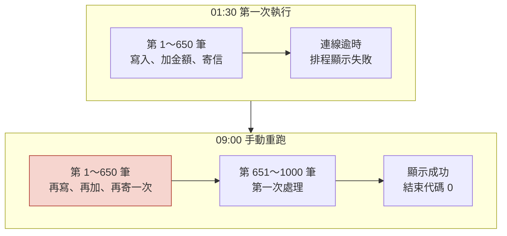
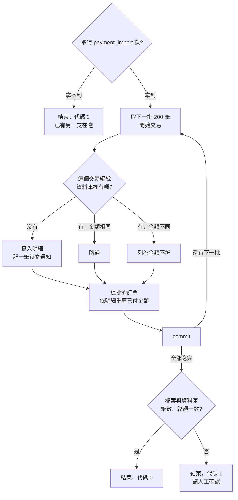

週五早上九點，會計對不上帳：金流商 11/26 撥款明細的總額是 260 萬出頭，系統裡同一天的入帳卻有 429 萬。客服那邊也接到電話：「我的訂單為什麼寄了兩次『已收到款項』？」

往回查，事情是這樣的：每天凌晨 1:30 有一支匯入批次，把金流商的撥款明細寫進資料庫、更新訂單的已付金額，再寄通知信給客人。那天凌晨它跑到一半，資料庫連線逾時，排程顯示失敗。早上值班的同事看到紅字，照著以前的習慣在主機上手動執行了一次。這次跑完了，顯示成功。

問題就出在這次「成功」。

以下的公司、資料表、檔案、金額與時間都是虛構的示範情境；文中的程式與 SQL 是在 PHP 8.3、MariaDB 10.11 上用示範資料實際執行的，輸出與文中相同。

## 原本的批次：它假設自己一定會從頭跑到尾

先看這支批次本身。它不長，也沒有明顯的錯誤，正常的日子每天都跑得很好：

```php
<?php
// 原本的匯入批次：每天 01:30 由 cron 執行
// 用法：php import_old.php <撥款明細.csv>
require __DIR__ . '/mailer.php';

$pdo = new PDO('mysql:host=localhost;dbname=shop;charset=utf8mb4', 'batch', 'demo',
    [PDO::ATTR_ERRMODE => PDO::ERRMODE_EXCEPTION]);
$crashAt = (int) getenv('CRASH_AT');   // 示範用：處理到第 N 筆時模擬連線中斷

$file = fopen($argv[1], 'r');
fgetcsv($file);                        // 跳過標題列
$count = 0;
try {
    while (($r = fgetcsv($file)) !== false) {
        [$txn, $orderNo, $amount, $date] = $r;

        $pdo->prepare('INSERT INTO payments (txn_id, order_no, amount, settle_date) VALUES (?, ?, ?, ?)')
            ->execute([$txn, $orderNo, $amount, $date]);
        $pdo->prepare('UPDATE orders SET paid_amount = paid_amount + ? WHERE order_no = ?')
            ->execute([$amount, $orderNo]);
        $q = $pdo->prepare('SELECT email FROM orders WHERE order_no = ?');
        $q->execute([$orderNo]);
        $email = $q->fetchColumn();
        send_mail($pdo, $email, "訂單 $orderNo 已收到款項");

        $count++;
        if ($count === $crashAt) throw new RuntimeException('（模擬）資料庫連線逾時');
    }
} catch (Throwable $e) {
    echo "匯入中斷：{$e->getMessage()}，已處理 $count 筆\n";
    exit(1);
}
echo "匯入完成，共 $count 筆\n";
```

示範用的 `send_mail()` 只是把信寫進一張 `mail_log` 表，代表「這封信已經寄到客人信箱」。`CRASH_AT` 是為了重現事故加的，原本的程式沒有。

每一筆做三件事：寫一筆入帳明細、把訂單的已付金額**加上**這筆金額、寄一封信。這三件事各自都沒問題，但整支程式藏著三個假設：

1. **它一定會從第一筆跑到最後一筆。** 沒有交易（transaction），每一筆一寫進去就生效，中斷時已經寫進去的不會退回。
2. **每一筆只會被處理一次。** `payments` 表沒有擋同一個交易編號寫兩次，已付金額用「加上去」的方式更新。
3. **寄出去的信是最後一步，不會出事。** 但信一旦寄出，就收不回來。

只要有一次中斷再重跑，這三個假設同時破功。用 1,000 筆示範資料重演一次：

```text
$ CRASH_AT=650 php import_old.php settle_20261126.csv
匯入中斷：（模擬）資料庫連線逾時，已處理 650 筆
結束代碼：1

$ php import_old.php settle_20261126.csv
匯入完成，共 1000 筆
結束代碼：0
```

第二次顯示「匯入完成」，結束代碼也是 0，排程監控看起來一切正常。



## 先查清楚：重複了多少、從哪裡到哪裡

發現對不上帳時，第一件事不是動手刪資料，而是先把損害範圍量出來。三個數字就夠：明細有沒有重複、訂單金額有沒有被加錯、通知有沒有重寄。

```sql
SELECT COUNT(*) AS 明細筆數, COUNT(DISTINCT txn_id) AS 交易數, SUM(amount) AS 入帳金額
  FROM payments WHERE settle_date = '2026-11-26';
SELECT COUNT(*) AS 溢收訂單 FROM orders WHERE paid_amount > total;
SELECT COUNT(*) AS 收到兩封以上的客人 FROM (
  SELECT email FROM mail_log GROUP BY email HAVING COUNT(*) > 1) t;
```

再看重複的是哪一段：

```sql
SELECT MIN(txn_id) AS 第一筆, MAX(txn_id) AS 最後一筆, COUNT(*) AS 重複的交易數
  FROM (SELECT txn_id FROM payments GROUP BY txn_id HAVING COUNT(*) > 1) d;
```

```figure caption="實際執行結果：明細多了 650 筆，重複的剛好是第一次中斷前的那一段" width="720"
<div style="font-family:var(--mono);font-size:14px;line-height:1.85;background:#1B2B3A;color:#C9D6DB;border-radius:8px;padding:18px 22px;text-align:left">
<div style="color:#8FA3AD;white-space:pre">-- 金流商檔案：1,000 筆，2,606,400 元</div>
<div style="height:8px"></div>
<div style="white-space:pre;color:#8FA3AD"><span style="display:inline-block;width:110px;text-align:right">明細筆數</span><span style="display:inline-block;width:110px;text-align:right">交易數</span><span style="display:inline-block;width:130px;text-align:right">入帳金額</span></div>
<div style="white-space:pre;background:rgba(176,58,46,.35);border-left:3px solid #E06A5C;margin:0 -12px;padding:0 9px;color:#fff"><span style="display:inline-block;width:110px;text-align:right">1650</span><span style="display:inline-block;width:110px;text-align:right">1000</span><span style="display:inline-block;width:130px;text-align:right">4295500</span></div>
<div style="height:12px"></div>
<div style="white-space:pre;color:#8FA3AD"><span style="display:inline-block;width:110px;text-align:right">溢收訂單</span></div>
<div style="white-space:pre;background:rgba(176,58,46,.35);border-left:3px solid #E06A5C;margin:0 -12px;padding:0 9px;color:#fff"><span style="display:inline-block;width:110px;text-align:right">650</span></div>
<div style="height:12px"></div>
<div style="white-space:pre;color:#8FA3AD"><span style="display:inline-block;width:190px;text-align:right">收到兩封以上的客人</span></div>
<div style="white-space:pre;background:rgba(176,58,46,.35);border-left:3px solid #E06A5C;margin:0 -12px;padding:0 9px;color:#fff"><span style="display:inline-block;width:190px;text-align:right">650</span></div>
<div style="height:12px"></div>
<div style="white-space:pre;color:#8FA3AD"><span style="display:inline-block;width:170px;text-align:right">第一筆</span><span style="display:inline-block;width:190px;text-align:right">最後一筆</span><span style="display:inline-block;width:150px;text-align:right">重複的交易數</span></div>
<div style="white-space:pre;background:rgba(201,134,31,.25);border-left:3px solid #C9861F;margin:0 -12px;padding:0 9px;color:#fff"><span style="display:inline-block;width:170px;text-align:right">T20261126000001</span><span style="display:inline-block;width:190px;text-align:right">T20261126000650</span><span style="display:inline-block;width:150px;text-align:right">650</span></div>
</div>
```

（上圖是把 `mariadb -t` 的表格輸出去掉框線後重排的，數字與實際輸出相同。）

交易數是 1,000，和金流商檔案的筆數一致，所以檔案本身沒有重複；明細卻有 1,650 筆。重複的範圍是 000001 到 000650，和第一次執行留下的「已處理 650 筆」對得上。原因很清楚：重跑從第一筆重新開始，把已經做過的部分又做了一次。

金額多出 1,689,100 元，約是正確金額的 65%。這就是開頭會計看到的落差。

## 清理：先刪重複，再重算，最後加鎖

清理分三步，前兩步放在同一個交易裡：

```sql
START TRANSACTION;
-- 1. 同一個交易編號只留最早寫入的那一筆
DELETE p FROM payments p
  JOIN payments k ON k.txn_id = p.txn_id AND k.id < p.id;
-- 2. 已付金額依明細重算，不要用減的
UPDATE orders o
   SET paid_amount = (SELECT COALESCE(SUM(amount), 0) FROM payments p WHERE p.order_no = o.order_no);
COMMIT;
-- 3. 加上唯一鍵，之後同一個交易編號寫第二次會直接被資料庫拒絕
ALTER TABLE payments ADD UNIQUE KEY uk_payments_txn (txn_id);
```

實際執行時，第 1 步刪了 650 列，第 2 步更新了 650 張訂單，第 3 步成功建立唯一鍵。之後再查一次：明細 1,000 筆、2,606,400 元，溢收訂單 0 張。

幾個要注意的地方：

- **第 2 步用「重算」，不用「減回去」。** 減回去要算對每張訂單被多加了幾次，算錯一張就又是一筆錯帳；從明細重新加總，結果只取決於明細本身。前提是 `paid_amount` 只由這支批次維護；如果有人工調整或退款也會改它，重算前要先把那些來源一起算進去。
- **刪之前先備份這兩張表**，或至少把要刪的列匯出一份留存。
- **唯一鍵一定要加。** 這是整件事裡最重要的一步：程式可以寫錯、可以被別人改，但資料庫的唯一鍵會一直擋在那裡。
- **寄出去的信收不回來。** `mail_log` 的 650 位客人還是收到了兩封，這部分只能請客服準備說明。這也是為什麼下面修改批次時，寄信要另外處理。

## 改成可以安全重跑的批次

目標是：**不管跑到哪裡中斷、重跑幾次，結果都和只跑一次一樣。**（這個性質叫做冪等，idempotent。）做法有五個：

1. **同一時間只能有一支在跑。** 用 MariaDB／MySQL 的 `GET_LOCK()` 取一個具名鎖，拿不到就直接結束。這可以擋住「第一次其實沒死、只是卡住，第二次又啟動」的情況。連線斷掉時資料庫會自動釋放這個鎖，不會因為程式當掉而永遠鎖住。
2. **每 200 筆一個交易。** 中斷時，最後那一批整批退回，前面已經 commit 的批次保留。不會出現「一筆明細寫進去了，但訂單金額沒更新」的半套狀態。
3. **用交易編號判斷做過沒有。** 已經有的就略過；交易編號相同但金額不同，不要默默略過，列出來給人看。
4. **已付金額用重算，不用累加。** 和清理時同一個道理：重算跑幾次都是同一個答案。
5. **不在批次裡寄信，只記下「要寄」。** 通知寫進 `payment_notices` 表，以交易編號為主鍵，所以同一筆交易只會有一列。另一支程式負責把還沒寄的寄出去。

跑完之後再加一步：**拿檔案的筆數與總額，和資料庫裡這個撥款日的筆數與總額比對。** 原本的批次只會說「我處理了 1000 筆」，但處理了幾筆和資料庫裡最後有幾筆，是兩件不同的事。



資料表的部分，`payments` 加上唯一鍵，另外新增待寄通知的表：

```sql
CREATE TABLE payments (
  id          INT AUTO_INCREMENT PRIMARY KEY,
  txn_id      VARCHAR(30) NOT NULL,
  order_no    VARCHAR(20) NOT NULL,
  amount      INT NOT NULL,
  settle_date DATE NOT NULL,
  imported_at DATETIME NOT NULL DEFAULT CURRENT_TIMESTAMP,
  UNIQUE KEY uk_payments_txn (txn_id)
);
-- 待寄的通知：同一筆交易只會有一列，寄出後填 sent_at
CREATE TABLE payment_notices (
  txn_id     VARCHAR(30) PRIMARY KEY,
  order_no   VARCHAR(20) NOT NULL,
  email      VARCHAR(100) NOT NULL,
  created_at DATETIME NOT NULL DEFAULT CURRENT_TIMESTAMP,
  sent_at    DATETIME NULL
);
```

匯入批次：

```php
<?php
// 可以安全重跑的匯入批次
// 用法：php import.php <撥款明細.csv>
// 結束代碼：0 完成且對帳一致；1 中斷或對帳不一致；2 已有另一個匯入在執行
const BATCH_SIZE = 200;

$pdo = new PDO('mysql:host=localhost;dbname=shop;charset=utf8mb4', 'batch', 'demo',
    [PDO::ATTR_ERRMODE => PDO::ERRMODE_EXCEPTION]);
$crashAt = (int) getenv('CRASH_AT');     // 示範用：處理到第 N 筆時模擬連線中斷
$slowMs  = (int) getenv('SLOW_MS');      // 示範用：每批之後暫停，模擬跑很久

// 1. 同一時間只能有一個匯入在跑（連線斷掉時，資料庫會自動釋放這個鎖）
if ((int) $pdo->query("SELECT GET_LOCK('payment_import', 0)")->fetchColumn() !== 1) {
    echo "已有另一個匯入正在執行，這次不執行\n";
    exit(2);
}

$rows = array_map('str_getcsv', array_slice(file($argv[1], FILE_IGNORE_NEW_LINES), 1));
$find   = $pdo->prepare('SELECT amount FROM payments WHERE txn_id = ?');
$insert = $pdo->prepare('INSERT INTO payments (txn_id, order_no, amount, settle_date) VALUES (?, ?, ?, ?)');
$notice = $pdo->prepare('INSERT INTO payment_notices (txn_id, order_no, email)
                         SELECT ?, order_no, email FROM orders WHERE order_no = ?');
$added = $skipped = 0;
$conflicts = [];

try {
    foreach (array_chunk($rows, BATCH_SIZE) as $chunk) {
        // 2. 每 200 筆一個交易：要嘛整批寫進去，要嘛整批沒寫
        $pdo->beginTransaction();
        foreach ($chunk as [$txn, $orderNo, $amount, $date]) {
            $find->execute([$txn]);
            $existing = $find->fetchColumn();
            if ($existing === false) {
                $insert->execute([$txn, $orderNo, $amount, $date]);
                $notice->execute([$txn, $orderNo]);   // 3. 只記下「要寄」，不在這裡寄
                $added++;
            } elseif ((int) $existing === (int) $amount) {
                $skipped++;                           // 之前已經匯入過，略過
            } else {
                $conflicts[] = "{$txn} 檔案金額 {$amount}，資料庫已有 {$existing}";
            }
            if ($crashAt && $added + $skipped === $crashAt) throw new RuntimeException('（模擬）資料庫連線逾時');
        }
        // 4. 已付金額依明細重算，不用「加上去」
        $orders = array_unique(array_column($chunk, 1));
        $in = implode(',', array_fill(0, count($orders), '?'));
        $pdo->prepare("UPDATE orders o SET paid_amount =
                         (SELECT COALESCE(SUM(amount), 0) FROM payments p WHERE p.order_no = o.order_no)
                       WHERE o.order_no IN ($in)")->execute($orders);
        $pdo->commit();
        usleep($slowMs * 1000);
    }
} catch (Throwable $e) {
    if ($pdo->inTransaction()) $pdo->rollBack();
    echo "匯入中斷：{$e->getMessage()}。已寫入的批次保留，可以直接重跑\n";
    exit(1);
}

// 5. 跑完對帳：檔案的筆數與總額，要和資料庫裡這個撥款日的一致
$date = $rows[0][3];
$fileSum = array_sum(array_column($rows, 2));
$q = $pdo->prepare('SELECT COUNT(*), COALESCE(SUM(amount), 0) FROM payments WHERE settle_date = ?');
$q->execute([$date]);
[$dbCount, $dbSum] = $q->fetch(PDO::FETCH_NUM);

echo "新增 $added 筆，略過已匯入 $skipped 筆，金額不符 " . count($conflicts) . " 筆\n";
foreach ($conflicts as $c) echo "  金額不符：$c\n";
echo "對帳 {$date}：檔案 " . count($rows) . " 筆 $fileSum 元，資料庫 $dbCount 筆 $dbSum 元\n";
$ok = !$conflicts && (int) $dbCount === count($rows) && (int) $dbSum === $fileSum;
echo $ok ? "對帳一致\n" : "對帳不一致，請人工確認\n";
exit($ok ? 0 : 1);
```

寄信程式：

```php
<?php
// 寄送待寄的入帳通知：每 5 分鐘由 cron 執行
require __DIR__ . '/mailer.php';

$pdo = new PDO('mysql:host=localhost;dbname=shop;charset=utf8mb4', 'batch', 'demo',
    [PDO::ATTR_ERRMODE => PDO::ERRMODE_EXCEPTION]);
if ((int) $pdo->query("SELECT GET_LOCK('payment_notices', 0)")->fetchColumn() !== 1) exit(2);

$pending = $pdo->query('SELECT txn_id, order_no, email FROM payment_notices
                        WHERE sent_at IS NULL ORDER BY created_at, txn_id LIMIT 500')->fetchAll();
$done = $pdo->prepare('UPDATE payment_notices SET sent_at = NOW() WHERE txn_id = ?');
foreach ($pending as $n) {
    send_mail($pdo, $n['email'], "訂單 {$n['order_no']} 已收到款項");
    $done->execute([$n['txn_id']]);   // 寄完立刻標記；若剛好在這兩行之間當掉，這一封會重寄
}
echo '寄出 ' . count($pending) . " 封\n";
```

寄信程式的註解寫得很直白：如果剛好在「寄出」和「標記已寄」之間當掉，那一封會在下次重寄。這個缺口沒辦法完全消除，因為寄信和資料庫是兩個系統，沒有辦法放在同一個交易裡。但影響從「中斷前的每一位客人都收到兩封」縮小到「最多一位客人收到兩封」。

## 用同一份檔案重演一次

在乾淨的示範資料庫上，用同一份 1,000 筆的檔案，一樣在第 650 筆模擬中斷：

```figure caption="實際執行結果：中斷後直接重跑，只補上缺的 400 筆；再跑一次什麼都不會改變" width="720"
<div style="font-family:var(--mono);font-size:14px;line-height:1.85;background:#1B2B3A;color:#C9D6DB;border-radius:8px;padding:18px 22px;text-align:left">
<div style="color:#8FA3AD;white-space:pre">$ CRASH_AT=650 php import.php settle_20261126.csv</div>
<div style="white-space:pre;background:rgba(201,134,31,.25);border-left:3px solid #C9861F;margin:0 -12px;padding:0 9px;color:#fff">匯入中斷：（模擬）資料庫連線逾時。已寫入的批次保留，可以直接重跑</div>
<div style="white-space:pre">結束代碼：1</div>
<div style="white-space:pre"> </div>
<div style="color:#8FA3AD;white-space:pre">$ php import.php settle_20261126.csv</div>
<div style="white-space:pre">新增 400 筆，略過已匯入 600 筆，金額不符 0 筆</div>
<div style="white-space:pre">對帳 2026-11-26：檔案 1000 筆 2606400 元，資料庫 1000 筆 2606400 元</div>
<div style="white-space:pre;background:rgba(47,127,120,.35);border-left:3px solid #4FB3A9;margin:0 -12px;padding:0 9px;color:#fff">對帳一致</div>
<div style="white-space:pre">結束代碼：0</div>
<div style="white-space:pre"> </div>
<div style="color:#8FA3AD;white-space:pre">$ php import.php settle_20261126.csv   # 再跑一次</div>
<div style="white-space:pre">新增 0 筆，略過已匯入 1000 筆，金額不符 0 筆</div>
<div style="white-space:pre">對帳 2026-11-26：檔案 1000 筆 2606400 元，資料庫 1000 筆 2606400 元</div>
<div style="white-space:pre;background:rgba(47,127,120,.35);border-left:3px solid #4FB3A9;margin:0 -12px;padding:0 9px;color:#fff">對帳一致</div>
<div style="white-space:pre">結束代碼：0</div>
</div>
```

中斷在第 650 筆，但重跑時「略過已匯入」是 600 筆，不是 650 筆。因為第 601～650 筆屬於第 4 批，那一批還沒 commit 就中斷了，整批退回。中斷後立刻查，資料庫裡的明細和待寄通知都是 600 筆，沒有半套的資料。

接著執行寄信程式三次（每次最多寄 500 封）：

```text
$ php send_notices.php
寄出 500 封
$ php send_notices.php
寄出 500 封
$ php send_notices.php
寄出 0 封
```

最後用前面那三段查詢檢查：明細 1,000 筆、2,606,400 元，溢收訂單 0 張，收到兩封以上的客人 0 位。

另外兩種情況也實際跑過。第一種是同時啟動兩支（第一支用 `SLOW_MS=1000` 讓它跑慢一點）：

```text
$ SLOW_MS=1000 php import.php settle_20261126.csv &   # 第一個，跑比較久
$ php import.php settle_20261126.csv                    # 同時又啟動一個
已有另一個匯入正在執行，這次不執行
結束代碼：2
（第一個的輸出）
新增 1000 筆，略過已匯入 0 筆，金額不符 0 筆
對帳 2026-11-26：檔案 1000 筆 2606400 元，資料庫 1000 筆 2606400 元
對帳一致
```

第二種是金流商事後重新提供檔案，其中一筆的金額不一樣（示範時把第 3 筆從 1400 改成 999）：

```text
$ php import.php settle_20261126_v2.csv   # 金流商重新提供的檔案
新增 0 筆，略過已匯入 999 筆，金額不符 1 筆
  金額不符：T20261126000003 檔案金額 999，資料庫已有 1400
對帳 2026-11-26：檔案 1000 筆 2605999 元，資料庫 1000 筆 2606400 元
對帳不一致，請人工確認
結束代碼：1
```

這種情況程式不會自己決定哪個金額才對，而是停下來、用結束代碼 1 讓排程監控亮紅燈。金額的更正應該走另一個有人確認的流程，不是讓批次默默覆蓋。

## 套用到你的批次之前

- **先找出「業務上的唯一值」。** 這個例子用的是金流商的交易編號。如果來源檔案沒有這種編號，就要和資料提供方確認有沒有可以唯一識別一筆資料的欄位組合；找不到的話，至少要用檔名或檔案雜湊值記錄「這份檔案匯入過了」。
- **加唯一鍵之前，先查現有資料有沒有重複。** 有重複的話 `ALTER TABLE` 會失敗，要先照前面的方法清理。
- **每批大小要依實際情況調。** 200 筆是示範用的數字。一批太大，交易會鎖住比較多資料列、退回時也比較久；太小則 commit 次數多、比較慢。
- **這支程式把整個檔案讀進記憶體。** 檔案很大時要改成逐行讀、累積到一批再處理。
- **Laravel 的排程有 `withoutOverlapping()`**，可以避免同一個排程任務重疊執行；但它擋不住有人在主機上手動執行 artisan 指令，資料庫的唯一鍵還是要加。（這一點本文沒有實際測試。）
- **MySQL 8 也有 `GET_LOCK()`**，用法相同，但本文只在 MariaDB 10.11 上實測過。

> 本文的兩支匯入批次、寄信程式（PHP 8.3.6）、建表、查詢與清理的 SQL（MariaDB 10.11.14），都在 Ubuntu 24.04 沙盒上用自行產生的 1,000 筆示範資料實際執行過，文中的輸出與實際輸出相同；「重複的範圍」那張圖是把表格輸出重排過的，數字未更動。cron 排程、實際寄信、MySQL 8 與 Laravel 的部分沒有實際執行。本系列文章原本優先使用 C#，這次的沙盒環境無法下載 .NET 的 MySQL 連線套件，所以改用 PHP 寫，觀念在 C# 一樣適用。

## 學到什麼

- 批次失敗後最危險的動作，常常是「直接再跑一次」。重跑前要先知道：上一次做到哪裡、已經做了的事會不會再做一次。
- 「顯示成功」只代表程式沒有報錯。跑完要拿來源的筆數與總額對帳，才知道結果對不對。
- 讓批次可以安全重跑，靠的不是更小心，而是結構：唯一鍵擋重複、交易擋半套、重算取代累加、副作用另外處理、同一時間只跑一支。
- 寄出去的信、打出去的 API、發出去的簡訊收不回來。這類動作要從批次裡拆出來，並且記錄「做過了沒有」。

如果你的系統也有一支「出事時沒人敢重跑」的批次，問達工作室可以幫你查清楚它中斷時會留下什麼，再把它改成可以放心重跑的樣子。
